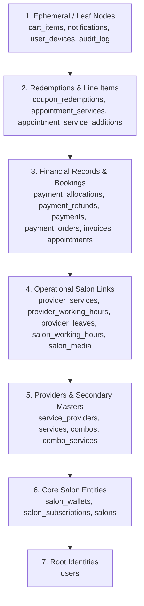

# BookALook — Complete PostgreSQL Database Schema Inventory

> **STRICT READ-ONLY AUDIT & ARCHITECTURAL INVENTORY**  
> **Audit Date:** 2026-10-20  
> **Scope:** Full PostgreSQL database structure analysis for production safety assessment.  
> **Rule Enforcement:** Zero schema mutations, zero data modifications, zero credentials exposed.  

---

## Table of Contents

- [A. Database Overview](#a-database-overview)
- [B. Complete Table Index (75 Tables)](#b-complete-table-index)
- [C. Detailed Schema for Every Table](#c-detailed-schema-for-every-table)
  - [1. `app_releases`](#table-1-app-releases)
  - [2. `app_update_policies`](#table-2-app-update-policies)
  - [3. `app_versions`](#table-3-app-versions)
  - [4. `appointment_service_additions`](#table-4-appointment-service-additions)
  - [5. `appointment_services`](#table-5-appointment-services)
  - [6. `appointments`](#table-6-appointments)
  - [7. `audit_log`](#table-7-audit-log)
  - [8. `banners`](#table-8-banners)
  - [9. `cache`](#table-9-cache)
  - [10. `cache_locks`](#table-10-cache-locks)
  - [11. `campaign_recipients`](#table-11-campaign-recipients)
  - [12. `campaign_templates`](#table-12-campaign-templates)
  - [13. `campaigns`](#table-13-campaigns)
  - [14. `cart_items`](#table-14-cart-items)
  - [15. `carts`](#table-15-carts)
  - [16. `cities`](#table-16-cities)
  - [17. `combo_services`](#table-17-combo-services)
  - [18. `combos`](#table-18-combos)
  - [19. `complaints`](#table-19-complaints)
  - [20. `coupon_redemptions`](#table-20-coupon-redemptions)
  - [21. `coupons`](#table-21-coupons)
  - [22. `failed_jobs`](#table-22-failed-jobs)
  - [23. `favourite_salons`](#table-23-favourite-salons)
  - [24. `first_time_offer_redemptions`](#table-24-first-time-offer-redemptions)
  - [25. `first_time_offer_salons`](#table-25-first-time-offer-salons)
  - [26. `first_time_offer_services`](#table-26-first-time-offer-services)
  - [27. `first_time_offers`](#table-27-first-time-offers)
  - [28. `invoice_settings`](#table-28-invoice-settings)
  - [29. `invoices`](#table-29-invoices)
  - [30. `job_batches`](#table-30-job-batches)
  - [31. `jobs`](#table-31-jobs)
  - [32. `marketing_consents`](#table-32-marketing-consents)
  - [33. `migrations`](#table-33-migrations)
  - [34. `notification_deliveries`](#table-34-notification-deliveries)
  - [35. `notification_preferences`](#table-35-notification-preferences)
  - [36. `notification_templates`](#table-36-notification-templates)
  - [37. `notifications`](#table-37-notifications)
  - [38. `password_reset_tokens`](#table-38-password-reset-tokens)
  - [39. `payment_allocations`](#table-39-payment-allocations)
  - [40. `payment_orders`](#table-40-payment-orders)
  - [41. `payment_refunds`](#table-41-payment-refunds)
  - [42. `payments`](#table-42-payments)
  - [43. `personal_access_tokens`](#table-43-personal-access-tokens)
  - [44. `platform_policy_settings`](#table-44-platform-policy-settings)
  - [45. `provider_leaves`](#table-45-provider-leaves)
  - [46. `provider_services`](#table-46-provider-services)
  - [47. `provider_working_hours`](#table-47-provider-working-hours)
  - [48. `reviews`](#table-48-reviews)
  - [49. `salary_payouts`](#table-49-salary-payouts)
  - [50. `salon_closures`](#table-50-salon-closures)
  - [51. `salon_commission_rates`](#table-51-salon-commission-rates)
  - [52. `salon_enquiries`](#table-52-salon-enquiries)
  - [53. `salon_media`](#table-53-salon-media)
  - [54. `salon_payout_items`](#table-54-salon-payout-items)
  - [55. `salon_payouts`](#table-55-salon-payouts)
  - [56. `salon_subscriptions`](#table-56-salon-subscriptions)
  - [57. `salon_wallets`](#table-57-salon-wallets)
  - [58. `salon_working_hours`](#table-58-salon-working-hours)
  - [59. `salons`](#table-59-salons)
  - [60. `service_categories`](#table-60-service-categories)
  - [61. `service_providers`](#table-61-service-providers)
  - [62. `service_templates`](#table-62-service-templates)
  - [63. `services`](#table-63-services)
  - [64. `sessions`](#table-64-sessions)
  - [65. `settlement_invoices`](#table-65-settlement-invoices)
  - [66. `sub_areas`](#table-66-sub-areas)
  - [67. `subscription_payment_requests`](#table-67-subscription-payment-requests)
  - [68. `subscription_plans`](#table-68-subscription-plans)
  - [69. `user_devices`](#table-69-user-devices)
  - [70. `users`](#table-70-users)
  - [71. `wallet_scheme_tiers`](#table-71-wallet-scheme-tiers)
  - [72. `wallet_schemes`](#table-72-wallet-schemes)
  - [73. `wallet_transactions`](#table-73-wallet-transactions)
  - [74. `whatsapp_automations`](#table-74-whatsapp-automations)
  - [75. `whatsapp_messages`](#table-75-whatsapp-messages)
- [D. Relationship and Foreign-Key Map (147 Foreign Keys)](#d-relationship-and-foreign-key-map)
  - [1. Foreign-Key Constraint Directory](#1-foreign-key-constraint-directory)
  - [2. Cardinality Analysis (1:1, 1:N, M:N)](#2-cardinality-analysis)
  - [3. Database-Enforced vs. Application-Level Relationships](#3-database-enforced-vs-application-level-relationships)
- [E. Junction and Pivot Tables Analysis](#e-junction-and-pivot-tables-analysis)
- [F. Business-Critical and Deletion-Sensitive Tables Classification](#f-business-critical-and-deletion-sensitive-tables-classification)
- [G. Seeders, Factories, and Dummy-Data Sources Audit](#g-seeders-factories-and-dummy-data-sources-audit)
- [H. Dependency and Deletion-Risk Matrix](#h-dependency-and-deletion-risk-matrix)
  - [1. Risk Matrix](#1-risk-matrix)
  - [2. Safe Deletion Execution Order (Topological Dependency Sequence)](#2-safe-deletion-execution-order)
- [I. Pre-Cleanup Recommendations & Safe Execution Checklist](#i-pre-cleanup-recommendations--safe-execution-checklist)
- [J. Unverified Items and Architectural Limitations](#j-unverified-items-and-architectural-limitations)
- [K. Glossary of Database Terminology](#k-glossary-of-database-terminology)

---

## A. Database Overview

This document provides a comprehensive, production-grade schema inventory of the BookALook application database. It was compiled through a rigorous read-only audit of the Laravel backend application repository, database migrations (102 migration files), Eloquent models (57 active models), and localized schema inspection.

| Parameter | Value / Finding |
|---|---|
| **Target Database Engine** | PostgreSQL (PostgreSQL 14+ compatible) |
| **Configured Database Driver** | `pgsql` (production VPS) / `sqlite` (local development fallback) |
| **Inspection Timestamp** | 2026-10-20 11:35:00 IST |
| **Target Database Schema** | `public` |
| **Total Tables Discovered** | **75 tables** |
| **Total Columns Discovered** | **914 columns** |
| **Total Foreign-Key Relationships** | **147 foreign key constraints** |
| **Tables with Soft Deletes** | 5 tables (`users`, `salons`, `services`, `service_providers`, `first_time_offers`) |
| **Primary Key Architecture** | Predominantly UUID (`uuid`), select system tables use BigSerial (`bigint`), 4 composite PK pivots |
| **Source of Truth Distinction** | **Verified from Migrations & Local Replicated Schema:** Table structures, column names, nullability, defaults, indexes, and foreign-key dependencies.<br>**Inferred from Laravel Schema Grammars:** Exact PostgreSQL column data types (`uuid`, `bigint`, `numeric`, `timestamp(0) without time zone`, `boolean`, `jsonb`).<br>**Not Verified:** Live row counts and data volumes on the remote production VPS. |
| **Security & Non-Mutation Guarantee** | **ZERO writes, zero schema alterations, zero credential disclosures.** No passwords, tokens, API keys, customer names, or phone numbers are included. |

## B. Complete Table Index

The following table indexes all **75 tables** present in the BookALook database, outlining their architectural purpose, primary key, dependencies, soft-delete capability, and operational risk category.

| # | Table Name | Purpose | Primary Key | Foreign-Key Dependencies | Soft Deletes? | Risk Category |
|---|---|---|---|---|---|---|
| 1 | [`app_releases`](#table-1-app-releases) | Stores published mobile app releases, version numbers, platforms (android/ios), build numbers, release notes, and mandatory update flags. | `id` | users | No | **Medium** |
| 2 | [`app_update_policies`](#table-2-app-update-policies) | Defines update enforcement rules per platform (grace periods, forced update deadlines, blocking behavior). | `id` | app_releases, users | No | **Medium** |
| 3 | [`app_versions`](#table-3-app-versions) | Legacy mobile app version registry tracking client build versions and deprecation status. | `id` | None | No | **Medium** |
| 4 | [`appointment_service_additions`](#table-4-appointment-service-additions) | Records add-on services or mid-service upsells added to an ongoing appointment by staff with pricing and approval. | `id` | appointments, service_providers, services (+1 more) | No | **Unknown** |
| 5 | [`appointment_services`](#table-5-appointment-services) | Line-item breakdown of individual catalog services booked in an appointment, with price, duration, provider, and fulfillment status. | `id` | appointments, combos, service_providers (+1 more) | No | **Critical** |
| 6 | [`appointments`](#table-6-appointments) | Core booking entity representing a scheduled salon visit, tracking status, customer, salon, timings, financials, payment holds, and cancellation. | `id` | appointments, first_time_offers, salon_closures (+3 more) | No | **Critical** |
| 7 | [`audit_log`](#table-7-audit-log) | Comprehensive administrative audit trail logging actor, action, target entity, IP address, before/after JSON state, and metadata. | `id` | users | No | **Critical** |
| 8 | [`banners`](#table-8-banners) | Marketing and promotional banner advertisements displayed on the customer app home screen or web with click-through actions. | `id` | salons, sub_areas | No | **Medium** |
| 9 | [`cache`](#table-9-cache) | Laravel application cache storage for serialized keys, values, and expiration timestamps. | `key` | None | No | **Low** |
| 10 | [`cache_locks`](#table-10-cache-locks) | Atomic locking mechanism for preventing race conditions in distributed or concurrent operations. | `key` | None | No | **Low** |
| 11 | [`campaign_recipients`](#table-11-campaign-recipients) | Tracks target customer recipients of specific WhatsApp marketing campaigns and delivery/read statuses. | `id` | campaigns, users | No | **Medium** |
| 12 | [`campaign_templates`](#table-12-campaign-templates) | Master template definitions for WhatsApp promotional campaigns with sample text and parameter placeholders. | `id` | None | No | **Medium** |
| 13 | [`campaigns`](#table-13-campaigns) | Salon-created WhatsApp promotional broadcasts, tracking audience criteria, schedule, credit cost, and execution stats. | `id` | campaign_templates, salons, users | No | **Medium** |
| 14 | [`cart_items`](#table-14-cart-items) | Items currently selected inside a customer booking cart, linking service or combo, price, and scheduled slot. | `id` | carts, combos, service_providers (+1 more) | No | **Low** |
| 15 | [`carts`](#table-15-carts) | Active shopping carts held by authenticated or guest customers prior to booking checkout. | `id` | salons, users | No | **Low** |
| 16 | [`cities`](#table-16-cities) | Geographic city master directory supporting multi-city salon discovery, location filtering, and state groupings. | `id` | None | No | **High** |
| 17 | [`combo_services`](#table-17-combo-services) | Pivot table linking promotional service packages (combos) to their individual constituent services. | `combo_id, service_id` | combos, services | No | **High** |
| 18 | [`combos`](#table-18-combos) | Packaged bundle of multiple salon services offered together at a discounted combo price. | `id` | salons | No | **High** |
| 19 | [`complaints`](#table-19-complaints) | Customer grievance and dispute filings against salons or appointments, with resolution workflow and administrative notes. | `id` | appointments, salons, users | No | **High** |
| 20 | [`coupon_redemptions`](#table-20-coupon-redemptions) | Audit ledger recording each coupon code usage by a customer against a specific appointment or order. | `id` | appointments, coupons, users | No | **High** |
| 21 | [`coupons`](#table-21-coupons) | Discount vouchers, promo codes, and referral discount definitions with usage limits, expiry, and discount calculations. | `id` | salons, users | No | **High** |
| 22 | [`failed_jobs`](#table-22-failed-jobs) | Queue worker dead-letter storage capturing failed async background jobs with exception stack traces. | `id` | None | No | **Low** |
| 23 | [`favourite_salons`](#table-23-favourite-salons) | Customer bookmark ledger storing salons bookmarked/saved by customers for quick repeat access. | `id` | salons, users | No | **Medium** |
| 24 | [`first_time_offer_redemptions`](#table-24-first-time-offer-redemptions) | Tracks customer redemptions of first-time introductory discount offers to enforce one-time eligibility. | `id` | appointments, first_time_offers, salons (+1 more) | No | **High** |
| 25 | [`first_time_offer_salons`](#table-25-first-time-offer-salons) | Pivot associating first-time introductory discount campaigns to participating salons. | `offer_id, salon_id` | first_time_offers, salons | No | **Medium** |
| 26 | [`first_time_offer_services`](#table-26-first-time-offer-services) | Pivot associating first-time introductory discount campaigns to eligible service templates. | `offer_id, service_template_id` | first_time_offers, service_templates | No | **Medium** |
| 27 | [`first_time_offers`](#table-27-first-time-offers) | Configuration for new-customer acquisition discounts, rules, subsidy funding, and activation windows. | `id` | salons | Yes (`deleted_at`) | **High** |
| 28 | [`invoice_settings`](#table-28-invoice-settings) | Global and salon-level invoicing configuration including GSTIN, tax rates, billing addresses, and invoice numbering sequences. | `setting_key` | users | No | **High** |
| 29 | [`invoices`](#table-29-invoices) | Customer-facing tax invoices generated upon appointment completion, itemizing services, taxes, discounts, and payment methods. | `id` | appointments | No | **Critical** |
| 30 | [`job_batches`](#table-30-job-batches) | Laravel queue batch tracking for groups of queued background tasks (progress, failures, cancellations). | `id` | None | No | **Low** |
| 31 | [`jobs`](#table-31-jobs) | Active asynchronous background task queue storage (push notifications, WhatsApp messages, background processing). | `id` | None | No | **Low** |
| 32 | [`marketing_consents`](#table-32-marketing-consents) | Customer privacy consent records for WhatsApp marketing, SMS, and promotional communication channels. | `id` | users | No | **Medium** |
| 33 | [`migrations`](#table-33-migrations) | Framework migration ledger recording executed database schema migration files and batch numbers. | `id` | None | No | **Unknown** |
| 34 | [`notification_deliveries`](#table-34-notification-deliveries) | Low-level dispatch log tracking push notification delivery attempts to specific device tokens. | `id` | notifications, user_devices | No | **Medium** |
| 35 | [`notification_preferences`](#table-35-notification-preferences) | Per-user channel and category notification preferences (opt-in/opt-out for marketing, transactional, updates). | `id` | users | No | **Medium** |
| 36 | [`notification_templates`](#table-36-notification-templates) | System notification templates for SMS, push, in-app, and email with multilingual text and variables. | `id` | None | No | **Medium** |
| 37 | [`notifications`](#table-37-notifications) | User in-app notifications inbox capturing alerts, booking confirmations, payment reminders, and administrative updates. | `id` | appointments, salons, users | No | **Medium** |
| 38 | [`password_reset_tokens`](#table-38-password-reset-tokens) | Security tokens for password recovery workflows, linking email addresses and expiration times. | `email` | None | No | **Low** |
| 39 | [`payment_allocations`](#table-39-payment-allocations) | Breakdown of an incoming payment across booking components (advance deposit, balance, platform fee, taxes). | `id` | appointments, payments, users | No | **High** |
| 40 | [`payment_orders`](#table-40-payment-orders) | Order initiation records created with payment gateways (e.g. Razorpay, Cashfree) prior to customer payment. | `id` | appointments | No | **Critical** |
| 41 | [`payment_refunds`](#table-41-payment-refunds) | Financial ledger of processed refunds for cancelled appointments or overpayments with gateway refund IDs. | `id` | appointments, payments, users | No | **High** |
| 42 | [`payments`](#table-42-payments) | Master payment transaction ledger capturing completed, pending, or failed customer transactions, gateway references, and fees. | `id` | appointments, payment_orders | No | **Critical** |
| 43 | [`personal_access_tokens`](#table-43-personal-access-tokens) | Laravel Sanctum API authentication tokens for mobile apps and web administrative sessions. | `id` | None | No | **Low** |
| 44 | [`platform_policy_settings`](#table-44-platform-policy-settings) | System-wide policy parameters including cancellation fees, grace periods, convenience charges, and operational thresholds. | `setting_key` | users | No | **Medium** |
| 45 | [`provider_leaves`](#table-45-provider-leaves) | Time-off and vacation calendar entries for salon stylists and service providers affecting appointment availability. | `id` | service_providers, users | No | **Medium** |
| 46 | [`provider_services`](#table-46-provider-services) | Pivot table linking individual service providers/staff members to the specific salon services they are qualified to perform. | `provider_id, service_id` | service_providers, services | No | **High** |
| 47 | [`provider_working_hours`](#table-47-provider-working-hours) | Individual shift schedules and working hours for stylists/providers across days of the week. | `id` | service_providers | No | **High** |
| 48 | [`reviews`](#table-48-reviews) | Verified customer ratings, text reviews, and photo feedback submitted for salons and completed appointments. | `id` | appointments, salons, users | No | **High** |
| 49 | [`salary_payouts`](#table-49-salary-payouts) | Salon internal staff payroll tracking, recording provider salary disbursements, commissions, deductions, and payment status. | `id` | salons, service_providers, users | No | **Critical** |
| 50 | [`salon_closures`](#table-50-salon-closures) | Temporary salon shutdown and holiday periods when all bookings are blocked, with closure reasons and reopening timestamps. | `id` | salons, users | No | **Medium** |
| 51 | [`salon_commission_rates`](#table-51-salon-commission-rates) | Historical audit log of agreed commission percentage rates for commission-model salons with effective date ranges. | `id` | salons, users | No | **High** |
| 52 | [`salon_enquiries`](#table-52-salon-enquiries) | Prospective salon partner onboarding leads and partnership inquiry submissions from web or marketing channels. | `id` | users | No | **Medium** |
| 53 | [`salon_media`](#table-53-salon-media) | Salon gallery photos, storefront pictures, interior images, and promotional videos with display order and approval status. | `id` | salons, users | No | **Medium** |
| 54 | [`salon_payout_items`](#table-54-salon-payout-items) | Individual booking line-item reconciliations attached to a salon settlement payout batch. | `id` | appointments, payments, salon_payouts | No | **Critical** |
| 55 | [`salon_payouts`](#table-55-salon-payouts) | Financial settlement batches disbursing accumulated net booking revenue from the platform to salon bank accounts. | `id` | salons, users | No | **Critical** |
| 56 | [`salon_subscriptions`](#table-56-salon-subscriptions) | Active and historical subscription plan allocations for salons, recording validity dates, fees, and billing status. | `id` | salon_subscriptions, salons, subscription_plans (+1 more) | No | **Critical** |
| 57 | [`salon_wallets`](#table-57-salon-wallets) | Salon virtual coin/credit balance ledger for platform features like WhatsApp campaigns and promotional boosts. | `salon_id` | salons | No | **Critical** |
| 58 | [`salon_working_hours`](#table-58-salon-working-hours) | Salon operating schedule defining open and close times and break slots for each day of the week. | `id` | salons | No | **High** |
| 59 | [`salons`](#table-59-salons) | Core salon business entity storing profile, owner, address, geo-coordinates, verification status, rating, and billing model. | `id` | salon_enquiries, subscription_plans, users | Yes (`deleted_at`) | **Critical** |
| 60 | [`service_categories`](#table-60-service-categories) | High-level catalog taxonomies grouping related services (e.g., Hair, Skin, Spa, Nails, Bridal). | `id` | salons, users | No | **High** |
| 61 | [`service_providers`](#table-61-service-providers) | Salon staff, stylists, barbers, and service personnel profiles with roles, commissions, and active statuses. | `id` | salons, users | Yes (`deleted_at`) | **Critical** |
| 62 | [`service_templates`](#table-62-service-templates) | Platform master service templates used as blueprints by salons to quickly instantiate standardized offerings. | `id` | salons, service_categories, users | No | **Unknown** |
| 63 | [`services`](#table-63-services) | Individual salon service offerings with localized names, pricing, duration, gender targeting, and category links. | `id` | salons, service_templates | Yes (`deleted_at`) | **Critical** |
| 64 | [`sessions`](#table-64-sessions) | HTTP session store capturing web session payloads, user IDs, IP addresses, and activity timestamps. | `id` | None | No | **Low** |
| 65 | [`settlement_invoices`](#table-65-settlement-invoices) | Formal B2B invoices issued to commission-model or subscription salons for platform services and commission deductions. | `id` | salon_payouts, salons | No | **Critical** |
| 66 | [`sub_areas`](#table-66-sub-areas) | Sub-city localized neighborhood districts and zones for high-precision geographic salon discovery and filtering. | `id` | cities | No | **High** |
| 67 | [`subscription_payment_requests`](#table-67-subscription-payment-requests) | Offline/manual UPI and bank transfer payment submissions from salons for subscription plans with transaction IDs and receipts. | `id` | salons, subscription_plans | No | **High** |
| 68 | [`subscription_plans`](#table-68-subscription-plans) | Prepaid recurring and commission-based membership tier definitions (Starter, Growth, Enterprise) with features and limits. | `id` | users | No | **Critical** |
| 69 | [`user_devices`](#table-69-user-devices) | Registered mobile devices and FCM push notification tokens linked to users for targeted push communications. | `id` | users | No | **Medium** |
| 70 | [`users`](#table-70-users) | Master user identity table storing customers, salon owners, managers, staff, and superadmins with auth credentials and roles. | `id` | cities | Yes (`deleted_at`) | **Critical** |
| 71 | [`wallet_scheme_tiers`](#table-71-wallet-scheme-tiers) | Tier milestones in reward schemes defining coin bonuses awarded when target spending thresholds are met. | `id` | wallet_schemes | No | **Medium** |
| 72 | [`wallet_schemes`](#table-72-wallet-schemes) | Promotional reward schemes defining coin reward structures and incentives for salon owners or customers. | `id` | users | No | **Medium** |
| 73 | [`wallet_transactions`](#table-73-wallet-transactions) | Ledger of all debits and credits to salon wallets for purchasing campaigns, welcome coins, or admin adjustments. | `id` | appointments, salon_payouts, salon_subscriptions (+3 more) | No | **Critical** |
| 74 | [`whatsapp_automations`](#table-74-whatsapp-automations) | Configuration for automated transactional WhatsApp message triggers (OTPs, appointment reminders, confirmations). | `id` | None | No | **Medium** |
| 75 | [`whatsapp_messages`](#table-75-whatsapp-messages) | Outbound and inbound WhatsApp message interaction log with vendor delivery status, message text, and timestamps. | `id` | appointments, campaigns, salons (+1 more) | No | **Medium** |

---

## C. Detailed Schema for Every Table

This section provides the complete column-by-column schema definition for all 75 tables, preserving PostgreSQL types, nullability, defaults, primary keys, foreign-key linkages, unique constraints, and business descriptions.

<a id="table-1-app-releases"></a>
### 1. `app_releases`

- **Purpose:** Stores published mobile app releases, version numbers, platforms (android/ios), build numbers, release notes, and mandatory update flags.
- **Associated Eloquent Model:** `App\Models\AppRelease`
- **Soft Deletes:** No (hard deletes)
- **Inbound Dependencies (Referenced By):** `app_update_policies`
- **Outbound Dependencies (Foreign Keys To):** `users`

| Column | PostgreSQL Type | Nullable? | Default | Primary Key? | Foreign Key / References | Unique? | Description |
|---|---|---|---|---|---|---|---|
| `id` | `uuid` | No | NULL | Yes | — | Yes | Unique primary identifier. |
| `app` | `varchar(32)` | No | NULL | No | — | Yes (composite: app+version+build_number) | Domain attribute storing app for app_releases. |
| `version` | `varchar(50)` | No | NULL | No | — | Yes (composite: app+version+build_number) | Domain attribute storing version for app_releases. |
| `build_number` | `integer` | No | NULL | No | — | Yes (composite: app+version+build_number) | Domain attribute storing build_number for app_releases. |
| `released_at` | `timestamp(0) without time zone` | Yes | NULL | No | — | No | Timestamp when released occurred. |
| `release_notes` | `text` | Yes | NULL | No | — | No | Domain attribute storing release_notes for app_releases. |
| `android_store_url` | `varchar(500)` | Yes | NULL | No | — | No | Public URL or cloud storage path for android_store_url. |
| `ios_store_url` | `varchar(500)` | Yes | NULL | No | — | No | Public URL or cloud storage path for ios_store_url. |
| `status` | `varchar(255) [enum: ['draft','published','retired']]` | No | `draft` | No | — | No | Lifecycle or processing state status indicator. |
| `created_by` | `uuid` | Yes | NULL | No | users(id) ON DELETE SET NULL | No | Domain attribute storing created_by for app_releases. |
| `updated_by` | `uuid` | Yes | NULL | No | users(id) ON DELETE SET NULL | No | Domain attribute storing updated_by for app_releases. |
| `created_at` | `timestamp(0) without time zone` | Yes | NULL | No | — | No | Record creation timestamp. |
| `updated_at` | `timestamp(0) without time zone` | Yes | NULL | No | — | No | Record last update timestamp. |

**Indexes and Unique Constraints:**
- `app_releases_app_status_index` on (`app`, `status`)
- **[UNIQUE]** `app_releases_app_version_build_number_unique` on (`app`, `version`, `build_number`)
- **[UNIQUE]** `sqlite_autoindex_app_releases_1` on (`id`)

<a id="table-2-app-update-policies"></a>
### 2. `app_update_policies`

- **Purpose:** Defines update enforcement rules per platform (grace periods, forced update deadlines, blocking behavior).
- **Associated Eloquent Model:** `App\Models\AppUpdatePolicy`
- **Soft Deletes:** No (hard deletes)
- **Inbound Dependencies (Referenced By):** None
- **Outbound Dependencies (Foreign Keys To):** `app_releases`, `users`

| Column | PostgreSQL Type | Nullable? | Default | Primary Key? | Foreign Key / References | Unique? | Description |
|---|---|---|---|---|---|---|---|
| `id` | `uuid` | No | NULL | Yes | — | Yes | Unique primary identifier. |
| `app` | `varchar(32)` | No | NULL | No | — | Yes | Domain attribute storing app for app_update_policies. |
| `latest_release_id` | `uuid` | Yes | NULL | No | app_releases(id) ON DELETE SET NULL | No | Foreign key identifier referencing latest_release. |
| `minimum_release_id` | `uuid` | Yes | NULL | No | app_releases(id) ON DELETE SET NULL | No | Foreign key identifier referencing minimum_release. |
| `update_mode` | `varchar(255) [enum: ['optional','mandatory']]` | No | `optional` | No | — | No | Domain attribute storing update_mode for app_update_policies. |
| `is_enforced` | `boolean` | No | `0` | No | — | No | Boolean flag indicating whether enforced is enabled or true. |
| `enforce_at` | `timestamp(0) without time zone` | Yes | NULL | No | — | No | Timestamp when enforce occurred. |
| `update_message` | `text` | Yes | NULL | No | — | No | Domain attribute storing update_message for app_update_policies. |
| `android_store_url` | `varchar(500)` | Yes | NULL | No | — | No | Public URL or cloud storage path for android_store_url. |
| `ios_store_url` | `varchar(500)` | Yes | NULL | No | — | No | Public URL or cloud storage path for ios_store_url. |
| `updated_by` | `uuid` | Yes | NULL | No | users(id) ON DELETE SET NULL | No | Domain attribute storing updated_by for app_update_policies. |
| `created_at` | `timestamp(0) without time zone` | Yes | NULL | No | — | No | Record creation timestamp. |
| `updated_at` | `timestamp(0) without time zone` | Yes | NULL | No | — | No | Record last update timestamp. |

**Indexes and Unique Constraints:**
- **[UNIQUE]** `app_update_policies_app_unique` on (`app`)
- **[UNIQUE]** `sqlite_autoindex_app_update_policies_1` on (`id`)

<a id="table-3-app-versions"></a>
### 3. `app_versions`

- **Purpose:** Legacy mobile app version registry tracking client build versions and deprecation status.
- **Associated Eloquent Model:** No dedicated Eloquent model (system / pivot table)
- **Soft Deletes:** No (hard deletes)
- **Inbound Dependencies (Referenced By):** None
- **Outbound Dependencies (Foreign Keys To):** None

| Column | PostgreSQL Type | Nullable? | Default | Primary Key? | Foreign Key / References | Unique? | Description |
|---|---|---|---|---|---|---|---|
| `id` | `uuid` | No | NULL | Yes | — | Yes | Unique primary identifier. |
| `app_type` | `varchar(255) [enum: ['customer_app','partner_app']]` | No | NULL | No | — | Yes (composite: app_type+platform) | Domain attribute storing app_type for app_versions. |
| `platform` | `varchar(255) [enum: ['android','ios']]` | No | NULL | No | — | Yes (composite: app_type+platform) | Domain attribute storing platform for app_versions. |
| `latest_version` | `varchar(20)` | No | NULL | No | — | No | Domain attribute storing latest_version for app_versions. |
| `minimum_supported_version` | `varchar(20)` | No | NULL | No | — | No | Domain attribute storing minimum_supported_version for app_versions. |
| `force_update` | `boolean` | No | `0` | No | — | No | Domain attribute storing force_update for app_versions. |
| `release_notes` | `text` | Yes | NULL | No | — | No | Domain attribute storing release_notes for app_versions. |
| `store_url` | `varchar(255)` | Yes | NULL | No | — | No | Public URL or cloud storage path for store_url. |
| `released_at` | `timestamp(0) without time zone` | No | `CURRENT_TIMESTAMP` | No | — | No | Timestamp when released occurred. |

**Indexes and Unique Constraints:**
- **[UNIQUE]** `app_versions_app_type_platform_unique` on (`app_type`, `platform`)
- **[UNIQUE]** `sqlite_autoindex_app_versions_1` on (`id`)

<a id="table-4-appointment-service-additions"></a>
### 4. `appointment_service_additions`

- **Purpose:** Records add-on services or mid-service upsells added to an ongoing appointment by staff with pricing and approval.
- **Associated Eloquent Model:** `App\Models\AppointmentServiceAddition`
- **Soft Deletes:** No (hard deletes)
- **Inbound Dependencies (Referenced By):** None
- **Outbound Dependencies (Foreign Keys To):** `appointments`, `service_providers`, `services`, `users`

| Column | PostgreSQL Type | Nullable? | Default | Primary Key? | Foreign Key / References | Unique? | Description |
|---|---|---|---|---|---|---|---|
| `id` | `uuid` | No | NULL | Yes | — | Yes | Unique primary identifier. |
| `appointment_id` | `uuid` | No | NULL | No | appointments(id) ON DELETE CASCADE | No | Foreign key referencing the booking appointment. |
| `service_id` | `uuid` | No | NULL | No | services(id) ON DELETE RESTRICT | No | Foreign key referencing the catalog service. |
| `provider_id` | `uuid` | No | NULL | No | service_providers(id) ON DELETE RESTRICT | No | Foreign key referencing the service provider / staff member. |
| `added_by` | `uuid` | No | NULL | No | users(id) ON DELETE RESTRICT | No | Domain attribute storing added_by for appointment_service_additions. |
| `price_at_addition` | `numeric(12,2)` | No | NULL | No | — | No | Domain attribute storing price_at_addition for appointment_service_additions. |
| `duration_minutes_at_addition` | `integer` | No | NULL | No | — | No | Domain attribute storing duration_minutes_at_addition for appointment_service_additions. |
| `commission_percentage_snapshot` | `numeric(5,2)` | No | `0` | No | — | No | Domain attribute storing commission_percentage_snapshot for appointment_service_additions. |
| `commission_amount` | `numeric(12,2)` | No | `0` | No | — | No | Monetary value in INR for commission_amount. |
| `status` | `varchar(20)` | No | `active` | No | — | No | Lifecycle or processing state status indicator. |
| `added_at` | `timestamp(0) without time zone` | No | `CURRENT_TIMESTAMP` | No | — | No | Timestamp when added occurred. |
| `created_at` | `timestamp(0) without time zone` | Yes | NULL | No | — | No | Record creation timestamp. |
| `updated_at` | `timestamp(0) without time zone` | Yes | NULL | No | — | No | Record last update timestamp. |

**Indexes and Unique Constraints:**
- **[UNIQUE]** `sqlite_autoindex_appointment_service_additions_1` on (`id`)

<a id="table-5-appointment-services"></a>
### 5. `appointment_services`

- **Purpose:** Line-item breakdown of individual catalog services booked in an appointment, with price, duration, provider, and fulfillment status.
- **Associated Eloquent Model:** `App\Models\AppointmentService`
- **Soft Deletes:** No (hard deletes)
- **Inbound Dependencies (Referenced By):** None
- **Outbound Dependencies (Foreign Keys To):** `appointments`, `combos`, `service_providers`, `services`

| Column | PostgreSQL Type | Nullable? | Default | Primary Key? | Foreign Key / References | Unique? | Description |
|---|---|---|---|---|---|---|---|
| `id` | `uuid` | No | NULL | Yes | — | Yes | Unique primary identifier. |
| `appointment_id` | `uuid` | No | NULL | No | appointments(id) ON DELETE CASCADE | No | Foreign key referencing the booking appointment. |
| `service_id` | `uuid` | No | NULL | No | services(id) ON DELETE RESTRICT | No | Foreign key referencing the catalog service. |
| `combo_id` | `uuid` | Yes | NULL | No | combos(id) ON DELETE RESTRICT | No | Foreign key referencing the package combo. |
| `serving_provider_id` | `uuid` | Yes | NULL | No | service_providers(id) ON DELETE RESTRICT | No | Foreign key identifier referencing serving_provider. |
| `price_at_booking` | `numeric(12,2)` | No | NULL | No | — | No | Domain attribute storing price_at_booking for appointment_services. |
| `original_service_price` | `numeric(12,2)` | No | NULL | No | — | No | Monetary value in INR for original_service_price. |
| `duration_minutes_at_booking` | `integer` | No | NULL | No | — | No | Domain attribute storing duration_minutes_at_booking for appointment_services. |
| `commission_percentage_snapshot` | `numeric(5,2)` | No | `0` | No | — | No | Domain attribute storing commission_percentage_snapshot for appointment_services. |
| `commission_amount` | `numeric(12,2)` | No | `0` | No | — | No | Monetary value in INR for commission_amount. |
| `line_status` | `varchar(20)` | No | `booked` | No | — | No | Domain attribute storing line_status for appointment_services. |
| `created_at` | `timestamp(0) without time zone` | Yes | NULL | No | — | No | Record creation timestamp. |
| `updated_at` | `timestamp(0) without time zone` | Yes | NULL | No | — | No | Record last update timestamp. |
| `first_time_discount_amount` | `numeric(12,2)` | No | `0` | No | — | No | Monetary value in INR for first_time_discount_amount. |

**Indexes and Unique Constraints:**
- **[UNIQUE]** `sqlite_autoindex_appointment_services_1` on (`id`)

<a id="table-6-appointments"></a>
### 6. `appointments`

- **Purpose:** Core booking entity representing a scheduled salon visit, tracking status, customer, salon, timings, financials, payment holds, and cancellation.
- **Associated Eloquent Model:** `App\Models\Appointment`
- **Soft Deletes:** No (hard deletes)
- **Inbound Dependencies (Referenced By):** `appointment_service_additions`, `appointment_services`, `appointments`, `complaints`, `coupon_redemptions`, `first_time_offer_redemptions`, `invoices`, `notifications`, `payment_allocations`, `payment_orders`, `payment_refunds`, `payments`, `reviews`, `salon_payout_items`, `wallet_transactions`, `whatsapp_messages`
- **Outbound Dependencies (Foreign Keys To):** `appointments`, `first_time_offers`, `salon_closures`, `salons`, `service_providers`, `users`

| Column | PostgreSQL Type | Nullable? | Default | Primary Key? | Foreign Key / References | Unique? | Description |
|---|---|---|---|---|---|---|---|
| `id` | `uuid` | No | NULL | Yes | — | Yes | Unique primary identifier. |
| `salon_id` | `uuid` | No | NULL | No | salons(id) ON DELETE CASCADE | No | Foreign key referencing the associated salon. |
| `customer_id` | `uuid` | Yes | NULL | No | users(id) ON DELETE SET NULL | No | Foreign key referencing the customer user account. |
| `appointed_provider_id` | `uuid` | No | NULL | No | service_providers(id) ON DELETE RESTRICT | No | Foreign key identifier referencing appointed_provider. |
| `serving_provider_id` | `uuid` | Yes | NULL | No | service_providers(id) ON DELETE RESTRICT | No | Foreign key identifier referencing serving_provider. |
| `booking_source` | `varchar(20)` | No | `online` | No | — | No | Domain attribute storing booking_source for appointments. |
| `appointment_date` | `date` | No | NULL | No | — | No | Domain attribute storing appointment_date for appointments. |
| `start_time` | `time(0) without time zone` | No | NULL | No | — | No | Domain attribute storing start_time for appointments. |
| `end_time` | `time(0) without time zone` | No | NULL | No | — | No | Domain attribute storing end_time for appointments. |
| `status` | `varchar(30)` | No | `pending_payment` | No | — | No | Lifecycle or processing state status indicator. |
| `payment_option` | `varchar(20)` | No | `advance_only` | No | — | No | Domain attribute storing payment_option for appointments. |
| `total_amount` | `numeric(12,2)` | No | `0` | No | — | No | Monetary value in INR for total_amount. |
| `advance_amount` | `numeric(12,2)` | No | `0` | No | — | No | Monetary value in INR for advance_amount. |
| `balance_amount` | `numeric(12,2)` | No | `0` | No | — | No | Monetary value in INR for balance_amount. |
| `final_billed_amount` | `numeric(12,2)` | Yes | NULL | No | — | No | Monetary value in INR for final_billed_amount. |
| `walk_in_customer_name` | `varchar(150)` | Yes | NULL | No | — | No | Domain attribute storing walk_in_customer_name for appointments. |
| `walk_in_customer_phone` | `varchar(20)` | Yes | NULL | No | — | No | Domain attribute storing walk_in_customer_phone for appointments. |
| `qr_token_hash` | `varchar` | Yes | NULL | No | — | No | Domain attribute storing qr_token_hash for appointments. |
| `qr_generated_at` | `timestamp(0) without time zone` | Yes | NULL | No | — | No | Timestamp when qr_generated occurred. |
| `qr_expires_at` | `timestamp(0) without time zone` | Yes | NULL | No | — | No | Timestamp when qr_expires occurred. |
| `qr_verified_at` | `timestamp(0) without time zone` | Yes | NULL | No | — | No | Timestamp when qr_verified occurred. |
| `qr_verified_by` | `uuid` | Yes | NULL | No | users(id) ON DELETE RESTRICT | No | Domain attribute storing qr_verified_by for appointments. |
| `verification_method` | `varchar(20)` | No | `qr` | No | — | No | Domain attribute storing verification_method for appointments. |
| `cancelled_by` | `varchar(20)` | Yes | NULL | No | — | No | Domain attribute storing cancelled_by for appointments. |
| `cancelled_by_user_id` | `uuid` | Yes | NULL | No | users(id) ON DELETE RESTRICT | No | Foreign key identifier referencing cancelled_by_user. |
| `cancellation_reason` | `varchar(255)` | Yes | NULL | No | — | No | Domain attribute storing cancellation_reason for appointments. |
| `cancelled_at` | `timestamp(0) without time zone` | Yes | NULL | No | — | No | Cancellation timestamp. |
| `rescheduled_from_id` | `uuid` | Yes | NULL | No | appointments(id) ON DELETE RESTRICT | No | Foreign key identifier referencing rescheduled_from. |
| `reschedule_reason` | `varchar(255)` | Yes | NULL | No | — | No | Domain attribute storing reschedule_reason for appointments. |
| `started_at` | `timestamp(0) without time zone` | Yes | NULL | No | — | No | Timestamp when started occurred. |
| `completed_at` | `timestamp(0) without time zone` | Yes | NULL | No | — | No | Fulfillment or completion timestamp. |
| `no_show_at` | `timestamp(0) without time zone` | Yes | NULL | No | — | No | Timestamp when no_show occurred. |
| `created_at` | `timestamp(0) without time zone` | Yes | NULL | No | — | No | Record creation timestamp. |
| `updated_at` | `timestamp(0) without time zone` | Yes | NULL | No | — | No | Record last update timestamp. |
| `walk_in_customer_gender` | `varchar(10)` | Yes | NULL | No | — | No | Domain attribute storing walk_in_customer_gender for appointments. |
| `salon_closure_id` | `uuid` | Yes | NULL | No | salon_closures(id) ON DELETE SET NULL | No | Foreign key identifier referencing salon_closure. |
| `closure_notified_at` | `timestamp(0) without time zone` | Yes | NULL | No | — | No | Timestamp when closure_notified occurred. |
| `payment_collected_at` | `timestamp(0) without time zone` | Yes | NULL | No | — | No | Timestamp when payment_collected occurred. |
| `payment_collected_by` | `uuid` | Yes | NULL | No | users(id) ON DELETE SET NULL | No | Domain attribute storing payment_collected_by for appointments. |
| `payment_mode` | `varchar(20)` | Yes | NULL | No | — | No | Domain attribute storing payment_mode for appointments. |
| `manual_check_in_reason` | `varchar(255)` | Yes | NULL | No | — | No | Domain attribute storing manual_check_in_reason for appointments. |
| `payment_hold_expires_at` | `timestamp(0) without time zone` | Yes | NULL | No | — | No | Timestamp when payment_hold_expires occurred. |
| `first_time_offer_id` | `uuid` | Yes | NULL | No | first_time_offers(id) ON DELETE SET NULL | No | Foreign key identifier referencing first_time_offer. |
| `first_time_discount_amount` | `numeric(12,2)` | No | `0` | No | — | No | Monetary value in INR for first_time_discount_amount. |
| `customer_phone_hash` | `varchar(64)` | Yes | NULL | No | — | No | Domain attribute storing customer_phone_hash for appointments. |

**Indexes and Unique Constraints:**
- `appointments_customer_phone_hash_index` on (`customer_phone_hash`)
- **[UNIQUE]** `sqlite_autoindex_appointments_1` on (`id`)

<a id="table-7-audit-log"></a>
### 7. `audit_log`

- **Purpose:** Comprehensive administrative audit trail logging actor, action, target entity, IP address, before/after JSON state, and metadata.
- **Associated Eloquent Model:** `App\Models\AuditLog`
- **Soft Deletes:** No (hard deletes)
- **Inbound Dependencies (Referenced By):** None
- **Outbound Dependencies (Foreign Keys To):** `users`

| Column | PostgreSQL Type | Nullable? | Default | Primary Key? | Foreign Key / References | Unique? | Description |
|---|---|---|---|---|---|---|---|
| `id` | `uuid` | No | NULL | Yes | — | Yes | Unique primary identifier. |
| `actor_id` | `uuid` | No | NULL | No | users(id) ON DELETE RESTRICT | No | Foreign key identifier referencing actor. |
| `action` | `varchar(150)` | No | NULL | No | — | No | Domain attribute storing action for audit_log. |
| `entity_type` | `varchar(100)` | No | NULL | No | — | No | Domain attribute storing entity_type for audit_log. |
| `entity_id` | `uuid` | Yes | NULL | No | — | No | Foreign key identifier referencing entity. |
| `field_name` | `varchar(100)` | Yes | NULL | No | — | No | Domain attribute storing field_name for audit_log. |
| `old_value` | `jsonb` | Yes | NULL | No | — | No | Domain attribute storing old_value for audit_log. |
| `new_value` | `jsonb` | Yes | NULL | No | — | No | Domain attribute storing new_value for audit_log. |
| `metadata` | `jsonb` | Yes | NULL | No | — | No | Domain attribute storing metadata for audit_log. |
| `ip_address` | `varchar(45)` | Yes | NULL | No | — | No | Domain attribute storing ip_address for audit_log. |
| `user_agent` | `text` | Yes | NULL | No | — | No | Domain attribute storing user_agent for audit_log. |
| `request_id` | `varchar(100)` | Yes | NULL | No | — | No | Foreign key identifier referencing request. |
| `created_at` | `timestamp(0) without time zone` | Yes | NULL | No | — | No | Record creation timestamp. |
| `updated_at` | `timestamp(0) without time zone` | Yes | NULL | No | — | No | Record last update timestamp. |

**Indexes and Unique Constraints:**
- **[UNIQUE]** `sqlite_autoindex_audit_log_1` on (`id`)

<a id="table-8-banners"></a>
### 8. `banners`

- **Purpose:** Marketing and promotional banner advertisements displayed on the customer app home screen or web with click-through actions.
- **Associated Eloquent Model:** `App\Models\Banner`
- **Soft Deletes:** No (hard deletes)
- **Inbound Dependencies (Referenced By):** None
- **Outbound Dependencies (Foreign Keys To):** `salons`, `sub_areas`

| Column | PostgreSQL Type | Nullable? | Default | Primary Key? | Foreign Key / References | Unique? | Description |
|---|---|---|---|---|---|---|---|
| `id` | `uuid` | No | NULL | Yes | — | Yes | Unique primary identifier. |
| `title` | `varchar(150)` | No | NULL | No | — | No | Domain attribute storing title for banners. |
| `image_url` | `varchar(255)` | No | NULL | No | — | No | Public URL or cloud storage path for image_url. |
| `target_scope` | `varchar(255) [enum: ['platform','city','salon']]` | No | `platform` | No | — | No | Domain attribute storing target_scope for banners. |
| `target_salon_id` | `uuid` | Yes | NULL | No | salons(id) ON DELETE RESTRICT | No | Foreign key identifier referencing target_salon. |
| `start_date` | `date` | No | NULL | No | — | No | Domain attribute storing start_date for banners. |
| `end_date` | `date` | No | NULL | No | — | No | Domain attribute storing end_date for banners. |
| `is_active` | `boolean` | No | `1` | No | — | No | Active availability status flag. |
| `target_city_id` | `uuid` | Yes | NULL | No | — | No | Foreign key identifier referencing target_city. |
| `action_url` | `varchar(255)` | Yes | NULL | No | — | No | Public URL or cloud storage path for action_url. |
| `banner_type` | `varchar(30)` | No | `static` | No | — | No | Domain attribute storing banner_type for banners. |
| `config` | `jsonb` | Yes | NULL | No | — | No | Domain attribute storing config for banners. |
| `target_sub_area_id` | `uuid` | Yes | NULL | No | sub_areas(id) ON DELETE SET NULL | No | Foreign key identifier referencing target_sub_area. |
| `priority` | `integer` | No | `0` | No | — | No | Domain attribute storing priority for banners. |
| `impressions` | `bigint` | No | `0` | No | — | No | Domain attribute storing impressions for banners. |
| `clicks` | `bigint` | No | `0` | No | — | No | Domain attribute storing clicks for banners. |
| `created_at` | `timestamp(0) without time zone` | Yes | NULL | No | — | No | Record creation timestamp. |
| `updated_at` | `timestamp(0) without time zone` | Yes | NULL | No | — | No | Record last update timestamp. |
| `media_kind` | `varchar(16)` | No | `image` | No | — | No | Domain attribute storing media_kind for banners. |

**Indexes and Unique Constraints:**
- `banners_banner_type_is_active_index` on (`banner_type`, `is_active`)
- **[UNIQUE]** `sqlite_autoindex_banners_1` on (`id`)

<a id="table-9-cache"></a>
### 9. `cache`

- **Purpose:** Laravel application cache storage for serialized keys, values, and expiration timestamps.
- **Associated Eloquent Model:** No dedicated Eloquent model (system / pivot table)
- **Soft Deletes:** No (hard deletes)
- **Inbound Dependencies (Referenced By):** None
- **Outbound Dependencies (Foreign Keys To):** None

| Column | PostgreSQL Type | Nullable? | Default | Primary Key? | Foreign Key / References | Unique? | Description |
|---|---|---|---|---|---|---|---|
| `key` | `varchar(255)` | No | NULL | Yes | — | Yes | Domain attribute storing key for cache. |
| `value` | `text` | No | NULL | No | — | No | Domain attribute storing value for cache. |
| `expiration` | `integer` | No | NULL | No | — | No | Domain attribute storing expiration for cache. |

**Indexes and Unique Constraints:**
- **[UNIQUE]** `sqlite_autoindex_cache_1` on (`key`)

<a id="table-10-cache-locks"></a>
### 10. `cache_locks`

- **Purpose:** Atomic locking mechanism for preventing race conditions in distributed or concurrent operations.
- **Associated Eloquent Model:** No dedicated Eloquent model (system / pivot table)
- **Soft Deletes:** No (hard deletes)
- **Inbound Dependencies (Referenced By):** None
- **Outbound Dependencies (Foreign Keys To):** None

| Column | PostgreSQL Type | Nullable? | Default | Primary Key? | Foreign Key / References | Unique? | Description |
|---|---|---|---|---|---|---|---|
| `key` | `varchar(255)` | No | NULL | Yes | — | Yes | Domain attribute storing key for cache_locks. |
| `owner` | `varchar(255)` | No | NULL | No | — | No | Domain attribute storing owner for cache_locks. |
| `expiration` | `integer` | No | NULL | No | — | No | Domain attribute storing expiration for cache_locks. |

**Indexes and Unique Constraints:**
- **[UNIQUE]** `sqlite_autoindex_cache_locks_1` on (`key`)

<a id="table-11-campaign-recipients"></a>
### 11. `campaign_recipients`

- **Purpose:** Tracks target customer recipients of specific WhatsApp marketing campaigns and delivery/read statuses.
- **Associated Eloquent Model:** `App\Models\CampaignRecipient`
- **Soft Deletes:** No (hard deletes)
- **Inbound Dependencies (Referenced By):** None
- **Outbound Dependencies (Foreign Keys To):** `campaigns`, `users`

| Column | PostgreSQL Type | Nullable? | Default | Primary Key? | Foreign Key / References | Unique? | Description |
|---|---|---|---|---|---|---|---|
| `id` | `uuid` | No | NULL | Yes | — | Yes | Unique primary identifier. |
| `campaign_id` | `uuid` | No | NULL | No | campaigns(id) ON DELETE CASCADE | Yes (composite: campaign_id+phone) | Foreign key referencing the WhatsApp broadcast campaign. |
| `user_id` | `uuid` | Yes | NULL | No | users(id) ON DELETE SET NULL | No | Foreign key referencing the associated user account. |
| `phone` | `varchar(255)` | No | NULL | No | — | Yes (composite: campaign_id+phone) | Phone or mobile number. |
| `name` | `varchar(255)` | Yes | NULL | No | — | No | Name or title of the entity. |
| `variables` | `jsonb` | Yes | NULL | No | — | No | Domain attribute storing variables for campaign_recipients. |
| `whatsapp_message_id` | `uuid` | Yes | NULL | No | — | No | Foreign key identifier referencing whatsapp_message. |
| `status` | `varchar(255)` | No | `pending` | No | — | No | Lifecycle or processing state status indicator. |
| `skip_reason` | `varchar(255)` | Yes | NULL | No | — | No | Domain attribute storing skip_reason for campaign_recipients. |
| `created_at` | `timestamp(0) without time zone` | Yes | NULL | No | — | No | Record creation timestamp. |
| `updated_at` | `timestamp(0) without time zone` | Yes | NULL | No | — | No | Record last update timestamp. |

**Indexes and Unique Constraints:**
- `campaign_recipients_campaign_id_status_index` on (`campaign_id`, `status`)
- **[UNIQUE]** `campaign_recipients_campaign_id_phone_unique` on (`campaign_id`, `phone`)
- **[UNIQUE]** `sqlite_autoindex_campaign_recipients_1` on (`id`)

<a id="table-12-campaign-templates"></a>
### 12. `campaign_templates`

- **Purpose:** Master template definitions for WhatsApp promotional campaigns with sample text and parameter placeholders.
- **Associated Eloquent Model:** `App\Models\CampaignTemplate`
- **Soft Deletes:** No (hard deletes)
- **Inbound Dependencies (Referenced By):** `campaigns`
- **Outbound Dependencies (Foreign Keys To):** None

| Column | PostgreSQL Type | Nullable? | Default | Primary Key? | Foreign Key / References | Unique? | Description |
|---|---|---|---|---|---|---|---|
| `id` | `uuid` | No | NULL | Yes | — | Yes | Unique primary identifier. |
| `key` | `varchar(255)` | No | NULL | No | — | Yes | Domain attribute storing key for campaign_templates. |
| `name` | `varchar(255)` | No | NULL | No | — | No | Name or title of the entity. |
| `category` | `varchar(255)` | No | NULL | No | — | No | Domain attribute storing category for campaign_templates. |
| `description` | `text` | Yes | NULL | No | — | No | Textual description or explanatory details. |
| `meta_template_name` | `varchar(255)` | Yes | NULL | No | — | No | Domain attribute storing meta_template_name for campaign_templates. |
| `language` | `varchar(10)` | No | `en` | No | — | No | Domain attribute storing language for campaign_templates. |
| `body_preview` | `text` | No | NULL | No | — | No | Domain attribute storing body_preview for campaign_templates. |
| `variables` | `jsonb` | Yes | NULL | No | — | No | Domain attribute storing variables for campaign_templates. |
| `default_audience` | `jsonb` | Yes | NULL | No | — | No | Domain attribute storing default_audience for campaign_templates. |
| `min_plan` | `varchar(255)` | No | `starter` | No | — | No | Domain attribute storing min_plan for campaign_templates. |
| `is_active` | `boolean` | No | `0` | No | — | No | Active availability status flag. |
| `sort_order` | `integer` | No | `0` | No | — | No | Domain attribute storing sort_order for campaign_templates. |
| `created_at` | `timestamp(0) without time zone` | Yes | NULL | No | — | No | Record creation timestamp. |
| `updated_at` | `timestamp(0) without time zone` | Yes | NULL | No | — | No | Record last update timestamp. |

**Indexes and Unique Constraints:**
- **[UNIQUE]** `campaign_templates_key_unique` on (`key`)
- `campaign_templates_is_active_category_index` on (`is_active`, `category`)
- **[UNIQUE]** `sqlite_autoindex_campaign_templates_1` on (`id`)

<a id="table-13-campaigns"></a>
### 13. `campaigns`

- **Purpose:** Salon-created WhatsApp promotional broadcasts, tracking audience criteria, schedule, credit cost, and execution stats.
- **Associated Eloquent Model:** `App\Models\Campaign`
- **Soft Deletes:** No (hard deletes)
- **Inbound Dependencies (Referenced By):** `campaign_recipients`, `whatsapp_messages`
- **Outbound Dependencies (Foreign Keys To):** `campaign_templates`, `salons`, `users`

| Column | PostgreSQL Type | Nullable? | Default | Primary Key? | Foreign Key / References | Unique? | Description |
|---|---|---|---|---|---|---|---|
| `id` | `uuid` | No | NULL | Yes | — | Yes | Unique primary identifier. |
| `salon_id` | `uuid` | No | NULL | No | salons(id) ON DELETE CASCADE | No | Foreign key referencing the associated salon. |
| `campaign_template_id` | `uuid` | No | NULL | No | campaign_templates(id) ON DELETE RESTRICT | No | Foreign key identifier referencing campaign_template. |
| `created_by` | `uuid` | Yes | NULL | No | users(id) ON DELETE SET NULL | No | Domain attribute storing created_by for campaigns. |
| `name` | `varchar(255)` | No | NULL | No | — | No | Name or title of the entity. |
| `status` | `varchar(255)` | No | `draft` | No | — | No | Lifecycle or processing state status indicator. |
| `audience` | `jsonb` | Yes | NULL | No | — | No | Domain attribute storing audience for campaigns. |
| `variables` | `jsonb` | Yes | NULL | No | — | No | Domain attribute storing variables for campaigns. |
| `scheduled_for` | `timestamp(0) without time zone` | Yes | NULL | No | — | No | Domain attribute storing scheduled_for for campaigns. |
| `recipients_count` | `integer` | No | `0` | No | — | No | Cumulative counter tracking number of recipients. |
| `sent_count` | `integer` | No | `0` | No | — | No | Cumulative counter tracking number of sent. |
| `delivered_count` | `integer` | No | `0` | No | — | No | Cumulative counter tracking number of delivered. |
| `read_count` | `integer` | No | `0` | No | — | No | Cumulative counter tracking number of read. |
| `failed_count` | `integer` | No | `0` | No | — | No | Cumulative counter tracking number of failed. |
| `skipped_count` | `integer` | No | `0` | No | — | No | Cumulative counter tracking number of skipped. |
| `cycle_start` | `date` | Yes | NULL | No | — | No | Domain attribute storing cycle_start for campaigns. |
| `cycle_end` | `date` | Yes | NULL | No | — | No | Domain attribute storing cycle_end for campaigns. |
| `started_at` | `timestamp(0) without time zone` | Yes | NULL | No | — | No | Timestamp when started occurred. |
| `completed_at` | `timestamp(0) without time zone` | Yes | NULL | No | — | No | Fulfillment or completion timestamp. |
| `failure_reason` | `text` | Yes | NULL | No | — | No | Domain attribute storing failure_reason for campaigns. |
| `created_at` | `timestamp(0) without time zone` | Yes | NULL | No | — | No | Record creation timestamp. |
| `updated_at` | `timestamp(0) without time zone` | Yes | NULL | No | — | No | Record last update timestamp. |

**Indexes and Unique Constraints:**
- `campaigns_scheduled_for_index` on (`scheduled_for`)
- `campaigns_salon_id_cycle_start_index` on (`salon_id`, `cycle_start`)
- `campaigns_salon_id_status_index` on (`salon_id`, `status`)
- **[UNIQUE]** `sqlite_autoindex_campaigns_1` on (`id`)

<a id="table-14-cart-items"></a>
### 14. `cart_items`

- **Purpose:** Items currently selected inside a customer booking cart, linking service or combo, price, and scheduled slot.
- **Associated Eloquent Model:** `App\Models\CartItem`
- **Soft Deletes:** No (hard deletes)
- **Inbound Dependencies (Referenced By):** None
- **Outbound Dependencies (Foreign Keys To):** `carts`, `combos`, `service_providers`, `services`

| Column | PostgreSQL Type | Nullable? | Default | Primary Key? | Foreign Key / References | Unique? | Description |
|---|---|---|---|---|---|---|---|
| `id` | `uuid` | No | NULL | Yes | — | Yes | Unique primary identifier. |
| `cart_id` | `uuid` | No | NULL | No | carts(id) ON DELETE CASCADE | Yes (composite: cart_id+service_id) | Foreign key identifier referencing cart. |
| `service_id` | `uuid` | Yes | NULL | No | services(id) ON DELETE CASCADE | Yes (composite: cart_id+service_id) | Foreign key referencing the catalog service. |
| `combo_id` | `uuid` | Yes | NULL | No | combos(id) ON DELETE CASCADE | No | Foreign key referencing the package combo. |
| `preferred_provider_id` | `uuid` | Yes | NULL | No | service_providers(id) ON DELETE RESTRICT | No | Foreign key identifier referencing preferred_provider. |
| `is_any_available` | `boolean` | No | `0` | No | — | No | Boolean flag indicating whether any_available is enabled or true. |
| `quantity` | `integer` | No | `1` | No | — | No | Domain attribute storing quantity for cart_items. |
| `created_at` | `timestamp(0) without time zone` | Yes | NULL | No | — | No | Record creation timestamp. |
| `updated_at` | `timestamp(0) without time zone` | Yes | NULL | No | — | No | Record last update timestamp. |

**Indexes and Unique Constraints:**
- **[UNIQUE]** `unique_active_cart_service` on (`cart_id`, `service_id`)
- **[UNIQUE]** `sqlite_autoindex_cart_items_1` on (`id`)

<a id="table-15-carts"></a>
### 15. `carts`

- **Purpose:** Active shopping carts held by authenticated or guest customers prior to booking checkout.
- **Associated Eloquent Model:** `App\Models\Cart`
- **Soft Deletes:** No (hard deletes)
- **Inbound Dependencies (Referenced By):** `cart_items`
- **Outbound Dependencies (Foreign Keys To):** `salons`, `users`

| Column | PostgreSQL Type | Nullable? | Default | Primary Key? | Foreign Key / References | Unique? | Description |
|---|---|---|---|---|---|---|---|
| `id` | `uuid` | No | NULL | Yes | — | Yes | Unique primary identifier. |
| `customer_id` | `uuid` | No | NULL | No | users(id) ON DELETE CASCADE | No | Foreign key referencing the customer user account. |
| `salon_id` | `uuid` | No | NULL | No | salons(id) ON DELETE CASCADE | No | Foreign key referencing the associated salon. |
| `status` | `varchar(20)` | No | `active` | No | — | No | Lifecycle or processing state status indicator. |
| `expires_at` | `timestamp(0) without time zone` | Yes | NULL | No | — | No | Expiration or validity end timestamp. |
| `created_at` | `timestamp(0) without time zone` | Yes | NULL | No | — | No | Record creation timestamp. |
| `updated_at` | `timestamp(0) without time zone` | Yes | NULL | No | — | No | Record last update timestamp. |

**Indexes and Unique Constraints:**
- **[UNIQUE]** `sqlite_autoindex_carts_1` on (`id`)

<a id="table-16-cities"></a>
### 16. `cities`

- **Purpose:** Geographic city master directory supporting multi-city salon discovery, location filtering, and state groupings.
- **Associated Eloquent Model:** `App\Models\City`
- **Soft Deletes:** No (hard deletes)
- **Inbound Dependencies (Referenced By):** `sub_areas`, `users`
- **Outbound Dependencies (Foreign Keys To):** None

| Column | PostgreSQL Type | Nullable? | Default | Primary Key? | Foreign Key / References | Unique? | Description |
|---|---|---|---|---|---|---|---|
| `id` | `uuid` | No | NULL | Yes | — | Yes | Unique primary identifier. |
| `name` | `varchar(100)` | No | NULL | No | — | Yes | Name or title of the entity. |
| `state` | `varchar(100)` | Yes | NULL | No | — | No | Domain attribute storing state for cities. |
| `is_active` | `boolean` | No | `1` | No | — | No | Active availability status flag. |
| `created_at` | `timestamp(0) without time zone` | Yes | NULL | No | — | No | Record creation timestamp. |
| `updated_at` | `timestamp(0) without time zone` | Yes | NULL | No | — | No | Record last update timestamp. |
| `latitude` | `numeric(10,7)` | Yes | NULL | No | — | No | Domain attribute storing latitude for cities. |
| `longitude` | `numeric(10,7)` | Yes | NULL | No | — | No | Domain attribute storing longitude for cities. |

**Indexes and Unique Constraints:**
- **[UNIQUE]** `cities_name_unique` on (`name`)
- **[UNIQUE]** `sqlite_autoindex_cities_1` on (`id`)

<a id="table-17-combo-services"></a>
### 17. `combo_services`

- **Purpose:** Pivot table linking promotional service packages (combos) to their individual constituent services.
- **Associated Eloquent Model:** `App\Models\ComboService`
- **Soft Deletes:** No (hard deletes)
- **Inbound Dependencies (Referenced By):** None
- **Outbound Dependencies (Foreign Keys To):** `combos`, `services`

| Column | PostgreSQL Type | Nullable? | Default | Primary Key? | Foreign Key / References | Unique? | Description |
|---|---|---|---|---|---|---|---|
| `combo_id` | `uuid` | No | NULL | Yes | combos(id) ON DELETE CASCADE | Yes (composite: combo_id+service_id) | Foreign key referencing the package combo. |
| `service_id` | `uuid` | No | NULL | Yes | services(id) ON DELETE CASCADE | Yes (composite: combo_id+service_id) | Foreign key referencing the catalog service. |
| `combo_special_price` | `numeric(10,2)` | No | NULL | No | — | No | Monetary value in INR for combo_special_price. |

**Indexes and Unique Constraints:**
- **[UNIQUE]** `sqlite_autoindex_combo_services_1` on (`combo_id`, `service_id`)

<a id="table-18-combos"></a>
### 18. `combos`

- **Purpose:** Packaged bundle of multiple salon services offered together at a discounted combo price.
- **Associated Eloquent Model:** `App\Models\Combo`
- **Soft Deletes:** No (hard deletes)
- **Inbound Dependencies (Referenced By):** `appointment_services`, `cart_items`, `combo_services`
- **Outbound Dependencies (Foreign Keys To):** `salons`

| Column | PostgreSQL Type | Nullable? | Default | Primary Key? | Foreign Key / References | Unique? | Description |
|---|---|---|---|---|---|---|---|
| `id` | `uuid` | No | NULL | Yes | — | Yes | Unique primary identifier. |
| `salon_id` | `uuid` | No | NULL | No | salons(id) ON DELETE CASCADE | No | Foreign key referencing the associated salon. |
| `name` | `varchar(150)` | No | NULL | No | — | No | Name or title of the entity. |
| `advance_percentage` | `numeric(5,2)` | No | `25` | No | — | No | Domain attribute storing advance_percentage for combos. |
| `will_refund_advance_if_cancelled` | `boolean` | No | `0` | No | — | No | Domain attribute storing will_refund_advance_if_cancelled for combos. |
| `is_active` | `boolean` | No | `1` | No | — | No | Active availability status flag. |

**Indexes and Unique Constraints:**
- **[UNIQUE]** `sqlite_autoindex_combos_1` on (`id`)

<a id="table-19-complaints"></a>
### 19. `complaints`

- **Purpose:** Customer grievance and dispute filings against salons or appointments, with resolution workflow and administrative notes.
- **Associated Eloquent Model:** `App\Models\Complaint`
- **Soft Deletes:** No (hard deletes)
- **Inbound Dependencies (Referenced By):** None
- **Outbound Dependencies (Foreign Keys To):** `appointments`, `salons`, `users`

| Column | PostgreSQL Type | Nullable? | Default | Primary Key? | Foreign Key / References | Unique? | Description |
|---|---|---|---|---|---|---|---|
| `id` | `uuid` | No | NULL | Yes | — | Yes | Unique primary identifier. |
| `salon_id` | `uuid` | No | NULL | No | salons(id) ON DELETE CASCADE | No | Foreign key referencing the associated salon. |
| `customer_id` | `uuid` | No | NULL | No | users(id) ON DELETE RESTRICT | No | Foreign key referencing the customer user account. |
| `related_appointment_id` | `uuid` | Yes | NULL | No | appointments(id) ON DELETE RESTRICT | No | Foreign key identifier referencing related_appointment. |
| `subject` | `varchar(150)` | No | NULL | No | — | No | Domain attribute storing subject for complaints. |
| `description` | `text` | No | NULL | No | — | No | Textual description or explanatory details. |
| `status` | `varchar(255) [enum: ['open','under_review','resolved','dismissed']]` | No | `open` | No | — | No | Lifecycle or processing state status indicator. |
| `resolved_by` | `uuid` | Yes | NULL | No | users(id) ON DELETE RESTRICT | No | Domain attribute storing resolved_by for complaints. |
| `resolved_at` | `timestamp(0) without time zone` | Yes | NULL | No | — | No | Timestamp when resolved occurred. |
| `created_at` | `timestamp(0) without time zone` | Yes | NULL | No | — | No | Record creation timestamp. |
| `updated_at` | `timestamp(0) without time zone` | Yes | NULL | No | — | No | Record last update timestamp. |
| `action_taken` | `varchar(20)` | Yes | NULL | No | — | No | Domain attribute storing action_taken for complaints. |
| `resolution_note` | `text` | Yes | NULL | No | — | No | Domain attribute storing resolution_note for complaints. |

**Indexes and Unique Constraints:**
- **[UNIQUE]** `sqlite_autoindex_complaints_1` on (`id`)

<a id="table-20-coupon-redemptions"></a>
### 20. `coupon_redemptions`

- **Purpose:** Audit ledger recording each coupon code usage by a customer against a specific appointment or order.
- **Associated Eloquent Model:** No dedicated Eloquent model (system / pivot table)
- **Soft Deletes:** No (hard deletes)
- **Inbound Dependencies (Referenced By):** None
- **Outbound Dependencies (Foreign Keys To):** `appointments`, `coupons`, `users`

| Column | PostgreSQL Type | Nullable? | Default | Primary Key? | Foreign Key / References | Unique? | Description |
|---|---|---|---|---|---|---|---|
| `id` | `uuid` | No | NULL | Yes | — | Yes | Unique primary identifier. |
| `coupon_id` | `uuid` | No | NULL | No | coupons(id) ON DELETE CASCADE | Yes (composite: coupon_id+customer_id+appointment_id) | Foreign key referencing the promotional coupon. |
| `customer_id` | `uuid` | No | NULL | No | users(id) ON DELETE RESTRICT | Yes (composite: coupon_id+customer_id+appointment_id) | Foreign key referencing the customer user account. |
| `appointment_id` | `uuid` | No | NULL | No | appointments(id) ON DELETE RESTRICT | Yes (composite: coupon_id+customer_id+appointment_id) | Foreign key referencing the booking appointment. |
| `discount_amount` | `numeric(12,2)` | No | NULL | No | — | No | Monetary value in INR for discount_amount. |
| `status` | `varchar(20)` | No | `applied` | No | — | No | Lifecycle or processing state status indicator. |
| `redeemed_at` | `timestamp(0) without time zone` | No | `CURRENT_TIMESTAMP` | No | — | No | Timestamp when redeemed occurred. |
| `reversed_at` | `timestamp(0) without time zone` | Yes | NULL | No | — | No | Timestamp when reversed occurred. |
| `created_at` | `timestamp(0) without time zone` | Yes | NULL | No | — | No | Record creation timestamp. |
| `updated_at` | `timestamp(0) without time zone` | Yes | NULL | No | — | No | Record last update timestamp. |

**Indexes and Unique Constraints:**
- **[UNIQUE]** `coupon_redemptions_coupon_id_customer_id_appointment_id_unique` on (`coupon_id`, `customer_id`, `appointment_id`)
- **[UNIQUE]** `sqlite_autoindex_coupon_redemptions_1` on (`id`)

<a id="table-21-coupons"></a>
### 21. `coupons`

- **Purpose:** Discount vouchers, promo codes, and referral discount definitions with usage limits, expiry, and discount calculations.
- **Associated Eloquent Model:** No dedicated Eloquent model (system / pivot table)
- **Soft Deletes:** No (hard deletes)
- **Inbound Dependencies (Referenced By):** `coupon_redemptions`
- **Outbound Dependencies (Foreign Keys To):** `salons`, `users`

| Column | PostgreSQL Type | Nullable? | Default | Primary Key? | Foreign Key / References | Unique? | Description |
|---|---|---|---|---|---|---|---|
| `id` | `uuid` | No | NULL | Yes | — | Yes | Unique primary identifier. |
| `salon_id` | `uuid` | Yes | NULL | No | salons(id) ON DELETE CASCADE | No | Foreign key referencing the associated salon. |
| `code` | `varchar(50)` | No | NULL | No | — | Yes | Domain attribute storing code for coupons. |
| `description` | `varchar(255)` | Yes | NULL | No | — | No | Textual description or explanatory details. |
| `discount_type` | `varchar(20)` | No | NULL | No | — | No | Domain attribute storing discount_type for coupons. |
| `discount_value` | `numeric(12,2)` | No | NULL | No | — | No | Domain attribute storing discount_value for coupons. |
| `max_discount_amount` | `numeric(12,2)` | Yes | NULL | No | — | No | Monetary value in INR for max_discount_amount. |
| `minimum_order_amount` | `numeric(12,2)` | No | `0` | No | — | No | Monetary value in INR for minimum_order_amount. |
| `usage_limit_total` | `integer` | Yes | NULL | No | — | No | Domain attribute storing usage_limit_total for coupons. |
| `usage_limit_per_customer` | `integer` | No | `1` | No | — | No | Domain attribute storing usage_limit_per_customer for coupons. |
| `valid_from` | `timestamp(0) without time zone` | No | NULL | No | — | No | Domain attribute storing valid_from for coupons. |
| `valid_until` | `timestamp(0) without time zone` | No | NULL | No | — | No | Domain attribute storing valid_until for coupons. |
| `is_active` | `boolean` | No | `1` | No | — | No | Active availability status flag. |
| `created_by` | `uuid` | No | NULL | No | users(id) ON DELETE RESTRICT | No | Domain attribute storing created_by for coupons. |
| `created_at` | `timestamp(0) without time zone` | Yes | NULL | No | — | No | Record creation timestamp. |
| `updated_at` | `timestamp(0) without time zone` | Yes | NULL | No | — | No | Record last update timestamp. |

**Indexes and Unique Constraints:**
- **[UNIQUE]** `coupons_code_unique` on (`code`)
- **[UNIQUE]** `sqlite_autoindex_coupons_1` on (`id`)

<a id="table-22-failed-jobs"></a>
### 22. `failed_jobs`

- **Purpose:** Queue worker dead-letter storage capturing failed async background jobs with exception stack traces.
- **Associated Eloquent Model:** No dedicated Eloquent model (system / pivot table)
- **Soft Deletes:** No (hard deletes)
- **Inbound Dependencies (Referenced By):** None
- **Outbound Dependencies (Foreign Keys To):** None

| Column | PostgreSQL Type | Nullable? | Default | Primary Key? | Foreign Key / References | Unique? | Description |
|---|---|---|---|---|---|---|---|
| `id` | `bigint (bigserial)` | No | NULL | Yes | — | No | Unique primary identifier. |
| `uuid` | `varchar(255)` | No | NULL | No | — | Yes | Domain attribute storing uuid for failed_jobs. |
| `connection` | `text` | No | NULL | No | — | No | Domain attribute storing connection for failed_jobs. |
| `queue` | `text` | No | NULL | No | — | No | Domain attribute storing queue for failed_jobs. |
| `payload` | `text` | No | NULL | No | — | No | Domain attribute storing payload for failed_jobs. |
| `exception` | `text` | No | NULL | No | — | No | Domain attribute storing exception for failed_jobs. |
| `failed_at` | `timestamp(0) without time zone` | No | `CURRENT_TIMESTAMP` | No | — | No | Timestamp when failed occurred. |

**Indexes and Unique Constraints:**
- **[UNIQUE]** `failed_jobs_uuid_unique` on (`uuid`)

<a id="table-23-favourite-salons"></a>
### 23. `favourite_salons`

- **Purpose:** Customer bookmark ledger storing salons bookmarked/saved by customers for quick repeat access.
- **Associated Eloquent Model:** No dedicated Eloquent model (system / pivot table)
- **Soft Deletes:** No (hard deletes)
- **Inbound Dependencies (Referenced By):** None
- **Outbound Dependencies (Foreign Keys To):** `salons`, `users`

| Column | PostgreSQL Type | Nullable? | Default | Primary Key? | Foreign Key / References | Unique? | Description |
|---|---|---|---|---|---|---|---|
| `id` | `bigint (bigserial)` | No | NULL | Yes | — | No | Unique primary identifier. |
| `customer_id` | `uuid` | No | NULL | No | users(id) ON DELETE CASCADE | Yes (composite: customer_id+salon_id) | Foreign key referencing the customer user account. |
| `salon_id` | `uuid` | No | NULL | No | salons(id) ON DELETE CASCADE | Yes (composite: customer_id+salon_id) | Foreign key referencing the associated salon. |
| `created_at` | `timestamp(0) without time zone` | Yes | NULL | No | — | No | Record creation timestamp. |
| `updated_at` | `timestamp(0) without time zone` | Yes | NULL | No | — | No | Record last update timestamp. |

**Indexes and Unique Constraints:**
- **[UNIQUE]** `favourite_salons_customer_id_salon_id_unique` on (`customer_id`, `salon_id`)

<a id="table-24-first-time-offer-redemptions"></a>
### 24. `first_time_offer_redemptions`

- **Purpose:** Tracks customer redemptions of first-time introductory discount offers to enforce one-time eligibility.
- **Associated Eloquent Model:** `App\Models\FirstTimeOfferRedemption`
- **Soft Deletes:** No (hard deletes)
- **Inbound Dependencies (Referenced By):** None
- **Outbound Dependencies (Foreign Keys To):** `appointments`, `first_time_offers`, `salons`, `users`

| Column | PostgreSQL Type | Nullable? | Default | Primary Key? | Foreign Key / References | Unique? | Description |
|---|---|---|---|---|---|---|---|
| `id` | `uuid` | No | NULL | Yes | — | Yes | Unique primary identifier. |
| `offer_id` | `uuid` | No | NULL | No | first_time_offers(id) ON DELETE RESTRICT | No | Foreign key referencing the first-time introductory offer. |
| `customer_id` | `uuid` | No | NULL | No | users(id) ON DELETE RESTRICT | No | Foreign key referencing the customer user account. |
| `salon_id` | `uuid` | No | NULL | No | salons(id) ON DELETE RESTRICT | No | Foreign key referencing the associated salon. |
| `appointment_id` | `uuid` | Yes | NULL | No | appointments(id) ON DELETE SET NULL | No | Foreign key referencing the booking appointment. |
| `status` | `varchar(30)` | No | NULL | No | — | No | Lifecycle or processing state status indicator. |
| `active_entitlement_key` | `varchar(255)` | Yes | NULL | No | — | Yes | Domain attribute storing active_entitlement_key for first_time_offer_redemptions. |
| `scope` | `varchar(30)` | No | NULL | No | — | No | Domain attribute storing scope for first_time_offer_redemptions. |
| `discount_amount` | `numeric(10,2)` | No | NULL | No | — | No | Monetary value in INR for discount_amount. |
| `reserved_at` | `timestamp(0) without time zone` | No | NULL | No | — | No | Timestamp when reserved occurred. |
| `committed_at` | `timestamp(0) without time zone` | Yes | NULL | No | — | No | Timestamp when committed occurred. |
| `released_at` | `timestamp(0) without time zone` | Yes | NULL | No | — | No | Timestamp when released occurred. |
| `release_reason` | `varchar(255)` | Yes | NULL | No | — | No | Domain attribute storing release_reason for first_time_offer_redemptions. |
| `created_at` | `timestamp(0) without time zone` | Yes | NULL | No | — | No | Record creation timestamp. |
| `updated_at` | `timestamp(0) without time zone` | Yes | NULL | No | — | No | Record last update timestamp. |
| `customer_phone_hash` | `varchar(64)` | Yes | NULL | No | — | No | Domain attribute storing customer_phone_hash for first_time_offer_redemptions. |

**Indexes and Unique Constraints:**
- `first_time_offer_redemptions_customer_phone_hash_index` on (`customer_phone_hash`)
- **[UNIQUE]** `first_time_offer_redemptions_active_entitlement_key_unique` on (`active_entitlement_key`)
- `first_time_offer_redemptions_status_index` on (`status`)
- `first_time_offer_redemptions_offer_id_status_index` on (`offer_id`, `status`)
- `first_time_offer_redemptions_customer_id_status_index` on (`customer_id`, `status`)
- **[UNIQUE]** `sqlite_autoindex_first_time_offer_redemptions_1` on (`id`)

<a id="table-25-first-time-offer-salons"></a>
### 25. `first_time_offer_salons`

- **Purpose:** Pivot associating first-time introductory discount campaigns to participating salons.
- **Associated Eloquent Model:** `App\Models\FirstTimeOfferSalon`
- **Soft Deletes:** No (hard deletes)
- **Inbound Dependencies (Referenced By):** None
- **Outbound Dependencies (Foreign Keys To):** `first_time_offers`, `salons`

| Column | PostgreSQL Type | Nullable? | Default | Primary Key? | Foreign Key / References | Unique? | Description |
|---|---|---|---|---|---|---|---|
| `offer_id` | `uuid` | No | NULL | Yes | first_time_offers(id) ON DELETE CASCADE | Yes (composite: offer_id+salon_id) | Foreign key referencing the first-time introductory offer. |
| `salon_id` | `uuid` | No | NULL | Yes | salons(id) ON DELETE CASCADE | Yes (composite: offer_id+salon_id) | Foreign key referencing the associated salon. |
| `created_at` | `timestamp(0) without time zone` | Yes | NULL | No | — | No | Record creation timestamp. |
| `updated_at` | `timestamp(0) without time zone` | Yes | NULL | No | — | No | Record last update timestamp. |

**Indexes and Unique Constraints:**
- **[UNIQUE]** `sqlite_autoindex_first_time_offer_salons_1` on (`offer_id`, `salon_id`)

<a id="table-26-first-time-offer-services"></a>
### 26. `first_time_offer_services`

- **Purpose:** Pivot associating first-time introductory discount campaigns to eligible service templates.
- **Associated Eloquent Model:** `App\Models\FirstTimeOfferService`
- **Soft Deletes:** No (hard deletes)
- **Inbound Dependencies (Referenced By):** None
- **Outbound Dependencies (Foreign Keys To):** `first_time_offers`, `service_templates`

| Column | PostgreSQL Type | Nullable? | Default | Primary Key? | Foreign Key / References | Unique? | Description |
|---|---|---|---|---|---|---|---|
| `offer_id` | `uuid` | No | NULL | Yes | first_time_offers(id) ON DELETE CASCADE | Yes (composite: offer_id+service_template_id) | Foreign key referencing the first-time introductory offer. |
| `service_template_id` | `uuid` | No | NULL | Yes | service_templates(id) ON DELETE CASCADE | Yes (composite: offer_id+service_template_id) | Foreign key referencing the master service template. |
| `created_at` | `timestamp(0) without time zone` | Yes | NULL | No | — | No | Record creation timestamp. |
| `updated_at` | `timestamp(0) without time zone` | Yes | NULL | No | — | No | Record last update timestamp. |

**Indexes and Unique Constraints:**
- **[UNIQUE]** `sqlite_autoindex_first_time_offer_services_1` on (`offer_id`, `service_template_id`)

<a id="table-27-first-time-offers"></a>
### 27. `first_time_offers`

- **Purpose:** Configuration for new-customer acquisition discounts, rules, subsidy funding, and activation windows.
- **Associated Eloquent Model:** `App\Models\FirstTimeOffer`
- **Soft Deletes:** Yes (`deleted_at` timestamp)
- **Inbound Dependencies (Referenced By):** `appointments`, `first_time_offer_redemptions`, `first_time_offer_salons`, `first_time_offer_services`
- **Outbound Dependencies (Foreign Keys To):** `salons`

| Column | PostgreSQL Type | Nullable? | Default | Primary Key? | Foreign Key / References | Unique? | Description |
|---|---|---|---|---|---|---|---|
| `id` | `uuid` | No | NULL | Yes | — | Yes | Unique primary identifier. |
| `name` | `varchar(150)` | No | NULL | No | — | No | Name or title of the entity. |
| `description` | `text` | Yes | NULL | No | — | No | Textual description or explanatory details. |
| `scope` | `varchar(30)` | No | NULL | No | — | No | Domain attribute storing scope for first_time_offers. |
| `discount_type` | `varchar(20)` | No | NULL | No | — | No | Domain attribute storing discount_type for first_time_offers. |
| `discount_value` | `numeric(10,2)` | No | NULL | No | — | No | Domain attribute storing discount_value for first_time_offers. |
| `max_discount_cap` | `numeric(10,2)` | Yes | NULL | No | — | No | Domain attribute storing max_discount_cap for first_time_offers. |
| `min_service_price` | `numeric(10,2)` | Yes | NULL | No | — | No | Monetary value in INR for min_service_price. |
| `min_eligible_subtotal` | `numeric(10,2)` | Yes | NULL | No | — | No | Domain attribute storing min_eligible_subtotal for first_time_offers. |
| `min_total_booking_subtotal` | `numeric(10,2)` | Yes | NULL | No | — | No | Domain attribute storing min_total_booking_subtotal for first_time_offers. |
| `is_active` | `boolean` | No | `1` | No | — | No | Active availability status flag. |
| `starts_at` | `timestamp(0) without time zone` | Yes | NULL | No | — | No | Commencement timestamp or datetime. |
| `ends_at` | `timestamp(0) without time zone` | Yes | NULL | No | — | No | Timestamp when ends occurred. |
| `max_redemptions` | `integer` | Yes | NULL | No | — | No | Domain attribute storing max_redemptions for first_time_offers. |
| `current_redemptions` | `integer` | No | `0` | No | — | No | Domain attribute storing current_redemptions for first_time_offers. |
| `created_at` | `timestamp(0) without time zone` | Yes | NULL | No | — | No | Record creation timestamp. |
| `updated_at` | `timestamp(0) without time zone` | Yes | NULL | No | — | No | Record last update timestamp. |
| `deleted_at` | `timestamp(0) without time zone` | Yes | NULL | No | — | No | Soft delete timestamp (null if active, timestamp when deleted). |
| `salon_id` | `uuid` | Yes | NULL | No | salons(id) ON DELETE CASCADE | No | Foreign key referencing the associated salon. |

**Indexes and Unique Constraints:**
- `first_time_offers_scope_index` on (`scope`)
- `first_time_offers_is_active_index` on (`is_active`)
- **[UNIQUE]** `sqlite_autoindex_first_time_offers_1` on (`id`)

<a id="table-28-invoice-settings"></a>
### 28. `invoice_settings`

- **Purpose:** Global and salon-level invoicing configuration including GSTIN, tax rates, billing addresses, and invoice numbering sequences.
- **Associated Eloquent Model:** `App\Models\InvoiceSetting`
- **Soft Deletes:** No (hard deletes)
- **Inbound Dependencies (Referenced By):** None
- **Outbound Dependencies (Foreign Keys To):** `users`

| Column | PostgreSQL Type | Nullable? | Default | Primary Key? | Foreign Key / References | Unique? | Description |
|---|---|---|---|---|---|---|---|
| `setting_key` | `varchar(100)` | No | NULL | Yes | — | Yes | Domain attribute storing setting_key for invoice_settings. |
| `setting_value` | `text` | Yes | NULL | No | — | No | Domain attribute storing setting_value for invoice_settings. |
| `data_type` | `varchar(20)` | No | `string` | No | — | No | Domain attribute storing data_type for invoice_settings. |
| `description` | `text` | Yes | NULL | No | — | No | Textual description or explanatory details. |
| `updated_by` | `uuid` | Yes | NULL | No | users(id) ON DELETE RESTRICT | No | Domain attribute storing updated_by for invoice_settings. |

**Indexes and Unique Constraints:**
- **[UNIQUE]** `sqlite_autoindex_invoice_settings_1` on (`setting_key`)

<a id="table-29-invoices"></a>
### 29. `invoices`

- **Purpose:** Customer-facing tax invoices generated upon appointment completion, itemizing services, taxes, discounts, and payment methods.
- **Associated Eloquent Model:** `App\Models\Invoice`
- **Soft Deletes:** No (hard deletes)
- **Inbound Dependencies (Referenced By):** None
- **Outbound Dependencies (Foreign Keys To):** `appointments`

| Column | PostgreSQL Type | Nullable? | Default | Primary Key? | Foreign Key / References | Unique? | Description |
|---|---|---|---|---|---|---|---|
| `id` | `uuid` | No | NULL | Yes | — | Yes | Unique primary identifier. |
| `appointment_id` | `uuid` | No | NULL | No | appointments(id) ON DELETE CASCADE | Yes | Foreign key referencing the booking appointment. |
| `invoice_number` | `varchar(60)` | No | NULL | No | — | Yes | Human-readable sequential tax invoice number. |
| `issued_at` | `timestamp(0) without time zone` | No | NULL | No | — | No | Timestamp when issued occurred. |
| `currency` | `varchar(3)` | No | `INR` | No | — | No | Currency code (default INR). |
| `bill_to_name` | `varchar(150)` | Yes | NULL | No | — | No | Domain attribute storing bill_to_name for invoices. |
| `bill_to_phone` | `varchar(20)` | Yes | NULL | No | — | No | Domain attribute storing bill_to_phone for invoices. |
| `bill_to_email` | `varchar(150)` | Yes | NULL | No | — | No | Domain attribute storing bill_to_email for invoices. |
| `salon_name` | `varchar(150)` | Yes | NULL | No | — | No | Domain attribute storing salon_name for invoices. |
| `salon_address` | `text` | Yes | NULL | No | — | No | Domain attribute storing salon_address for invoices. |
| `provider_name` | `varchar(150)` | Yes | NULL | No | — | No | Domain attribute storing provider_name for invoices. |
| `appointment_date` | `date` | No | NULL | No | — | No | Domain attribute storing appointment_date for invoices. |
| `start_time` | `time(0) without time zone` | No | NULL | No | — | No | Domain attribute storing start_time for invoices. |
| `end_time` | `time(0) without time zone` | No | NULL | No | — | No | Domain attribute storing end_time for invoices. |
| `line_items` | `jsonb` | No | NULL | No | — | No | Domain attribute storing line_items for invoices. |
| `subtotal` | `numeric(12,2)` | No | `0` | No | — | No | Domain attribute storing subtotal for invoices. |
| `advance_paid` | `numeric(12,2)` | No | `0` | No | — | No | Domain attribute storing advance_paid for invoices. |
| `balance_due` | `numeric(12,2)` | No | `0` | No | — | No | Domain attribute storing balance_due for invoices. |
| `total` | `numeric(12,2)` | No | `0` | No | — | No | Domain attribute storing total for invoices. |
| `template` | `jsonb` | No | NULL | No | — | No | Domain attribute storing template for invoices. |
| `created_at` | `timestamp(0) without time zone` | Yes | NULL | No | — | No | Record creation timestamp. |
| `updated_at` | `timestamp(0) without time zone` | Yes | NULL | No | — | No | Record last update timestamp. |
| `pdf_url` | `text` | Yes | NULL | No | — | No | Public URL or cloud storage path for pdf_url. |

**Indexes and Unique Constraints:**
- **[UNIQUE]** `invoices_invoice_number_unique` on (`invoice_number`)
- **[UNIQUE]** `invoices_appointment_id_unique` on (`appointment_id`)
- **[UNIQUE]** `sqlite_autoindex_invoices_1` on (`id`)

<a id="table-30-job-batches"></a>
### 30. `job_batches`

- **Purpose:** Laravel queue batch tracking for groups of queued background tasks (progress, failures, cancellations).
- **Associated Eloquent Model:** No dedicated Eloquent model (system / pivot table)
- **Soft Deletes:** No (hard deletes)
- **Inbound Dependencies (Referenced By):** None
- **Outbound Dependencies (Foreign Keys To):** None

| Column | PostgreSQL Type | Nullable? | Default | Primary Key? | Foreign Key / References | Unique? | Description |
|---|---|---|---|---|---|---|---|
| `id` | `uuid` | No | NULL | Yes | — | Yes | Unique primary identifier. |
| `name` | `varchar(255)` | No | NULL | No | — | No | Name or title of the entity. |
| `total_jobs` | `integer` | No | NULL | No | — | No | Domain attribute storing total_jobs for job_batches. |
| `pending_jobs` | `integer` | No | NULL | No | — | No | Domain attribute storing pending_jobs for job_batches. |
| `failed_jobs` | `integer` | No | NULL | No | — | No | Domain attribute storing failed_jobs for job_batches. |
| `failed_job_ids` | `text` | No | NULL | No | — | No | Domain attribute storing failed_job_ids for job_batches. |
| `options` | `text` | Yes | NULL | No | — | No | Domain attribute storing options for job_batches. |
| `cancelled_at` | `integer` | Yes | NULL | No | — | No | Cancellation timestamp. |
| `created_at` | `integer` | No | NULL | No | — | No | Record creation timestamp. |
| `finished_at` | `integer` | Yes | NULL | No | — | No | Timestamp when finished occurred. |

**Indexes and Unique Constraints:**
- **[UNIQUE]** `sqlite_autoindex_job_batches_1` on (`id`)

<a id="table-31-jobs"></a>
### 31. `jobs`

- **Purpose:** Active asynchronous background task queue storage (push notifications, WhatsApp messages, background processing).
- **Associated Eloquent Model:** No dedicated Eloquent model (system / pivot table)
- **Soft Deletes:** No (hard deletes)
- **Inbound Dependencies (Referenced By):** None
- **Outbound Dependencies (Foreign Keys To):** None

| Column | PostgreSQL Type | Nullable? | Default | Primary Key? | Foreign Key / References | Unique? | Description |
|---|---|---|---|---|---|---|---|
| `id` | `bigint (bigserial)` | No | NULL | Yes | — | No | Unique primary identifier. |
| `queue` | `varchar(255)` | No | NULL | No | — | No | Domain attribute storing queue for jobs. |
| `payload` | `text` | No | NULL | No | — | No | Domain attribute storing payload for jobs. |
| `attempts` | `integer` | No | NULL | No | — | No | Domain attribute storing attempts for jobs. |
| `reserved_at` | `integer` | Yes | NULL | No | — | No | Timestamp when reserved occurred. |
| `available_at` | `integer` | No | NULL | No | — | No | Timestamp when available occurred. |
| `created_at` | `integer` | No | NULL | No | — | No | Record creation timestamp. |

**Indexes and Unique Constraints:**
- `jobs_queue_index` on (`queue`)

<a id="table-32-marketing-consents"></a>
### 32. `marketing_consents`

- **Purpose:** Customer privacy consent records for WhatsApp marketing, SMS, and promotional communication channels.
- **Associated Eloquent Model:** `App\Models\MarketingConsent`
- **Soft Deletes:** No (hard deletes)
- **Inbound Dependencies (Referenced By):** None
- **Outbound Dependencies (Foreign Keys To):** `users`

| Column | PostgreSQL Type | Nullable? | Default | Primary Key? | Foreign Key / References | Unique? | Description |
|---|---|---|---|---|---|---|---|
| `id` | `uuid` | No | NULL | Yes | — | Yes | Unique primary identifier. |
| `phone` | `varchar(255)` | No | NULL | No | — | Yes | Phone or mobile number. |
| `user_id` | `uuid` | Yes | NULL | No | users(id) ON DELETE SET NULL | No | Foreign key referencing the associated user account. |
| `status` | `varchar(255)` | No | `opted_in` | No | — | No | Lifecycle or processing state status indicator. |
| `source` | `varchar(255)` | No | `booking` | No | — | No | Domain attribute storing source for marketing_consents. |
| `opted_in_at` | `timestamp(0) without time zone` | Yes | NULL | No | — | No | Timestamp when opted_in occurred. |
| `opted_out_at` | `timestamp(0) without time zone` | Yes | NULL | No | — | No | Timestamp when opted_out occurred. |
| `created_at` | `timestamp(0) without time zone` | Yes | NULL | No | — | No | Record creation timestamp. |
| `updated_at` | `timestamp(0) without time zone` | Yes | NULL | No | — | No | Record last update timestamp. |

**Indexes and Unique Constraints:**
- **[UNIQUE]** `marketing_consents_phone_unique` on (`phone`)
- `marketing_consents_status_index` on (`status`)
- **[UNIQUE]** `sqlite_autoindex_marketing_consents_1` on (`id`)

<a id="table-33-migrations"></a>
### 33. `migrations`

- **Purpose:** Framework migration ledger recording executed database schema migration files and batch numbers.
- **Associated Eloquent Model:** No dedicated Eloquent model (system / pivot table)
- **Soft Deletes:** No (hard deletes)
- **Inbound Dependencies (Referenced By):** None
- **Outbound Dependencies (Foreign Keys To):** None

| Column | PostgreSQL Type | Nullable? | Default | Primary Key? | Foreign Key / References | Unique? | Description |
|---|---|---|---|---|---|---|---|
| `id` | `integer` | No | NULL | Yes | — | No | Unique primary identifier. |
| `migration` | `varchar` | No | NULL | No | — | No | Domain attribute storing migration for migrations. |
| `batch` | `integer` | No | NULL | No | — | No | Domain attribute storing batch for migrations. |

<a id="table-34-notification-deliveries"></a>
### 34. `notification_deliveries`

- **Purpose:** Low-level dispatch log tracking push notification delivery attempts to specific device tokens.
- **Associated Eloquent Model:** `App\Models\NotificationDelivery`
- **Soft Deletes:** No (hard deletes)
- **Inbound Dependencies (Referenced By):** None
- **Outbound Dependencies (Foreign Keys To):** `notifications`, `user_devices`

| Column | PostgreSQL Type | Nullable? | Default | Primary Key? | Foreign Key / References | Unique? | Description |
|---|---|---|---|---|---|---|---|
| `id` | `uuid` | No | NULL | Yes | — | Yes | Unique primary identifier. |
| `notification_id` | `uuid` | No | NULL | No | notifications(id) ON DELETE CASCADE | No | Foreign key identifier referencing notification. |
| `user_device_id` | `uuid` | No | NULL | No | user_devices(id) ON DELETE CASCADE | No | Foreign key identifier referencing user_device. |
| `channel` | `varchar(30)` | No | NULL | No | — | No | Domain attribute storing channel for notification_deliveries. |
| `status` | `varchar(20)` | No | `pending` | No | — | No | Lifecycle or processing state status indicator. |
| `provider` | `varchar(40)` | No | NULL | No | — | No | Domain attribute storing provider for notification_deliveries. |
| `destination` | `varchar(255)` | No | NULL | No | — | No | Domain attribute storing destination for notification_deliveries. |
| `provider_message_id` | `varchar(255)` | Yes | NULL | No | — | No | Foreign key identifier referencing provider_message. |
| `attempt_count` | `integer` | No | `0` | No | — | No | Cumulative counter tracking number of attempt. |
| `failure_reason` | `text` | Yes | NULL | No | — | No | Domain attribute storing failure_reason for notification_deliveries. |
| `sent_at` | `timestamp(0) without time zone` | Yes | NULL | No | — | No | Timestamp when sent occurred. |
| `delivered_at` | `timestamp(0) without time zone` | Yes | NULL | No | — | No | Timestamp when delivered occurred. |
| `failed_at` | `timestamp(0) without time zone` | Yes | NULL | No | — | No | Timestamp when failed occurred. |
| `created_at` | `timestamp(0) without time zone` | Yes | NULL | No | — | No | Record creation timestamp. |
| `updated_at` | `timestamp(0) without time zone` | Yes | NULL | No | — | No | Record last update timestamp. |

**Indexes and Unique Constraints:**
- `notification_deliveries_status_created_at_index` on (`status`, `created_at`)
- `notification_deliveries_user_device_id_index` on (`user_device_id`)
- `notification_deliveries_notification_id_index` on (`notification_id`)
- **[UNIQUE]** `sqlite_autoindex_notification_deliveries_1` on (`id`)

<a id="table-35-notification-preferences"></a>
### 35. `notification_preferences`

- **Purpose:** Per-user channel and category notification preferences (opt-in/opt-out for marketing, transactional, updates).
- **Associated Eloquent Model:** `App\Models\NotificationPreference`
- **Soft Deletes:** No (hard deletes)
- **Inbound Dependencies (Referenced By):** None
- **Outbound Dependencies (Foreign Keys To):** `users`

| Column | PostgreSQL Type | Nullable? | Default | Primary Key? | Foreign Key / References | Unique? | Description |
|---|---|---|---|---|---|---|---|
| `id` | `uuid` | No | NULL | Yes | — | Yes | Unique primary identifier. |
| `user_id` | `uuid` | No | NULL | No | users(id) ON DELETE CASCADE | Yes (composite: user_id+app_type) | Foreign key referencing the associated user account. |
| `app_type` | `varchar(30)` | No | NULL | No | — | Yes (composite: user_id+app_type) | Domain attribute storing app_type for notification_preferences. |
| `push_enabled` | `boolean` | No | `1` | No | — | No | Domain attribute storing push_enabled for notification_preferences. |
| `booking_notifications` | `boolean` | No | `1` | No | — | No | Domain attribute storing booking_notifications for notification_preferences. |
| `appointment_reminders` | `boolean` | No | `1` | No | — | No | Domain attribute storing appointment_reminders for notification_preferences. |
| `payment_notifications` | `boolean` | No | `1` | No | — | No | Domain attribute storing payment_notifications for notification_preferences. |
| `promotional_notifications` | `boolean` | No | `1` | No | — | No | Domain attribute storing promotional_notifications for notification_preferences. |
| `created_at` | `timestamp(0) without time zone` | Yes | NULL | No | — | No | Record creation timestamp. |
| `updated_at` | `timestamp(0) without time zone` | Yes | NULL | No | — | No | Record last update timestamp. |

**Indexes and Unique Constraints:**
- `notification_preferences_app_type_push_enabled_index` on (`app_type`, `push_enabled`)
- **[UNIQUE]** `notification_preferences_user_id_app_type_unique` on (`user_id`, `app_type`)
- **[UNIQUE]** `sqlite_autoindex_notification_preferences_1` on (`id`)

<a id="table-36-notification-templates"></a>
### 36. `notification_templates`

- **Purpose:** System notification templates for SMS, push, in-app, and email with multilingual text and variables.
- **Associated Eloquent Model:** `App\Models\NotificationTemplate`
- **Soft Deletes:** No (hard deletes)
- **Inbound Dependencies (Referenced By):** None
- **Outbound Dependencies (Foreign Keys To):** None

| Column | PostgreSQL Type | Nullable? | Default | Primary Key? | Foreign Key / References | Unique? | Description |
|---|---|---|---|---|---|---|---|
| `id` | `uuid` | No | NULL | Yes | — | Yes | Unique primary identifier. |
| `key` | `varchar(100)` | No | NULL | No | — | Yes | Domain attribute storing key for notification_templates. |
| `type` | `varchar(50)` | No | NULL | No | — | No | Domain attribute storing type for notification_templates. |
| `audience` | `varchar(50)` | No | NULL | No | — | No | Domain attribute storing audience for notification_templates. |
| `is_enabled` | `boolean` | No | `1` | No | — | No | Boolean flag indicating whether enabled is enabled or true. |
| `default_title` | `varchar(255)` | No | NULL | No | — | No | Domain attribute storing default_title for notification_templates. |
| `default_message` | `text` | No | NULL | No | — | No | Domain attribute storing default_message for notification_templates. |
| `title` | `varchar(255)` | Yes | NULL | No | — | No | Domain attribute storing title for notification_templates. |
| `message` | `text` | Yes | NULL | No | — | No | Domain attribute storing message for notification_templates. |
| `available_variables` | `jsonb` | Yes | NULL | No | — | No | Domain attribute storing available_variables for notification_templates. |
| `channels` | `jsonb` | Yes | NULL | No | — | No | Domain attribute storing channels for notification_templates. |
| `created_at` | `timestamp(0) without time zone` | Yes | NULL | No | — | No | Record creation timestamp. |
| `updated_at` | `timestamp(0) without time zone` | Yes | NULL | No | — | No | Record last update timestamp. |
| `name` | `varchar(100)` | Yes | NULL | No | — | No | Name or title of the entity. |
| `description` | `text` | Yes | NULL | No | — | No | Textual description or explanatory details. |
| `category` | `varchar(50)` | Yes | NULL | No | — | No | Domain attribute storing category for notification_templates. |
| `default_push_title` | `varchar(255)` | Yes | NULL | No | — | No | Domain attribute storing default_push_title for notification_templates. |
| `default_push_message` | `text` | Yes | NULL | No | — | No | Domain attribute storing default_push_message for notification_templates. |
| `push_title` | `varchar(255)` | Yes | NULL | No | — | No | Domain attribute storing push_title for notification_templates. |
| `push_message` | `text` | Yes | NULL | No | — | No | Domain attribute storing push_message for notification_templates. |
| `push_image_url` | `varchar(500)` | Yes | NULL | No | — | No | Public URL or cloud storage path for push_image_url. |
| `action_config` | `jsonb` | Yes | NULL | No | — | No | Domain attribute storing action_config for notification_templates. |
| `schedule_config` | `jsonb` | Yes | NULL | No | — | No | Domain attribute storing schedule_config for notification_templates. |

**Indexes and Unique Constraints:**
- **[UNIQUE]** `notification_templates_key_unique` on (`key`)
- **[UNIQUE]** `sqlite_autoindex_notification_templates_1` on (`id`)

<a id="table-37-notifications"></a>
### 37. `notifications`

- **Purpose:** User in-app notifications inbox capturing alerts, booking confirmations, payment reminders, and administrative updates.
- **Associated Eloquent Model:** `App\Models\Notification`
- **Soft Deletes:** No (hard deletes)
- **Inbound Dependencies (Referenced By):** `notification_deliveries`
- **Outbound Dependencies (Foreign Keys To):** `appointments`, `salons`, `users`

| Column | PostgreSQL Type | Nullable? | Default | Primary Key? | Foreign Key / References | Unique? | Description |
|---|---|---|---|---|---|---|---|
| `id` | `uuid` | No | NULL | Yes | — | Yes | Unique primary identifier. |
| `user_id` | `uuid` | No | NULL | No | users(id) ON DELETE CASCADE | No | Foreign key referencing the associated user account. |
| `type` | `varchar(50)` | No | NULL | No | — | No | Domain attribute storing type for notifications. |
| `title` | `varchar(150)` | No | NULL | No | — | No | Domain attribute storing title for notifications. |
| `message` | `text` | No | NULL | No | — | No | Domain attribute storing message for notifications. |
| `data` | `jsonb` | Yes | NULL | No | — | No | Domain attribute storing data for notifications. |
| `related_appointment_id` | `uuid` | Yes | NULL | No | appointments(id) ON DELETE RESTRICT | No | Foreign key identifier referencing related_appointment. |
| `related_salon_id` | `uuid` | Yes | NULL | No | salons(id) ON DELETE RESTRICT | No | Foreign key identifier referencing related_salon. |
| `is_read` | `boolean` | No | `0` | No | — | No | Boolean flag indicating whether read is enabled or true. |
| `read_at` | `timestamp(0) without time zone` | Yes | NULL | No | — | No | Timestamp when read occurred. |
| `created_at` | `timestamp(0) without time zone` | Yes | NULL | No | — | No | Record creation timestamp. |
| `updated_at` | `timestamp(0) without time zone` | Yes | NULL | No | — | No | Record last update timestamp. |
| `dedupe_key` | `varchar(120)` | Yes | NULL | No | — | Yes | Domain attribute storing dedupe_key for notifications. |

**Indexes and Unique Constraints:**
- **[UNIQUE]** `notifications_dedupe_key_unique` on (`dedupe_key`)
- `notifications_user_id_is_read_index` on (`user_id`, `is_read`)
- `notifications_user_id_created_at_index` on (`user_id`, `created_at`)
- **[UNIQUE]** `sqlite_autoindex_notifications_1` on (`id`)

<a id="table-38-password-reset-tokens"></a>
### 38. `password_reset_tokens`

- **Purpose:** Security tokens for password recovery workflows, linking email addresses and expiration times.
- **Associated Eloquent Model:** No dedicated Eloquent model (system / pivot table)
- **Soft Deletes:** No (hard deletes)
- **Inbound Dependencies (Referenced By):** None
- **Outbound Dependencies (Foreign Keys To):** None

| Column | PostgreSQL Type | Nullable? | Default | Primary Key? | Foreign Key / References | Unique? | Description |
|---|---|---|---|---|---|---|---|
| `email` | `varchar(255)` | No | NULL | Yes | — | Yes | Email address. |
| `token` | `varchar(255)` | No | NULL | No | — | No | Domain attribute storing token for password_reset_tokens. |
| `created_at` | `timestamp(0) without time zone` | Yes | NULL | No | — | No | Record creation timestamp. |

**Indexes and Unique Constraints:**
- **[UNIQUE]** `sqlite_autoindex_password_reset_tokens_1` on (`email`)

<a id="table-39-payment-allocations"></a>
### 39. `payment_allocations`

- **Purpose:** Breakdown of an incoming payment across booking components (advance deposit, balance, platform fee, taxes).
- **Associated Eloquent Model:** No dedicated Eloquent model (system / pivot table)
- **Soft Deletes:** No (hard deletes)
- **Inbound Dependencies (Referenced By):** None
- **Outbound Dependencies (Foreign Keys To):** `appointments`, `payments`, `users`

| Column | PostgreSQL Type | Nullable? | Default | Primary Key? | Foreign Key / References | Unique? | Description |
|---|---|---|---|---|---|---|---|
| `id` | `uuid` | No | NULL | Yes | — | Yes | Unique primary identifier. |
| `payment_id` | `uuid` | No | NULL | No | payments(id) ON DELETE CASCADE | No | Foreign key identifier referencing payment. |
| `appointment_id` | `uuid` | No | NULL | No | appointments(id) ON DELETE RESTRICT | No | Foreign key referencing the booking appointment. |
| `allocated_amount` | `numeric(12,2)` | No | NULL | No | — | No | Monetary value in INR for allocated_amount. |
| `allocation_type` | `varchar(30)` | No | `booking` | No | — | No | Domain attribute storing allocation_type for payment_allocations. |
| `created_by` | `uuid` | Yes | NULL | No | users(id) ON DELETE RESTRICT | No | Domain attribute storing created_by for payment_allocations. |
| `created_at` | `timestamp(0) without time zone` | Yes | NULL | No | — | No | Record creation timestamp. |
| `updated_at` | `timestamp(0) without time zone` | Yes | NULL | No | — | No | Record last update timestamp. |

**Indexes and Unique Constraints:**
- **[UNIQUE]** `sqlite_autoindex_payment_allocations_1` on (`id`)

<a id="table-40-payment-orders"></a>
### 40. `payment_orders`

- **Purpose:** Order initiation records created with payment gateways (e.g. Razorpay, Cashfree) prior to customer payment.
- **Associated Eloquent Model:** No dedicated Eloquent model (system / pivot table)
- **Soft Deletes:** No (hard deletes)
- **Inbound Dependencies (Referenced By):** `payments`
- **Outbound Dependencies (Foreign Keys To):** `appointments`

| Column | PostgreSQL Type | Nullable? | Default | Primary Key? | Foreign Key / References | Unique? | Description |
|---|---|---|---|---|---|---|---|
| `id` | `uuid` | No | NULL | Yes | — | Yes | Unique primary identifier. |
| `appointment_id` | `uuid` | No | NULL | No | appointments(id) ON DELETE CASCADE | No | Foreign key referencing the booking appointment. |
| `amount` | `numeric(12,2)` | No | NULL | No | — | No | Monetary transaction amount in INR. |
| `currency` | `varchar` | No | `INR` | No | — | No | Currency code (default INR). |
| `gateway` | `varchar(30)` | No | NULL | No | — | No | Domain attribute storing gateway for payment_orders. |
| `gateway_order_id` | `varchar(150)` | No | NULL | No | — | Yes | Foreign key identifier referencing gateway_order. |
| `status` | `varchar(30)` | No | `created` | No | — | No | Lifecycle or processing state status indicator. |
| `expires_at` | `timestamp(0) without time zone` | Yes | NULL | No | — | No | Expiration or validity end timestamp. |
| `idempotency_key` | `varchar(100)` | Yes | NULL | No | — | Yes | Domain attribute storing idempotency_key for payment_orders. |
| `created_at` | `timestamp(0) without time zone` | Yes | NULL | No | — | No | Record creation timestamp. |
| `updated_at` | `timestamp(0) without time zone` | Yes | NULL | No | — | No | Record last update timestamp. |

**Indexes and Unique Constraints:**
- **[UNIQUE]** `payment_orders_idempotency_key_unique` on (`idempotency_key`)
- **[UNIQUE]** `payment_orders_gateway_order_id_unique` on (`gateway_order_id`)
- **[UNIQUE]** `sqlite_autoindex_payment_orders_1` on (`id`)

<a id="table-41-payment-refunds"></a>
### 41. `payment_refunds`

- **Purpose:** Financial ledger of processed refunds for cancelled appointments or overpayments with gateway refund IDs.
- **Associated Eloquent Model:** No dedicated Eloquent model (system / pivot table)
- **Soft Deletes:** No (hard deletes)
- **Inbound Dependencies (Referenced By):** None
- **Outbound Dependencies (Foreign Keys To):** `appointments`, `payments`, `users`

| Column | PostgreSQL Type | Nullable? | Default | Primary Key? | Foreign Key / References | Unique? | Description |
|---|---|---|---|---|---|---|---|
| `id` | `uuid` | No | NULL | Yes | — | Yes | Unique primary identifier. |
| `payment_id` | `uuid` | No | NULL | No | payments(id) ON DELETE CASCADE | No | Foreign key identifier referencing payment. |
| `appointment_id` | `uuid` | No | NULL | No | appointments(id) ON DELETE RESTRICT | No | Foreign key referencing the booking appointment. |
| `amount` | `numeric(12,2)` | No | NULL | No | — | No | Monetary transaction amount in INR. |
| `reason` | `varchar(255)` | No | NULL | No | — | No | Domain attribute storing reason for payment_refunds. |
| `gateway_refund_id` | `varchar(150)` | Yes | NULL | No | — | Yes | Foreign key identifier referencing gateway_refund. |
| `status` | `varchar(30)` | No | `pending` | No | — | No | Lifecycle or processing state status indicator. |
| `initiated_by` | `uuid` | Yes | NULL | No | users(id) ON DELETE RESTRICT | No | Domain attribute storing initiated_by for payment_refunds. |
| `processed_at` | `timestamp(0) without time zone` | Yes | NULL | No | — | No | Timestamp when processed occurred. |
| `failure_reason` | `text` | Yes | NULL | No | — | No | Domain attribute storing failure_reason for payment_refunds. |
| `metadata` | `jsonb` | Yes | NULL | No | — | No | Domain attribute storing metadata for payment_refunds. |
| `created_at` | `timestamp(0) without time zone` | Yes | NULL | No | — | No | Record creation timestamp. |
| `updated_at` | `timestamp(0) without time zone` | Yes | NULL | No | — | No | Record last update timestamp. |

**Indexes and Unique Constraints:**
- **[UNIQUE]** `payment_refunds_gateway_refund_id_unique` on (`gateway_refund_id`)
- **[UNIQUE]** `sqlite_autoindex_payment_refunds_1` on (`id`)

<a id="table-42-payments"></a>
### 42. `payments`

- **Purpose:** Master payment transaction ledger capturing completed, pending, or failed customer transactions, gateway references, and fees.
- **Associated Eloquent Model:** No dedicated Eloquent model (system / pivot table)
- **Soft Deletes:** No (hard deletes)
- **Inbound Dependencies (Referenced By):** `payment_allocations`, `payment_refunds`, `salon_payout_items`
- **Outbound Dependencies (Foreign Keys To):** `appointments`, `payment_orders`

| Column | PostgreSQL Type | Nullable? | Default | Primary Key? | Foreign Key / References | Unique? | Description |
|---|---|---|---|---|---|---|---|
| `id` | `uuid` | No | NULL | Yes | — | Yes | Unique primary identifier. |
| `appointment_id` | `uuid` | No | NULL | No | appointments(id) ON DELETE CASCADE | No | Foreign key referencing the booking appointment. |
| `payment_order_id` | `uuid` | Yes | NULL | No | payment_orders(id) ON DELETE SET NULL | No | Foreign key identifier referencing payment_order. |
| `amount` | `numeric(12,2)` | No | NULL | No | — | No | Monetary transaction amount in INR. |
| `currency` | `varchar` | No | `INR` | No | — | No | Currency code (default INR). |
| `payment_type` | `varchar(20)` | No | NULL | No | — | No | Domain attribute storing payment_type for payments. |
| `payment_mode` | `varchar(20)` | No | `online` | No | — | No | Domain attribute storing payment_mode for payments. |
| `gateway` | `varchar(30)` | Yes | NULL | No | — | No | Domain attribute storing gateway for payments. |
| `gateway_transaction_id` | `varchar(150)` | Yes | NULL | No | — | No | Foreign key identifier referencing gateway_transaction. |
| `gateway_signature` | `varchar(500)` | Yes | NULL | No | — | No | Domain attribute storing gateway_signature for payments. |
| `status` | `varchar(30)` | No | `pending` | No | — | No | Lifecycle or processing state status indicator. |
| `failure_reason` | `text` | Yes | NULL | No | — | No | Domain attribute storing failure_reason for payments. |
| `paid_at` | `timestamp(0) without time zone` | Yes | NULL | No | — | No | Payment settlement timestamp. |
| `idempotency_key` | `varchar(100)` | Yes | NULL | No | — | Yes | Domain attribute storing idempotency_key for payments. |
| `metadata` | `jsonb` | Yes | NULL | No | — | No | Domain attribute storing metadata for payments. |
| `created_at` | `timestamp(0) without time zone` | Yes | NULL | No | — | No | Record creation timestamp. |
| `updated_at` | `timestamp(0) without time zone` | Yes | NULL | No | — | No | Record last update timestamp. |

**Indexes and Unique Constraints:**
- **[UNIQUE]** `payments_idempotency_key_unique` on (`idempotency_key`)
- **[UNIQUE]** `sqlite_autoindex_payments_1` on (`id`)

<a id="table-43-personal-access-tokens"></a>
### 43. `personal_access_tokens`

- **Purpose:** Laravel Sanctum API authentication tokens for mobile apps and web administrative sessions.
- **Associated Eloquent Model:** No dedicated Eloquent model (system / pivot table)
- **Soft Deletes:** No (hard deletes)
- **Inbound Dependencies (Referenced By):** None
- **Outbound Dependencies (Foreign Keys To):** None

| Column | PostgreSQL Type | Nullable? | Default | Primary Key? | Foreign Key / References | Unique? | Description |
|---|---|---|---|---|---|---|---|
| `id` | `bigint (bigserial)` | No | NULL | Yes | — | No | Unique primary identifier. |
| `tokenable_type` | `varchar` | No | NULL | No | — | No | Domain attribute storing tokenable_type for personal_access_tokens. |
| `tokenable_id` | `varchar` | No | NULL | No | — | No | Foreign key identifier referencing tokenable. |
| `name` | `text` | No | NULL | No | — | No | Name or title of the entity. |
| `token` | `varchar(64)` | No | NULL | No | — | Yes | Domain attribute storing token for personal_access_tokens. |
| `abilities` | `text` | Yes | NULL | No | — | No | Domain attribute storing abilities for personal_access_tokens. |
| `last_used_at` | `timestamp(0) without time zone` | Yes | NULL | No | — | No | Timestamp when last_used occurred. |
| `expires_at` | `timestamp(0) without time zone` | Yes | NULL | No | — | No | Expiration or validity end timestamp. |
| `created_at` | `timestamp(0) without time zone` | Yes | NULL | No | — | No | Record creation timestamp. |
| `updated_at` | `timestamp(0) without time zone` | Yes | NULL | No | — | No | Record last update timestamp. |

**Indexes and Unique Constraints:**
- `personal_access_tokens_expires_at_index` on (`expires_at`)
- **[UNIQUE]** `personal_access_tokens_token_unique` on (`token`)
- `personal_access_tokens_tokenable_type_tokenable_id_index` on (`tokenable_type`, `tokenable_id`)

<a id="table-44-platform-policy-settings"></a>
### 44. `platform_policy_settings`

- **Purpose:** System-wide policy parameters including cancellation fees, grace periods, convenience charges, and operational thresholds.
- **Associated Eloquent Model:** `App\Models\PlatformPolicySetting`
- **Soft Deletes:** No (hard deletes)
- **Inbound Dependencies (Referenced By):** None
- **Outbound Dependencies (Foreign Keys To):** `users`

| Column | PostgreSQL Type | Nullable? | Default | Primary Key? | Foreign Key / References | Unique? | Description |
|---|---|---|---|---|---|---|---|
| `setting_key` | `varchar(100)` | No | NULL | Yes | — | Yes | Domain attribute storing setting_key for platform_policy_settings. |
| `setting_value` | `varchar(255)` | No | NULL | No | — | No | Domain attribute storing setting_value for platform_policy_settings. |
| `data_type` | `varchar(255) [enum: ['integer','decimal','boolean','string']]` | No | NULL | No | — | No | Domain attribute storing data_type for platform_policy_settings. |
| `description` | `text` | Yes | NULL | No | — | No | Textual description or explanatory details. |
| `updated_by` | `uuid` | No | NULL | No | users(id) ON DELETE RESTRICT | No | Domain attribute storing updated_by for platform_policy_settings. |

**Indexes and Unique Constraints:**
- **[UNIQUE]** `sqlite_autoindex_platform_policy_settings_1` on (`setting_key`)

<a id="table-45-provider-leaves"></a>
### 45. `provider_leaves`

- **Purpose:** Time-off and vacation calendar entries for salon stylists and service providers affecting appointment availability.
- **Associated Eloquent Model:** `App\Models\ProviderLeave`
- **Soft Deletes:** No (hard deletes)
- **Inbound Dependencies (Referenced By):** None
- **Outbound Dependencies (Foreign Keys To):** `service_providers`, `users`

| Column | PostgreSQL Type | Nullable? | Default | Primary Key? | Foreign Key / References | Unique? | Description |
|---|---|---|---|---|---|---|---|
| `id` | `uuid` | No | NULL | Yes | — | Yes | Unique primary identifier. |
| `provider_id` | `uuid` | No | NULL | No | service_providers(id) ON DELETE CASCADE | No | Foreign key referencing the service provider / staff member. |
| `leave_date` | `date` | No | NULL | No | — | No | Domain attribute storing leave_date for provider_leaves. |
| `leave_type` | `varchar(255) [enum: ['paid','unpaid']]` | No | `unpaid` | No | — | No | Domain attribute storing leave_type for provider_leaves. |
| `is_full_day` | `boolean` | No | `1` | No | — | No | Boolean flag indicating whether full_day is enabled or true. |
| `start_time` | `time(0) without time zone` | Yes | NULL | No | — | No | Domain attribute storing start_time for provider_leaves. |
| `end_time` | `time(0) without time zone` | Yes | NULL | No | — | No | Domain attribute storing end_time for provider_leaves. |
| `reason` | `varchar(255)` | Yes | NULL | No | — | No | Domain attribute storing reason for provider_leaves. |
| `status` | `varchar(255) [enum: ['pending','approved','rejected']]` | No | `pending` | No | — | No | Lifecycle or processing state status indicator. |
| `reviewed_by` | `uuid` | Yes | NULL | No | users(id) ON DELETE RESTRICT | No | Domain attribute storing reviewed_by for provider_leaves. |
| `reviewed_at` | `timestamp(0) without time zone` | Yes | NULL | No | — | No | Timestamp when reviewed occurred. |

**Indexes and Unique Constraints:**
- **[UNIQUE]** `sqlite_autoindex_provider_leaves_1` on (`id`)

<a id="table-46-provider-services"></a>
### 46. `provider_services`

- **Purpose:** Pivot table linking individual service providers/staff members to the specific salon services they are qualified to perform.
- **Associated Eloquent Model:** `App\Models\ProviderService`
- **Soft Deletes:** No (hard deletes)
- **Inbound Dependencies (Referenced By):** None
- **Outbound Dependencies (Foreign Keys To):** `service_providers`, `services`

| Column | PostgreSQL Type | Nullable? | Default | Primary Key? | Foreign Key / References | Unique? | Description |
|---|---|---|---|---|---|---|---|
| `provider_id` | `uuid` | No | NULL | Yes | service_providers(id) ON DELETE CASCADE | Yes (composite: provider_id+service_id) | Foreign key referencing the service provider / staff member. |
| `service_id` | `uuid` | No | NULL | Yes | services(id) ON DELETE CASCADE | Yes (composite: provider_id+service_id) | Foreign key referencing the catalog service. |

**Indexes and Unique Constraints:**
- **[UNIQUE]** `sqlite_autoindex_provider_services_1` on (`provider_id`, `service_id`)

<a id="table-47-provider-working-hours"></a>
### 47. `provider_working_hours`

- **Purpose:** Individual shift schedules and working hours for stylists/providers across days of the week.
- **Associated Eloquent Model:** `App\Models\ProviderWorkingHour`
- **Soft Deletes:** No (hard deletes)
- **Inbound Dependencies (Referenced By):** None
- **Outbound Dependencies (Foreign Keys To):** `service_providers`

| Column | PostgreSQL Type | Nullable? | Default | Primary Key? | Foreign Key / References | Unique? | Description |
|---|---|---|---|---|---|---|---|
| `id` | `uuid` | No | NULL | Yes | — | Yes | Unique primary identifier. |
| `provider_id` | `uuid` | No | NULL | No | service_providers(id) ON DELETE CASCADE | Yes (composite: provider_id+day_of_week) | Foreign key referencing the service provider / staff member. |
| `day_of_week` | `smallint` | No | NULL | No | — | Yes (composite: provider_id+day_of_week) | Domain attribute storing day_of_week for provider_working_hours. |
| `is_weekly_off` | `boolean` | No | `0` | No | — | No | Boolean flag indicating whether weekly_off is enabled or true. |
| `shift_start` | `time(0) without time zone` | Yes | NULL | No | — | No | Domain attribute storing shift_start for provider_working_hours. |
| `shift_end` | `time(0) without time zone` | Yes | NULL | No | — | No | Domain attribute storing shift_end for provider_working_hours. |
| `break_start` | `time(0) without time zone` | Yes | NULL | No | — | No | Domain attribute storing break_start for provider_working_hours. |
| `break_end` | `time(0) without time zone` | Yes | NULL | No | — | No | Domain attribute storing break_end for provider_working_hours. |

**Indexes and Unique Constraints:**
- **[UNIQUE]** `provider_working_hours_provider_id_day_of_week_unique` on (`provider_id`, `day_of_week`)
- **[UNIQUE]** `sqlite_autoindex_provider_working_hours_1` on (`id`)

<a id="table-48-reviews"></a>
### 48. `reviews`

- **Purpose:** Verified customer ratings, text reviews, and photo feedback submitted for salons and completed appointments.
- **Associated Eloquent Model:** `App\Models\Review`
- **Soft Deletes:** No (hard deletes)
- **Inbound Dependencies (Referenced By):** None
- **Outbound Dependencies (Foreign Keys To):** `appointments`, `salons`, `users`

| Column | PostgreSQL Type | Nullable? | Default | Primary Key? | Foreign Key / References | Unique? | Description |
|---|---|---|---|---|---|---|---|
| `id` | `uuid` | No | NULL | Yes | — | Yes | Unique primary identifier. |
| `appointment_id` | `uuid` | No | NULL | No | appointments(id) ON DELETE RESTRICT | Yes | Foreign key referencing the booking appointment. |
| `customer_id` | `uuid` | No | NULL | No | users(id) ON DELETE RESTRICT | No | Foreign key referencing the customer user account. |
| `salon_id` | `uuid` | No | NULL | No | salons(id) ON DELETE CASCADE | No | Foreign key referencing the associated salon. |
| `rating` | `smallint` | No | NULL | No | — | No | Customer rating score (typically 1.0 to 5.0). |
| `comment` | `text` | Yes | NULL | No | — | No | Text feedback, review comment, or resolution note. |
| `created_at` | `timestamp(0) without time zone` | Yes | NULL | No | — | No | Record creation timestamp. |
| `updated_at` | `timestamp(0) without time zone` | Yes | NULL | No | — | No | Record last update timestamp. |

**Indexes and Unique Constraints:**
- **[UNIQUE]** `reviews_appointment_id_unique` on (`appointment_id`)
- **[UNIQUE]** `sqlite_autoindex_reviews_1` on (`id`)

<a id="table-49-salary-payouts"></a>
### 49. `salary_payouts`

- **Purpose:** Salon internal staff payroll tracking, recording provider salary disbursements, commissions, deductions, and payment status.
- **Associated Eloquent Model:** `App\Models\SalaryPayout`
- **Soft Deletes:** No (hard deletes)
- **Inbound Dependencies (Referenced By):** None
- **Outbound Dependencies (Foreign Keys To):** `salons`, `service_providers`, `users`

| Column | PostgreSQL Type | Nullable? | Default | Primary Key? | Foreign Key / References | Unique? | Description |
|---|---|---|---|---|---|---|---|
| `id` | `uuid` | No | NULL | Yes | — | Yes | Unique primary identifier. |
| `provider_id` | `uuid` | No | NULL | No | service_providers(id) ON DELETE CASCADE | Yes (composite: provider_id+salary_month) | Foreign key referencing the service provider / staff member. |
| `salon_id` | `uuid` | No | NULL | No | salons(id) ON DELETE RESTRICT | No | Foreign key referencing the associated salon. |
| `salary_month` | `date` | No | NULL | No | — | Yes (composite: provider_id+salary_month) | Domain attribute storing salary_month for salary_payouts. |
| `base_salary_snapshot` | `numeric(12,2)` | No | `0` | No | — | No | Domain attribute storing base_salary_snapshot for salary_payouts. |
| `commission_percentage_snapshot` | `numeric(5,2)` | No | `0` | No | — | No | Domain attribute storing commission_percentage_snapshot for salary_payouts. |
| `commission_earned` | `numeric(12,2)` | No | `0` | No | — | No | Domain attribute storing commission_earned for salary_payouts. |
| `unpaid_leave_days` | `numeric(4,1)` | No | `0` | No | — | No | Domain attribute storing unpaid_leave_days for salary_payouts. |
| `unpaid_leave_deduction` | `numeric(12,2)` | No | `0` | No | — | No | Domain attribute storing unpaid_leave_deduction for salary_payouts. |
| `other_adjustments` | `numeric(12,2)` | No | `0` | No | — | No | Domain attribute storing other_adjustments for salary_payouts. |
| `total_payable` | `numeric(12,2)` | No | `0` | No | — | No | Domain attribute storing total_payable for salary_payouts. |
| `status` | `varchar(20)` | No | `pending` | No | — | No | Lifecycle or processing state status indicator. |
| `approved_by` | `uuid` | Yes | NULL | No | users(id) ON DELETE RESTRICT | No | Domain attribute storing approved_by for salary_payouts. |
| `approved_at` | `timestamp(0) without time zone` | Yes | NULL | No | — | No | Timestamp when approved occurred. |
| `paid_by` | `uuid` | Yes | NULL | No | users(id) ON DELETE RESTRICT | No | Domain attribute storing paid_by for salary_payouts. |
| `paid_at` | `timestamp(0) without time zone` | Yes | NULL | No | — | No | Payment settlement timestamp. |
| `payment_reference` | `varchar(150)` | Yes | NULL | No | — | No | Domain attribute storing payment_reference for salary_payouts. |
| `created_at` | `timestamp(0) without time zone` | Yes | NULL | No | — | No | Record creation timestamp. |
| `updated_at` | `timestamp(0) without time zone` | Yes | NULL | No | — | No | Record last update timestamp. |
| `working_days_in_month` | `integer` | No | `0` | No | — | No | Domain attribute storing working_days_in_month for salary_payouts. |
| `daily_rate` | `numeric(12,2)` | No | `0` | No | — | No | Domain attribute storing daily_rate for salary_payouts. |
| `paid_leave_days` | `numeric(4,1)` | No | `0` | No | — | No | Domain attribute storing paid_leave_days for salary_payouts. |
| `calculated_at` | `timestamp(0) without time zone` | Yes | NULL | No | — | No | Timestamp when calculated occurred. |

**Indexes and Unique Constraints:**
- **[UNIQUE]** `salary_payouts_provider_id_salary_month_unique` on (`provider_id`, `salary_month`)
- **[UNIQUE]** `sqlite_autoindex_salary_payouts_1` on (`id`)

<a id="table-50-salon-closures"></a>
### 50. `salon_closures`

- **Purpose:** Temporary salon shutdown and holiday periods when all bookings are blocked, with closure reasons and reopening timestamps.
- **Associated Eloquent Model:** `App\Models\SalonClosure`
- **Soft Deletes:** No (hard deletes)
- **Inbound Dependencies (Referenced By):** `appointments`
- **Outbound Dependencies (Foreign Keys To):** `salons`, `users`

| Column | PostgreSQL Type | Nullable? | Default | Primary Key? | Foreign Key / References | Unique? | Description |
|---|---|---|---|---|---|---|---|
| `id` | `uuid` | No | NULL | Yes | — | Yes | Unique primary identifier. |
| `salon_id` | `uuid` | No | NULL | No | salons(id) ON DELETE CASCADE | Yes (composite: salon_id+closed_date) | Foreign key referencing the associated salon. |
| `closed_date` | `date` | No | NULL | No | — | Yes (composite: salon_id+closed_date) | Domain attribute storing closed_date for salon_closures. |
| `reason` | `varchar(255)` | Yes | NULL | No | — | No | Domain attribute storing reason for salon_closures. |
| `triggers_mass_reschedule` | `boolean` | No | `0` | No | — | No | Domain attribute storing triggers_mass_reschedule for salon_closures. |
| `reschedule_processed` | `boolean` | No | `0` | No | — | No | Domain attribute storing reschedule_processed for salon_closures. |
| `processed_by` | `uuid` | Yes | NULL | No | users(id) ON DELETE RESTRICT | No | Domain attribute storing processed_by for salon_closures. |
| `processed_at` | `timestamp(0) without time zone` | Yes | NULL | No | — | No | Timestamp when processed occurred. |
| `created_by` | `uuid` | No | NULL | No | users(id) ON DELETE RESTRICT | No | Domain attribute storing created_by for salon_closures. |
| `created_at` | `timestamp(0) without time zone` | Yes | NULL | No | — | No | Record creation timestamp. |
| `updated_at` | `timestamp(0) without time zone` | Yes | NULL | No | — | No | Record last update timestamp. |
| `reopened_at` | `timestamp(0) without time zone` | Yes | NULL | No | — | No | Timestamp when reopened occurred. |
| `reopened_by` | `uuid` | Yes | NULL | No | users(id) ON DELETE SET NULL | No | Domain attribute storing reopened_by for salon_closures. |

**Indexes and Unique Constraints:**
- **[UNIQUE]** `salon_closures_salon_id_closed_date_unique` on (`salon_id`, `closed_date`)
- **[UNIQUE]** `sqlite_autoindex_salon_closures_1` on (`id`)

<a id="table-51-salon-commission-rates"></a>
### 51. `salon_commission_rates`

- **Purpose:** Historical audit log of agreed commission percentage rates for commission-model salons with effective date ranges.
- **Associated Eloquent Model:** `App\Models\SalonCommissionRate`
- **Soft Deletes:** No (hard deletes)
- **Inbound Dependencies (Referenced By):** None
- **Outbound Dependencies (Foreign Keys To):** `salons`, `users`

| Column | PostgreSQL Type | Nullable? | Default | Primary Key? | Foreign Key / References | Unique? | Description |
|---|---|---|---|---|---|---|---|
| `id` | `uuid` | No | NULL | Yes | — | Yes | Unique primary identifier. |
| `salon_id` | `uuid` | No | NULL | No | salons(id) ON DELETE CASCADE | No | Foreign key referencing the associated salon. |
| `percentage` | `numeric(5,2)` | No | NULL | No | — | No | Domain attribute storing percentage for salon_commission_rates. |
| `effective_from` | `date` | No | NULL | No | — | No | Domain attribute storing effective_from for salon_commission_rates. |
| `effective_to` | `date` | Yes | NULL | No | — | No | Domain attribute storing effective_to for salon_commission_rates. |
| `set_by` | `uuid` | Yes | NULL | No | users(id) ON DELETE RESTRICT | No | Domain attribute storing set_by for salon_commission_rates. |
| `reason` | `varchar(255)` | Yes | NULL | No | — | No | Domain attribute storing reason for salon_commission_rates. |
| `created_at` | `timestamp(0) without time zone` | Yes | NULL | No | — | No | Record creation timestamp. |
| `updated_at` | `timestamp(0) without time zone` | Yes | NULL | No | — | No | Record last update timestamp. |

**Indexes and Unique Constraints:**
- `salon_commission_rates_salon_id_effective_from_index` on (`salon_id`, `effective_from`)
- **[UNIQUE]** `sqlite_autoindex_salon_commission_rates_1` on (`id`)

<a id="table-52-salon-enquiries"></a>
### 52. `salon_enquiries`

- **Purpose:** Prospective salon partner onboarding leads and partnership inquiry submissions from web or marketing channels.
- **Associated Eloquent Model:** `App\Models\SalonEnquiry`
- **Soft Deletes:** No (hard deletes)
- **Inbound Dependencies (Referenced By):** `salons`
- **Outbound Dependencies (Foreign Keys To):** `users`

| Column | PostgreSQL Type | Nullable? | Default | Primary Key? | Foreign Key / References | Unique? | Description |
|---|---|---|---|---|---|---|---|
| `id` | `uuid` | No | NULL | Yes | — | Yes | Unique primary identifier. |
| `salon_name` | `varchar(150)` | No | NULL | No | — | No | Domain attribute storing salon_name for salon_enquiries. |
| `owner_name` | `varchar(150)` | No | NULL | No | — | No | Domain attribute storing owner_name for salon_enquiries. |
| `phone` | `varchar(15)` | No | NULL | No | — | No | Phone or mobile number. |
| `message` | `text` | Yes | NULL | No | — | No | Domain attribute storing message for salon_enquiries. |
| `status` | `varchar(255) [enum: ['new','assigned','onboarded','rejected']]` | No | `new` | No | — | No | Lifecycle or processing state status indicator. |
| `assigned_collaborator_id` | `uuid` | Yes | NULL | No | users(id) ON DELETE SET NULL | No | Foreign key identifier referencing assigned_collaborator. |
| `assigned_at` | `timestamp(0) without time zone` | Yes | NULL | No | — | No | Timestamp when assigned occurred. |
| `created_at` | `timestamp(0) without time zone` | Yes | NULL | No | — | No | Record creation timestamp. |
| `updated_at` | `timestamp(0) without time zone` | Yes | NULL | No | — | No | Record last update timestamp. |
| `city_id` | `uuid` | Yes | NULL | No | — | No | Foreign key referencing the operating city. |
| `sub_area_id` | `uuid` | Yes | NULL | No | — | No | Foreign key referencing the local geographic neighborhood / sub-area. |
| `street_address` | `varchar(255)` | Yes | NULL | No | — | No | Domain attribute storing street_address for salon_enquiries. |
| `pincode` | `varchar(20)` | Yes | NULL | No | — | No | Domain attribute storing pincode for salon_enquiries. |
| `photo_url` | `varchar(500)` | Yes | NULL | No | — | No | Public URL or cloud storage path for photo_url. |

**Indexes and Unique Constraints:**
- `salon_enquiries_sub_area_id_index` on (`sub_area_id`)
- **[UNIQUE]** `sqlite_autoindex_salon_enquiries_1` on (`id`)

<a id="table-53-salon-media"></a>
### 53. `salon_media`

- **Purpose:** Salon gallery photos, storefront pictures, interior images, and promotional videos with display order and approval status.
- **Associated Eloquent Model:** `App\Models\SalonMedia`
- **Soft Deletes:** No (hard deletes)
- **Inbound Dependencies (Referenced By):** None
- **Outbound Dependencies (Foreign Keys To):** `salons`, `users`

| Column | PostgreSQL Type | Nullable? | Default | Primary Key? | Foreign Key / References | Unique? | Description |
|---|---|---|---|---|---|---|---|
| `id` | `uuid` | No | NULL | Yes | — | Yes | Unique primary identifier. |
| `salon_id` | `uuid` | No | NULL | No | salons(id) ON DELETE CASCADE | No | Foreign key referencing the associated salon. |
| `media_type` | `varchar(20)` | No | `image` | No | — | No | Domain attribute storing media_type for salon_media. |
| `file_url` | `varchar(500)` | No | NULL | No | — | No | Public URL or cloud storage path for file_url. |
| `thumbnail_url` | `varchar(500)` | Yes | NULL | No | — | No | Public URL or cloud storage path for thumbnail_url. |
| `alt_text` | `varchar(255)` | Yes | NULL | No | — | No | Domain attribute storing alt_text for salon_media. |
| `sort_order` | `integer` | No | `0` | No | — | No | Domain attribute storing sort_order for salon_media. |
| `is_cover` | `boolean` | No | `0` | No | — | No | Boolean flag indicating whether cover is enabled or true. |
| `uploaded_by` | `uuid` | No | NULL | No | users(id) ON DELETE RESTRICT | No | Domain attribute storing uploaded_by for salon_media. |
| `created_at` | `timestamp(0) without time zone` | Yes | NULL | No | — | No | Record creation timestamp. |
| `updated_at` | `timestamp(0) without time zone` | Yes | NULL | No | — | No | Record last update timestamp. |

**Indexes and Unique Constraints:**
- **[UNIQUE]** `sqlite_autoindex_salon_media_1` on (`id`)

<a id="table-54-salon-payout-items"></a>
### 54. `salon_payout_items`

- **Purpose:** Individual booking line-item reconciliations attached to a salon settlement payout batch.
- **Associated Eloquent Model:** No dedicated Eloquent model (system / pivot table)
- **Soft Deletes:** No (hard deletes)
- **Inbound Dependencies (Referenced By):** None
- **Outbound Dependencies (Foreign Keys To):** `appointments`, `payments`, `salon_payouts`

| Column | PostgreSQL Type | Nullable? | Default | Primary Key? | Foreign Key / References | Unique? | Description |
|---|---|---|---|---|---|---|---|
| `id` | `uuid` | No | NULL | Yes | — | Yes | Unique primary identifier. |
| `salon_payout_id` | `uuid` | No | NULL | No | salon_payouts(id) ON DELETE CASCADE | No | Foreign key identifier referencing salon_payout. |
| `payment_id` | `uuid` | Yes | NULL | No | payments(id) ON DELETE RESTRICT | No | Foreign key identifier referencing payment. |
| `appointment_id` | `uuid` | Yes | NULL | No | appointments(id) ON DELETE RESTRICT | No | Foreign key referencing the booking appointment. |
| `gross_amount` | `numeric(12,2)` | No | NULL | No | — | No | Monetary value in INR for gross_amount. |
| `commission_amount` | `numeric(12,2)` | No | `0` | No | — | No | Monetary value in INR for commission_amount. |
| `refund_amount` | `numeric(12,2)` | No | `0` | No | — | No | Monetary value in INR for refund_amount. |
| `net_amount` | `numeric(12,2)` | No | NULL | No | — | No | Monetary value in INR for net_amount. |
| `created_at` | `timestamp(0) without time zone` | Yes | NULL | No | — | No | Record creation timestamp. |
| `updated_at` | `timestamp(0) without time zone` | Yes | NULL | No | — | No | Record last update timestamp. |

**Indexes and Unique Constraints:**
- **[UNIQUE]** `sqlite_autoindex_salon_payout_items_1` on (`id`)

<a id="table-55-salon-payouts"></a>
### 55. `salon_payouts`

- **Purpose:** Financial settlement batches disbursing accumulated net booking revenue from the platform to salon bank accounts.
- **Associated Eloquent Model:** `App\Models\SalonPayout`
- **Soft Deletes:** No (hard deletes)
- **Inbound Dependencies (Referenced By):** `salon_payout_items`, `settlement_invoices`, `wallet_transactions`
- **Outbound Dependencies (Foreign Keys To):** `salons`, `users`

| Column | PostgreSQL Type | Nullable? | Default | Primary Key? | Foreign Key / References | Unique? | Description |
|---|---|---|---|---|---|---|---|
| `id` | `uuid` | No | NULL | Yes | — | Yes | Unique primary identifier. |
| `salon_id` | `uuid` | No | NULL | No | salons(id) ON DELETE CASCADE | No | Foreign key referencing the associated salon. |
| `cycle_start_date` | `date` | No | NULL | No | — | No | Domain attribute storing cycle_start_date for salon_payouts. |
| `cycle_end_date` | `date` | No | NULL | No | — | No | Domain attribute storing cycle_end_date for salon_payouts. |
| `gross_amount` | `numeric(12,2)` | No | `0` | No | — | No | Monetary value in INR for gross_amount. |
| `commission_percentage_snapshot` | `numeric(5,2)` | No | `0` | No | — | No | Domain attribute storing commission_percentage_snapshot for salon_payouts. |
| `commission_deducted` | `numeric(12,2)` | No | `0` | No | — | No | Domain attribute storing commission_deducted for salon_payouts. |
| `wallet_redeemed_amount` | `numeric(12,2)` | No | `0` | No | — | No | Monetary value in INR for wallet_redeemed_amount. |
| `refund_adjustment` | `numeric(12,2)` | No | `0` | No | — | No | Domain attribute storing refund_adjustment for salon_payouts. |
| `net_amount` | `numeric(12,2)` | No | `0` | No | — | No | Monetary value in INR for net_amount. |
| `status` | `varchar(30)` | No | `pending` | No | — | No | Lifecycle or processing state status indicator. |
| `calculated_at` | `timestamp(0) without time zone` | Yes | NULL | No | — | No | Timestamp when calculated occurred. |
| `approved_by` | `uuid` | Yes | NULL | No | users(id) ON DELETE RESTRICT | No | Domain attribute storing approved_by for salon_payouts. |
| `approved_at` | `timestamp(0) without time zone` | Yes | NULL | No | — | No | Timestamp when approved occurred. |
| `distributed_by` | `uuid` | Yes | NULL | No | users(id) ON DELETE RESTRICT | No | Domain attribute storing distributed_by for salon_payouts. |
| `distributed_at` | `timestamp(0) without time zone` | Yes | NULL | No | — | No | Timestamp when distributed occurred. |
| `distribution_reference` | `varchar(150)` | Yes | NULL | No | — | No | Domain attribute storing distribution_reference for salon_payouts. |
| `notes` | `text` | Yes | NULL | No | — | No | Internal operational or administrative notes. |
| `created_at` | `timestamp(0) without time zone` | Yes | NULL | No | — | No | Record creation timestamp. |
| `updated_at` | `timestamp(0) without time zone` | Yes | NULL | No | — | No | Record last update timestamp. |
| `appointment_revenue` | `numeric(12,2)` | No | `0` | No | — | No | Domain attribute storing appointment_revenue for salon_payouts. |
| `appointments_count` | `integer` | No | `0` | No | — | No | Cumulative counter tracking number of appointments. |
| `billing_type` | `varchar(20)` | No | `flat` | No | — | No | Domain attribute storing billing_type for salon_payouts. |
| `cycle_type` | `varchar(10)` | No | `weekly` | No | — | No | Domain attribute storing cycle_type for salon_payouts. |

**Indexes and Unique Constraints:**
- **[UNIQUE]** `sqlite_autoindex_salon_payouts_1` on (`id`)

<a id="table-56-salon-subscriptions"></a>
### 56. `salon_subscriptions`

- **Purpose:** Active and historical subscription plan allocations for salons, recording validity dates, fees, and billing status.
- **Associated Eloquent Model:** `App\Models\SalonSubscription`
- **Soft Deletes:** No (hard deletes)
- **Inbound Dependencies (Referenced By):** `salon_subscriptions`, `wallet_transactions`
- **Outbound Dependencies (Foreign Keys To):** `salon_subscriptions`, `salons`, `subscription_plans`, `users`

| Column | PostgreSQL Type | Nullable? | Default | Primary Key? | Foreign Key / References | Unique? | Description |
|---|---|---|---|---|---|---|---|
| `id` | `uuid` | No | NULL | Yes | — | Yes | Unique primary identifier. |
| `salon_id` | `uuid` | No | NULL | No | salons(id) ON DELETE CASCADE | No | Foreign key referencing the associated salon. |
| `plan_id` | `uuid` | No | NULL | No | subscription_plans(id) ON DELETE RESTRICT | No | Foreign key referencing the subscription plan. |
| `billing_type` | `varchar(20)` | No | `flat` | No | — | No | Domain attribute storing billing_type for salon_subscriptions. |
| `commission_percentage` | `numeric(5,2)` | Yes | NULL | No | — | No | Domain attribute storing commission_percentage for salon_subscriptions. |
| `plan_price_snapshot` | `numeric(12,2)` | No | `0` | No | — | No | Domain attribute storing plan_price_snapshot for salon_subscriptions. |
| `start_date` | `date` | No | NULL | No | — | No | Domain attribute storing start_date for salon_subscriptions. |
| `end_date` | `date` | No | NULL | No | — | No | Domain attribute storing end_date for salon_subscriptions. |
| `status` | `varchar(20)` | No | `active` | No | — | No | Lifecycle or processing state status indicator. |
| `auto_renew` | `boolean` | No | `0` | No | — | No | Domain attribute storing auto_renew for salon_subscriptions. |
| `renewed_from_id` | `uuid` | Yes | NULL | No | salon_subscriptions(id) ON DELETE RESTRICT | No | Foreign key identifier referencing renewed_from. |
| `cancelled_at` | `timestamp(0) without time zone` | Yes | NULL | No | — | No | Cancellation timestamp. |
| `cancelled_by` | `uuid` | Yes | NULL | No | users(id) ON DELETE RESTRICT | No | Domain attribute storing cancelled_by for salon_subscriptions. |
| `created_at` | `timestamp(0) without time zone` | Yes | NULL | No | — | No | Record creation timestamp. |
| `updated_at` | `timestamp(0) without time zone` | Yes | NULL | No | — | No | Record last update timestamp. |

**Indexes and Unique Constraints:**
- **[UNIQUE]** `sqlite_autoindex_salon_subscriptions_1` on (`id`)

<a id="table-57-salon-wallets"></a>
### 57. `salon_wallets`

- **Purpose:** Salon virtual coin/credit balance ledger for platform features like WhatsApp campaigns and promotional boosts.
- **Associated Eloquent Model:** `App\Models\SalonWallet`
- **Soft Deletes:** No (hard deletes)
- **Inbound Dependencies (Referenced By):** None
- **Outbound Dependencies (Foreign Keys To):** `salons`

| Column | PostgreSQL Type | Nullable? | Default | Primary Key? | Foreign Key / References | Unique? | Description |
|---|---|---|---|---|---|---|---|
| `salon_id` | `uuid` | No | NULL | Yes | salons(id) ON DELETE CASCADE | Yes | Foreign key referencing the associated salon. |
| `coin_balance` | `integer` | No | `0` | No | — | No | Domain attribute storing coin_balance for salon_wallets. |
| `completed_online_appointments_count` | `integer` | No | `0` | No | — | No | Cumulative counter tracking number of completed_online_appointments. |

**Indexes and Unique Constraints:**
- **[UNIQUE]** `sqlite_autoindex_salon_wallets_1` on (`salon_id`)

<a id="table-58-salon-working-hours"></a>
### 58. `salon_working_hours`

- **Purpose:** Salon operating schedule defining open and close times and break slots for each day of the week.
- **Associated Eloquent Model:** `App\Models\SalonWorkingHour`
- **Soft Deletes:** No (hard deletes)
- **Inbound Dependencies (Referenced By):** None
- **Outbound Dependencies (Foreign Keys To):** `salons`

| Column | PostgreSQL Type | Nullable? | Default | Primary Key? | Foreign Key / References | Unique? | Description |
|---|---|---|---|---|---|---|---|
| `id` | `uuid` | No | NULL | Yes | — | Yes | Unique primary identifier. |
| `salon_id` | `uuid` | No | NULL | No | salons(id) ON DELETE CASCADE | Yes (composite: salon_id+day_of_week) | Foreign key referencing the associated salon. |
| `day_of_week` | `smallint` | No | NULL | No | — | Yes (composite: salon_id+day_of_week) | Domain attribute storing day_of_week for salon_working_hours. |
| `is_closed` | `boolean` | No | `0` | No | — | No | Boolean flag indicating whether closed is enabled or true. |
| `open_time` | `time(0) without time zone` | Yes | NULL | No | — | No | Domain attribute storing open_time for salon_working_hours. |
| `close_time` | `time(0) without time zone` | Yes | NULL | No | — | No | Domain attribute storing close_time for salon_working_hours. |

**Indexes and Unique Constraints:**
- **[UNIQUE]** `salon_working_hours_salon_id_day_of_week_unique` on (`salon_id`, `day_of_week`)
- **[UNIQUE]** `sqlite_autoindex_salon_working_hours_1` on (`id`)

<a id="table-59-salons"></a>
### 59. `salons`

- **Purpose:** Core salon business entity storing profile, owner, address, geo-coordinates, verification status, rating, and billing model.
- **Associated Eloquent Model:** `App\Models\Salon`
- **Soft Deletes:** Yes (`deleted_at` timestamp)
- **Inbound Dependencies (Referenced By):** `appointments`, `banners`, `campaigns`, `carts`, `combos`, `complaints`, `coupons`, `favourite_salons`, `first_time_offer_redemptions`, `first_time_offer_salons`, `first_time_offers`, `notifications`, `reviews`, `salary_payouts`, `salon_closures`, `salon_commission_rates`, `salon_media`, `salon_payouts`, `salon_subscriptions`, `salon_wallets`, `salon_working_hours`, `service_categories`, `service_providers`, `service_templates`, `services`, `settlement_invoices`, `subscription_payment_requests`, `wallet_transactions`, `whatsapp_messages`
- **Outbound Dependencies (Foreign Keys To):** `salon_enquiries`, `subscription_plans`, `users`

| Column | PostgreSQL Type | Nullable? | Default | Primary Key? | Foreign Key / References | Unique? | Description |
|---|---|---|---|---|---|---|---|
| `id` | `uuid` | No | NULL | Yes | — | Yes | Unique primary identifier. |
| `admin_id` | `uuid` | No | NULL | No | users(id) ON DELETE CASCADE | No | Foreign key identifier referencing admin. |
| `name` | `varchar(150)` | No | NULL | No | — | No | Name or title of the entity. |
| `slug` | `varchar(180)` | No | NULL | No | — | Yes | Domain attribute storing slug for salons. |
| `description` | `text` | Yes | NULL | No | — | No | Textual description or explanatory details. |
| `cover_photo_url` | `varchar(500)` | Yes | NULL | No | — | No | Public URL or cloud storage path for cover_photo_url. |
| `address` | `text` | No | NULL | No | — | No | Domain attribute storing address for salons. |
| `pincode` | `varchar(10)` | Yes | NULL | No | — | No | Domain attribute storing pincode for salons. |
| `phone_num` | `varchar(20)` | Yes | NULL | No | — | No | Domain attribute storing phone_num for salons. |
| `map_url` | `varchar(500)` | Yes | NULL | No | — | No | Public URL or cloud storage path for map_url. |
| `latitude` | `numeric(10,7)` | Yes | NULL | No | — | No | Domain attribute storing latitude for salons. |
| `longitude` | `numeric(10,7)` | Yes | NULL | No | — | No | Domain attribute storing longitude for salons. |
| `status` | `varchar(30)` | No | `pending_approval` | No | — | No | Lifecycle or processing state status indicator. |
| `submitted_by` | `uuid` | No | NULL | No | users(id) ON DELETE RESTRICT | No | Domain attribute storing submitted_by for salons. |
| `approved_by` | `uuid` | Yes | NULL | No | users(id) ON DELETE RESTRICT | No | Domain attribute storing approved_by for salons. |
| `approved_at` | `timestamp(0) without time zone` | Yes | NULL | No | — | No | Timestamp when approved occurred. |
| `rejection_reason` | `text` | Yes | NULL | No | — | No | Domain attribute storing rejection_reason for salons. |
| `qr_code_url` | `varchar(500)` | Yes | NULL | No | — | No | Public URL or cloud storage path for qr_code_url. |
| `assigned_collaborator_id` | `uuid` | Yes | NULL | No | users(id) ON DELETE RESTRICT | No | Foreign key identifier referencing assigned_collaborator. |
| `advance_required` | `boolean` | No | `1` | No | — | No | Domain attribute storing advance_required for salons. |
| `advance_refundable` | `boolean` | No | `0` | No | — | No | Domain attribute storing advance_refundable for salons. |
| `advance_percentage_default` | `numeric(5,2)` | No | `25` | No | — | No | Domain attribute storing advance_percentage_default for salons. |
| `avg_rating` | `numeric(3,2)` | No | `0` | No | — | No | Domain attribute storing avg_rating for salons. |
| `review_count` | `integer` | No | `0` | No | — | No | Cumulative counter tracking number of review. |
| `suspended_reason` | `text` | Yes | NULL | No | — | No | Domain attribute storing suspended_reason for salons. |
| `gender_focus` | `varchar(255) [enum: ['Unisex','MenOnly','WomenOnly']]` | No | `Unisex` | No | — | No | Domain attribute storing gender_focus for salons. |
| `created_at` | `timestamp(0) without time zone` | Yes | NULL | No | — | No | Record creation timestamp. |
| `updated_at` | `timestamp(0) without time zone` | Yes | NULL | No | — | No | Record last update timestamp. |
| `deleted_at` | `timestamp(0) without time zone` | Yes | NULL | No | — | No | Soft delete timestamp (null if active, timestamp when deleted). |
| `city_id` | `uuid` | Yes | NULL | No | — | No | Foreign key referencing the operating city. |
| `commission_opt_in` | `boolean` | No | `0` | No | — | No | Domain attribute storing commission_opt_in for salons. |
| `commission_percentage` | `numeric(5,2)` | Yes | NULL | No | — | No | Domain attribute storing commission_percentage for salons. |
| `commission_rate_effective_from` | `date` | Yes | NULL | No | — | No | Domain attribute storing commission_rate_effective_from for salons. |
| `location_source` | `varchar(20)` | Yes | NULL | No | — | No | Domain attribute storing location_source for salons. |
| `enquiry_id` | `uuid` | Yes | NULL | No | salon_enquiries(id) ON DELETE SET NULL | No | Foreign key identifier referencing enquiry. |
| `sub_area_id` | `uuid` | Yes | NULL | No | — | No | Foreign key referencing the local geographic neighborhood / sub-area. |
| `whatsapp_25_days_enabled` | `boolean` | No | `0` | No | — | No | Domain attribute storing whatsapp_25_days_enabled for salons. |
| `whatsapp_birthday_enabled` | `boolean` | No | `0` | No | — | No | Domain attribute storing whatsapp_birthday_enabled for salons. |
| `preferred_plan_id` | `uuid` | Yes | NULL | No | subscription_plans(id) ON DELETE RESTRICT | No | Foreign key identifier referencing preferred_plan. |
| `preferred_commercial_model` | `varchar(20)` | Yes | NULL | No | — | No | Domain attribute storing preferred_commercial_model for salons. |
| `requested_commission_percentage` | `numeric(5,2)` | Yes | NULL | No | — | No | Domain attribute storing requested_commission_percentage for salons. |
| `correction_notes` | `text` | Yes | NULL | No | — | No | Domain attribute storing correction_notes for salons. |
| `correction_requested_at` | `timestamp(0) without time zone` | Yes | NULL | No | — | No | Timestamp when correction_requested occurred. |
| `resubmitted_at` | `timestamp(0) without time zone` | Yes | NULL | No | — | No | Timestamp when resubmitted occurred. |

**Indexes and Unique Constraints:**
- `salons_sub_area_id_index` on (`sub_area_id`)
- `salons_status_index` on (`status`)
- **[UNIQUE]** `salons_slug_unique` on (`slug`)
- `salons_latitude_longitude_index` on (`latitude`, `longitude`)
- `salons_city_status_index` on (`city_id`, `status`)
- **[UNIQUE]** `sqlite_autoindex_salons_1` on (`id`)

<a id="table-60-service-categories"></a>
### 60. `service_categories`

- **Purpose:** High-level catalog taxonomies grouping related services (e.g., Hair, Skin, Spa, Nails, Bridal).
- **Associated Eloquent Model:** `App\Models\ServiceCategory`
- **Soft Deletes:** No (hard deletes)
- **Inbound Dependencies (Referenced By):** `service_templates`
- **Outbound Dependencies (Foreign Keys To):** `salons`, `users`

| Column | PostgreSQL Type | Nullable? | Default | Primary Key? | Foreign Key / References | Unique? | Description |
|---|---|---|---|---|---|---|---|
| `id` | `uuid` | No | NULL | Yes | — | Yes | Unique primary identifier. |
| `name` | `varchar(80)` | No | NULL | No | — | No | Name or title of the entity. |
| `icon_url` | `varchar(255)` | Yes | NULL | No | — | No | Public URL or cloud storage path for icon_url. |
| `is_custom` | `boolean` | No | `0` | No | — | No | Boolean flag indicating whether custom is enabled or true. |
| `created_by_salon_id` | `uuid` | Yes | NULL | No | salons(id) ON DELETE CASCADE | No | Foreign key identifier referencing created_by_salon. |
| `promoted_to_standard_at` | `timestamp(0) without time zone` | Yes | NULL | No | — | No | Timestamp when promoted_to_standard occurred. |
| `promoted_by` | `uuid` | Yes | NULL | No | users(id) ON DELETE RESTRICT | No | Domain attribute storing promoted_by for service_categories. |
| `is_active` | `boolean` | No | `1` | No | — | No | Active availability status flag. |
| `display_order` | `integer` | No | `0` | No | — | No | Domain attribute storing display_order for service_categories. |

**Indexes and Unique Constraints:**
- **[UNIQUE]** `sqlite_autoindex_service_categories_1` on (`id`)

<a id="table-61-service-providers"></a>
### 61. `service_providers`

- **Purpose:** Salon staff, stylists, barbers, and service personnel profiles with roles, commissions, and active statuses.
- **Associated Eloquent Model:** `App\Models\ServiceProvider`
- **Soft Deletes:** Yes (`deleted_at` timestamp)
- **Inbound Dependencies (Referenced By):** `appointment_service_additions`, `appointment_services`, `appointments`, `cart_items`, `provider_leaves`, `provider_services`, `provider_working_hours`, `salary_payouts`
- **Outbound Dependencies (Foreign Keys To):** `salons`, `users`

| Column | PostgreSQL Type | Nullable? | Default | Primary Key? | Foreign Key / References | Unique? | Description |
|---|---|---|---|---|---|---|---|
| `id` | `uuid` | No | NULL | Yes | — | Yes | Unique primary identifier. |
| `user_id` | `uuid` | No | NULL | No | users(id) ON DELETE CASCADE | Yes | Foreign key referencing the associated user account. |
| `salon_id` | `uuid` | No | NULL | No | salons(id) ON DELETE CASCADE | No | Foreign key referencing the associated salon. |
| `specialization` | `varchar(150)` | Yes | NULL | No | — | No | Domain attribute storing specialization for service_providers. |
| `base_salary` | `numeric(12,2)` | No | `0` | No | — | No | Domain attribute storing base_salary for service_providers. |
| `commission_percentage` | `numeric(5,2)` | No | `0` | No | — | No | Domain attribute storing commission_percentage for service_providers. |
| `auto_approve_leave` | `boolean` | No | `0` | No | — | No | Domain attribute storing auto_approve_leave for service_providers. |
| `is_active` | `boolean` | No | `1` | No | — | No | Active availability status flag. |
| `joined_at` | `date` | Yes | NULL | No | — | No | Timestamp when joined occurred. |
| `created_at` | `timestamp(0) without time zone` | Yes | NULL | No | — | No | Record creation timestamp. |
| `updated_at` | `timestamp(0) without time zone` | Yes | NULL | No | — | No | Record last update timestamp. |
| `deleted_at` | `timestamp(0) without time zone` | Yes | NULL | No | — | No | Soft delete timestamp (null if active, timestamp when deleted). |
| `paid_leave_allowance` | `integer` | No | `0` | No | — | No | Domain attribute storing paid_leave_allowance for service_providers. |

**Indexes and Unique Constraints:**
- **[UNIQUE]** `service_providers_user_id_unique` on (`user_id`)
- **[UNIQUE]** `sqlite_autoindex_service_providers_1` on (`id`)

<a id="table-62-service-templates"></a>
### 62. `service_templates`

- **Purpose:** Platform master service templates used as blueprints by salons to quickly instantiate standardized offerings.
- **Associated Eloquent Model:** `App\Models\ServiceTemplate`
- **Soft Deletes:** No (hard deletes)
- **Inbound Dependencies (Referenced By):** `first_time_offer_services`, `services`
- **Outbound Dependencies (Foreign Keys To):** `salons`, `service_categories`, `users`

| Column | PostgreSQL Type | Nullable? | Default | Primary Key? | Foreign Key / References | Unique? | Description |
|---|---|---|---|---|---|---|---|
| `id` | `uuid` | No | NULL | Yes | — | Yes | Unique primary identifier. |
| `category_id` | `uuid` | No | NULL | No | service_categories(id) ON DELETE CASCADE | No | Foreign key referencing the service category taxonomy. |
| `name` | `varchar(150)` | No | NULL | No | — | No | Name or title of the entity. |
| `estimated_duration_minutes` | `integer` | No | `30` | No | — | No | Domain attribute storing estimated_duration_minutes for service_templates. |
| `is_custom` | `boolean` | No | `0` | No | — | No | Boolean flag indicating whether custom is enabled or true. |
| `created_by_salon_id` | `uuid` | Yes | NULL | No | salons(id) ON DELETE CASCADE | No | Foreign key identifier referencing created_by_salon. |
| `promoted_to_standard_at` | `timestamp(0) without time zone` | Yes | NULL | No | — | No | Timestamp when promoted_to_standard occurred. |
| `promoted_by` | `uuid` | Yes | NULL | No | users(id) ON DELETE RESTRICT | No | Domain attribute storing promoted_by for service_templates. |
| `is_active` | `boolean` | No | `1` | No | — | No | Active availability status flag. |

**Indexes and Unique Constraints:**
- **[UNIQUE]** `sqlite_autoindex_service_templates_1` on (`id`)

<a id="table-63-services"></a>
### 63. `services`

- **Purpose:** Individual salon service offerings with localized names, pricing, duration, gender targeting, and category links.
- **Associated Eloquent Model:** `App\Models\Service`
- **Soft Deletes:** Yes (`deleted_at` timestamp)
- **Inbound Dependencies (Referenced By):** `appointment_service_additions`, `appointment_services`, `cart_items`, `combo_services`, `provider_services`
- **Outbound Dependencies (Foreign Keys To):** `salons`, `service_templates`

| Column | PostgreSQL Type | Nullable? | Default | Primary Key? | Foreign Key / References | Unique? | Description |
|---|---|---|---|---|---|---|---|
| `id` | `uuid` | No | NULL | Yes | — | Yes | Unique primary identifier. |
| `salon_id` | `uuid` | No | NULL | No | salons(id) ON DELETE CASCADE | Yes (composite: salon_id+template_id) | Foreign key referencing the associated salon. |
| `template_id` | `uuid` | No | NULL | No | service_templates(id) ON DELETE RESTRICT | Yes (composite: salon_id+template_id) | Foreign key referencing the message/notification template. |
| `description` | `text` | Yes | NULL | No | — | No | Textual description or explanatory details. |
| `price` | `numeric(12,2)` | No | NULL | No | — | No | Monetary price in INR. |
| `advance_percentage` | `numeric(5,2)` | Yes | NULL | No | — | No | Domain attribute storing advance_percentage for services. |
| `will_refund_advance_if_cancelled` | `boolean` | No | `0` | No | — | No | Domain attribute storing will_refund_advance_if_cancelled for services. |
| `is_active` | `boolean` | No | `1` | No | — | No | Active availability status flag. |
| `display_order` | `integer` | No | `0` | No | — | No | Domain attribute storing display_order for services. |
| `gender_focus` | `varchar(255) [enum: ['Unisex','MenOnly','WomenOnly']]` | No | `Unisex` | No | — | No | Domain attribute storing gender_focus for services. |
| `created_at` | `timestamp(0) without time zone` | Yes | NULL | No | — | No | Record creation timestamp. |
| `updated_at` | `timestamp(0) without time zone` | Yes | NULL | No | — | No | Record last update timestamp. |
| `deleted_at` | `timestamp(0) without time zone` | Yes | NULL | No | — | No | Soft delete timestamp (null if active, timestamp when deleted). |

**Indexes and Unique Constraints:**
- **[UNIQUE]** `services_salon_id_template_id_unique` on (`salon_id`, `template_id`)
- **[UNIQUE]** `sqlite_autoindex_services_1` on (`id`)

<a id="table-64-sessions"></a>
### 64. `sessions`

- **Purpose:** HTTP session store capturing web session payloads, user IDs, IP addresses, and activity timestamps.
- **Associated Eloquent Model:** No dedicated Eloquent model (system / pivot table)
- **Soft Deletes:** No (hard deletes)
- **Inbound Dependencies (Referenced By):** None
- **Outbound Dependencies (Foreign Keys To):** None

| Column | PostgreSQL Type | Nullable? | Default | Primary Key? | Foreign Key / References | Unique? | Description |
|---|---|---|---|---|---|---|---|
| `id` | `uuid` | No | NULL | Yes | — | Yes | Unique primary identifier. |
| `user_id` | `uuid` | Yes | NULL | No | — | No | Foreign key referencing the associated user account. |
| `ip_address` | `varchar(45)` | Yes | NULL | No | — | No | Domain attribute storing ip_address for sessions. |
| `user_agent` | `text` | Yes | NULL | No | — | No | Domain attribute storing user_agent for sessions. |
| `payload` | `text` | No | NULL | No | — | No | Domain attribute storing payload for sessions. |
| `last_activity` | `integer` | No | NULL | No | — | No | Domain attribute storing last_activity for sessions. |

**Indexes and Unique Constraints:**
- `sessions_last_activity_index` on (`last_activity`)
- `sessions_user_id_index` on (`user_id`)
- **[UNIQUE]** `sqlite_autoindex_sessions_1` on (`id`)

<a id="table-65-settlement-invoices"></a>
### 65. `settlement_invoices`

- **Purpose:** Formal B2B invoices issued to commission-model or subscription salons for platform services and commission deductions.
- **Associated Eloquent Model:** `App\Models\SettlementInvoice`
- **Soft Deletes:** No (hard deletes)
- **Inbound Dependencies (Referenced By):** None
- **Outbound Dependencies (Foreign Keys To):** `salon_payouts`, `salons`

| Column | PostgreSQL Type | Nullable? | Default | Primary Key? | Foreign Key / References | Unique? | Description |
|---|---|---|---|---|---|---|---|
| `id` | `uuid` | No | NULL | Yes | — | Yes | Unique primary identifier. |
| `payout_id` | `uuid` | No | NULL | No | salon_payouts(id) ON DELETE CASCADE | Yes | Foreign key referencing the financial settlement payout batch. |
| `invoice_number` | `varchar(60)` | No | NULL | No | — | Yes | Human-readable sequential tax invoice number. |
| `issued_at` | `timestamp(0) without time zone` | No | NULL | No | — | No | Timestamp when issued occurred. |
| `currency` | `varchar(3)` | No | `INR` | No | — | No | Currency code (default INR). |
| `salon_id` | `uuid` | No | NULL | No | salons(id) ON DELETE CASCADE | No | Foreign key referencing the associated salon. |
| `salon_name` | `varchar(150)` | Yes | NULL | No | — | No | Domain attribute storing salon_name for settlement_invoices. |
| `salon_address` | `text` | Yes | NULL | No | — | No | Domain attribute storing salon_address for settlement_invoices. |
| `salon_phone` | `varchar(20)` | Yes | NULL | No | — | No | Domain attribute storing salon_phone for settlement_invoices. |
| `owner_name` | `varchar(150)` | Yes | NULL | No | — | No | Domain attribute storing owner_name for settlement_invoices. |
| `billing_type` | `varchar(20)` | No | `subscription` | No | — | No | Domain attribute storing billing_type for settlement_invoices. |
| `cycle_type` | `varchar(10)` | No | NULL | No | — | No | Domain attribute storing cycle_type for settlement_invoices. |
| `cycle_start_date` | `date` | No | NULL | No | — | No | Domain attribute storing cycle_start_date for settlement_invoices. |
| `cycle_end_date` | `date` | No | NULL | No | — | No | Domain attribute storing cycle_end_date for settlement_invoices. |
| `cycle_label` | `varchar(100)` | Yes | NULL | No | — | No | Domain attribute storing cycle_label for settlement_invoices. |
| `line_items` | `jsonb` | No | NULL | No | — | No | Domain attribute storing line_items for settlement_invoices. |
| `appointments_count` | `integer` | No | `0` | No | — | No | Cumulative counter tracking number of appointments. |
| `appointment_revenue` | `numeric(12,2)` | No | `0` | No | — | No | Domain attribute storing appointment_revenue for settlement_invoices. |
| `advances_held` | `numeric(12,2)` | No | `0` | No | — | No | Domain attribute storing advances_held for settlement_invoices. |
| `commission_deducted` | `numeric(12,2)` | No | `0` | No | — | No | Domain attribute storing commission_deducted for settlement_invoices. |
| `commission_percentage` | `numeric(5,2)` | No | `0` | No | — | No | Domain attribute storing commission_percentage for settlement_invoices. |
| `refund_adjustment` | `numeric(12,2)` | No | `0` | No | — | No | Domain attribute storing refund_adjustment for settlement_invoices. |
| `wallet_redeemed_amount` | `numeric(12,2)` | No | `0` | No | — | No | Monetary value in INR for wallet_redeemed_amount. |
| `net_amount` | `numeric(12,2)` | No | `0` | No | — | No | Monetary value in INR for net_amount. |
| `distribution_reference` | `varchar(150)` | Yes | NULL | No | — | No | Domain attribute storing distribution_reference for settlement_invoices. |
| `paid_at` | `timestamp(0) without time zone` | Yes | NULL | No | — | No | Payment settlement timestamp. |
| `template` | `jsonb` | No | NULL | No | — | No | Domain attribute storing template for settlement_invoices. |
| `created_at` | `timestamp(0) without time zone` | Yes | NULL | No | — | No | Record creation timestamp. |
| `updated_at` | `timestamp(0) without time zone` | Yes | NULL | No | — | No | Record last update timestamp. |

**Indexes and Unique Constraints:**
- **[UNIQUE]** `settlement_invoices_invoice_number_unique` on (`invoice_number`)
- **[UNIQUE]** `settlement_invoices_payout_id_unique` on (`payout_id`)
- `settlement_invoices_salon_id_issued_at_index` on (`salon_id`, `issued_at`)
- **[UNIQUE]** `sqlite_autoindex_settlement_invoices_1` on (`id`)

<a id="table-66-sub-areas"></a>
### 66. `sub_areas`

- **Purpose:** Sub-city localized neighborhood districts and zones for high-precision geographic salon discovery and filtering.
- **Associated Eloquent Model:** `App\Models\SubArea`
- **Soft Deletes:** No (hard deletes)
- **Inbound Dependencies (Referenced By):** `banners`
- **Outbound Dependencies (Foreign Keys To):** `cities`

| Column | PostgreSQL Type | Nullable? | Default | Primary Key? | Foreign Key / References | Unique? | Description |
|---|---|---|---|---|---|---|---|
| `id` | `uuid` | No | NULL | Yes | — | Yes | Unique primary identifier. |
| `city_id` | `uuid` | No | NULL | No | cities(id) ON DELETE CASCADE | Yes (composite: city_id+name) | Foreign key referencing the operating city. |
| `name` | `varchar(120)` | No | NULL | No | — | Yes (composite: city_id+name) | Name or title of the entity. |
| `is_active` | `boolean` | No | `1` | No | — | No | Active availability status flag. |
| `created_at` | `timestamp(0) without time zone` | Yes | NULL | No | — | No | Record creation timestamp. |
| `updated_at` | `timestamp(0) without time zone` | Yes | NULL | No | — | No | Record last update timestamp. |

**Indexes and Unique Constraints:**
- `sub_areas_city_id_is_active_index` on (`city_id`, `is_active`)
- **[UNIQUE]** `sub_areas_city_id_name_unique` on (`city_id`, `name`)
- **[UNIQUE]** `sqlite_autoindex_sub_areas_1` on (`id`)

<a id="table-67-subscription-payment-requests"></a>
### 67. `subscription_payment_requests`

- **Purpose:** Offline/manual UPI and bank transfer payment submissions from salons for subscription plans with transaction IDs and receipts.
- **Associated Eloquent Model:** `App\Models\SubscriptionPaymentRequest`
- **Soft Deletes:** No (hard deletes)
- **Inbound Dependencies (Referenced By):** None
- **Outbound Dependencies (Foreign Keys To):** `salons`, `subscription_plans`

| Column | PostgreSQL Type | Nullable? | Default | Primary Key? | Foreign Key / References | Unique? | Description |
|---|---|---|---|---|---|---|---|
| `id` | `bigint (bigserial)` | No | NULL | Yes | — | No | Unique primary identifier. |
| `salon_id` | `uuid` | No | NULL | No | salons(id) ON DELETE CASCADE | No | Foreign key referencing the associated salon. |
| `subscription_plan_id` | `uuid` | Yes | NULL | No | subscription_plans(id) ON DELETE CASCADE | No | Foreign key identifier referencing subscription_plan. |
| `billing_type` | `varchar(255)` | No | `flat` | No | — | No | Domain attribute storing billing_type for subscription_payment_requests. |
| `screenshot_url` | `varchar(255)` | Yes | NULL | No | — | No | Public URL or cloud storage path for screenshot_url. |
| `status` | `varchar(255)` | No | `pending` | No | — | No | Lifecycle or processing state status indicator. |
| `created_at` | `timestamp(0) without time zone` | Yes | NULL | No | — | No | Record creation timestamp. |
| `updated_at` | `timestamp(0) without time zone` | Yes | NULL | No | — | No | Record last update timestamp. |
| `coins_to_redeem` | `integer` | No | `0` | No | — | No | Domain attribute storing coins_to_redeem for subscription_payment_requests. |
| `coin_discount_inr` | `numeric(12,2)` | No | `0` | No | — | No | Monetary value in INR for coin_discount_inr. |
| `amount_payable_inr` | `numeric(12,2)` | Yes | NULL | No | — | No | Monetary value in INR for amount_payable_inr. |
| `transaction_id` | `varchar(150)` | Yes | NULL | No | — | No | Gateway or bank transfer transaction reference identifier. |
| `note` | `text` | Yes | NULL | No | — | No | Domain attribute storing note for subscription_payment_requests. |

<a id="table-68-subscription-plans"></a>
### 68. `subscription_plans`

- **Purpose:** Prepaid recurring and commission-based membership tier definitions (Starter, Growth, Enterprise) with features and limits.
- **Associated Eloquent Model:** `App\Models\SubscriptionPlan`
- **Soft Deletes:** No (hard deletes)
- **Inbound Dependencies (Referenced By):** `salon_subscriptions`, `salons`, `subscription_payment_requests`
- **Outbound Dependencies (Foreign Keys To):** `users`

| Column | PostgreSQL Type | Nullable? | Default | Primary Key? | Foreign Key / References | Unique? | Description |
|---|---|---|---|---|---|---|---|
| `id` | `uuid` | No | NULL | Yes | — | Yes | Unique primary identifier. |
| `name` | `varchar(50)` | No | NULL | No | — | No | Name or title of the entity. |
| `price` | `numeric(12,2)` | No | `0` | No | — | No | Monetary price in INR. |
| `whatsapp_campaign_limit` | `integer` | No | `0` | No | — | No | Domain attribute storing whatsapp_campaign_limit for subscription_plans. |
| `has_customer_segmentation` | `boolean` | No | `0` | No | — | No | Boolean flag indicating whether customer_segmentation is enabled or true. |
| `has_service_based_targeting` | `boolean` | No | `0` | No | — | No | Boolean flag indicating whether service_based_targeting is enabled or true. |
| `has_high_value_targeting` | `boolean` | No | `0` | No | — | No | Boolean flag indicating whether high_value_targeting is enabled or true. |
| `has_advanced_insights` | `boolean` | No | `0` | No | — | No | Boolean flag indicating whether advanced_insights is enabled or true. |
| `has_upsell_recommendations` | `varchar(20)` | No | `none` | No | — | No | Boolean flag indicating whether upsell_recommendations is enabled or true. |
| `has_cross_sell_recommendations` | `varchar(20)` | No | `none` | No | — | No | Boolean flag indicating whether cross_sell_recommendations is enabled or true. |
| `has_priority_visibility` | `boolean` | No | `0` | No | — | No | Boolean flag indicating whether priority_visibility is enabled or true. |
| `is_active` | `boolean` | No | `1` | No | — | No | Active availability status flag. |
| `created_by` | `uuid` | Yes | NULL | No | users(id) ON DELETE RESTRICT | No | Domain attribute storing created_by for subscription_plans. |
| `created_at` | `timestamp(0) without time zone` | Yes | NULL | No | — | No | Record creation timestamp. |
| `updated_at` | `timestamp(0) without time zone` | Yes | NULL | No | — | No | Record last update timestamp. |
| `validity_days` | `integer` | No | `30` | No | — | No | Domain attribute storing validity_days for subscription_plans. |
| `is_commission_plan` | `boolean` | No | `0` | No | — | No | Boolean flag indicating whether commission_plan is enabled or true. |
| `whatsapp_message_limit` | `integer` | No | `0` | No | — | No | Domain attribute storing whatsapp_message_limit for subscription_plans. |

**Indexes and Unique Constraints:**
- **[UNIQUE]** `sqlite_autoindex_subscription_plans_1` on (`id`)

<a id="table-69-user-devices"></a>
### 69. `user_devices`

- **Purpose:** Registered mobile devices and FCM push notification tokens linked to users for targeted push communications.
- **Associated Eloquent Model:** `App\Models\UserDevice`
- **Soft Deletes:** No (hard deletes)
- **Inbound Dependencies (Referenced By):** `notification_deliveries`
- **Outbound Dependencies (Foreign Keys To):** `users`

| Column | PostgreSQL Type | Nullable? | Default | Primary Key? | Foreign Key / References | Unique? | Description |
|---|---|---|---|---|---|---|---|
| `id` | `uuid` | No | NULL | Yes | — | Yes | Unique primary identifier. |
| `user_id` | `uuid` | No | NULL | No | users(id) ON DELETE CASCADE | Yes (composite: user_id+push_token) | Foreign key referencing the associated user account. |
| `app_type` | `varchar(255) [enum: ['customer_app','partner_app']]` | No | NULL | No | — | No | Domain attribute storing app_type for user_devices. |
| `platform` | `varchar(255) [enum: ['android','ios']]` | No | NULL | No | — | No | Domain attribute storing platform for user_devices. |
| `push_token` | `varchar(255)` | Yes | NULL | No | — | Yes (composite: user_id+push_token) | Domain attribute storing push_token for user_devices. |
| `app_version` | `varchar(20)` | No | NULL | No | — | No | Domain attribute storing app_version for user_devices. |
| `device_model` | `varchar(100)` | Yes | NULL | No | — | No | Domain attribute storing device_model for user_devices. |
| `os_version` | `varchar(20)` | Yes | NULL | No | — | No | Domain attribute storing os_version for user_devices. |
| `last_active_at` | `timestamp(0) without time zone` | No | `CURRENT_TIMESTAMP` | No | — | No | Timestamp when last_active occurred. |
| `is_active` | `boolean` | No | `1` | No | — | No | Active availability status flag. |

**Indexes and Unique Constraints:**
- `user_devices_push_token_index` on (`push_token`)
- **[UNIQUE]** `user_devices_user_id_push_token_unique` on (`user_id`, `push_token`)
- **[UNIQUE]** `sqlite_autoindex_user_devices_1` on (`id`)

<a id="table-70-users"></a>
### 70. `users`

- **Purpose:** Master user identity table storing customers, salon owners, managers, staff, and superadmins with auth credentials and roles.
- **Associated Eloquent Model:** `App\Models\User`
- **Soft Deletes:** Yes (`deleted_at` timestamp)
- **Inbound Dependencies (Referenced By):** `app_releases`, `app_update_policies`, `appointment_service_additions`, `appointments`, `audit_log`, `campaign_recipients`, `campaigns`, `carts`, `complaints`, `coupon_redemptions`, `coupons`, `favourite_salons`, `first_time_offer_redemptions`, `invoice_settings`, `marketing_consents`, `notification_preferences`, `notifications`, `payment_allocations`, `payment_refunds`, `platform_policy_settings`, `provider_leaves`, `reviews`, `salary_payouts`, `salon_closures`, `salon_commission_rates`, `salon_enquiries`, `salon_media`, `salon_payouts`, `salon_subscriptions`, `salons`, `service_categories`, `service_providers`, `service_templates`, `subscription_plans`, `user_devices`, `wallet_schemes`, `wallet_transactions`, `whatsapp_messages`
- **Outbound Dependencies (Foreign Keys To):** `cities`

| Column | PostgreSQL Type | Nullable? | Default | Primary Key? | Foreign Key / References | Unique? | Description |
|---|---|---|---|---|---|---|---|
| `id` | `uuid` | No | NULL | Yes | — | Yes | Unique primary identifier. |
| `role` | `varchar(255) [enum: ['superadmin','admin','service_provider','customer','collaborator']]` | No | NULL | No | — | No | User system role (e.g., customer, salon_admin, staff, superadmin, collaborator). |
| `name` | `varchar(150)` | No | NULL | No | — | No | Name or title of the entity. |
| `phone` | `varchar(15)` | No | NULL | No | — | Yes | Phone or mobile number. |
| `email` | `varchar(150)` | Yes | NULL | No | — | Yes | Email address. |
| `password_hash` | `varchar(255)` | No | NULL | No | — | No | Hashed account password string. |
| `gender` | `varchar(255) [enum: ['male','female','other','unspecified']]` | No | `unspecified` | No | — | No | Domain attribute storing gender for users. |
| `date_of_birth` | `date` | Yes | NULL | No | — | No | Domain attribute storing date_of_birth for users. |
| `address` | `text` | Yes | NULL | No | — | No | Domain attribute storing address for users. |
| `pincode` | `varchar(10)` | Yes | NULL | No | — | No | Domain attribute storing pincode for users. |
| `is_active` | `boolean` | No | `1` | No | — | No | Active availability status flag. |
| `last_login_at` | `timestamp(0) without time zone` | Yes | NULL | No | — | No | Timestamp when last_login occurred. |
| `created_at` | `timestamp(0) without time zone` | Yes | NULL | No | — | No | Record creation timestamp. |
| `updated_at` | `timestamp(0) without time zone` | Yes | NULL | No | — | No | Record last update timestamp. |
| `city_id` | `uuid` | Yes | NULL | No | cities(id) ON DELETE RESTRICT | No | Foreign key referencing the operating city. |
| `sub_area_id` | `uuid` | Yes | NULL | No | — | No | Foreign key referencing the local geographic neighborhood / sub-area. |
| `deleted_at` | `timestamp(0) without time zone` | Yes | NULL | No | — | No | Soft delete timestamp (null if active, timestamp when deleted). |

**Indexes and Unique Constraints:**
- `users_sub_area_id_index` on (`sub_area_id`)
- `users_city_id_index` on (`city_id`)
- **[UNIQUE]** `users_phone_unique` on (`phone`)
- **[UNIQUE]** `users_email_unique` on (`email`)
- **[UNIQUE]** `sqlite_autoindex_users_1` on (`id`)

<a id="table-71-wallet-scheme-tiers"></a>
### 71. `wallet_scheme_tiers`

- **Purpose:** Tier milestones in reward schemes defining coin bonuses awarded when target spending thresholds are met.
- **Associated Eloquent Model:** `App\Models\WalletSchemeTier`
- **Soft Deletes:** No (hard deletes)
- **Inbound Dependencies (Referenced By):** `wallet_transactions`
- **Outbound Dependencies (Foreign Keys To):** `wallet_schemes`

| Column | PostgreSQL Type | Nullable? | Default | Primary Key? | Foreign Key / References | Unique? | Description |
|---|---|---|---|---|---|---|---|
| `id` | `uuid` | No | NULL | Yes | — | Yes | Unique primary identifier. |
| `scheme_id` | `uuid` | No | NULL | No | wallet_schemes(id) ON DELETE CASCADE | Yes (composite: scheme_id+tier_order) | Foreign key referencing the reward scheme. |
| `tier_order` | `integer` | No | NULL | No | — | Yes (composite: scheme_id+tier_order) | Domain attribute storing tier_order for wallet_scheme_tiers. |
| `appointments_required` | `integer` | No | NULL | No | — | No | Domain attribute storing appointments_required for wallet_scheme_tiers. |
| `coins_awarded` | `integer` | No | NULL | No | — | No | Domain attribute storing coins_awarded for wallet_scheme_tiers. |
| `appointments_from` | `integer` | No | `1` | No | — | No | Domain attribute storing appointments_from for wallet_scheme_tiers. |
| `appointments_to` | `integer` | Yes | NULL | No | — | No | Domain attribute storing appointments_to for wallet_scheme_tiers. |

**Indexes and Unique Constraints:**
- **[UNIQUE]** `wallet_scheme_tiers_scheme_id_tier_order_unique` on (`scheme_id`, `tier_order`)
- **[UNIQUE]** `sqlite_autoindex_wallet_scheme_tiers_1` on (`id`)

<a id="table-72-wallet-schemes"></a>
### 72. `wallet_schemes`

- **Purpose:** Promotional reward schemes defining coin reward structures and incentives for salon owners or customers.
- **Associated Eloquent Model:** `App\Models\WalletScheme`
- **Soft Deletes:** No (hard deletes)
- **Inbound Dependencies (Referenced By):** `wallet_scheme_tiers`
- **Outbound Dependencies (Foreign Keys To):** `users`

| Column | PostgreSQL Type | Nullable? | Default | Primary Key? | Foreign Key / References | Unique? | Description |
|---|---|---|---|---|---|---|---|
| `id` | `uuid` | No | NULL | Yes | — | Yes | Unique primary identifier. |
| `name` | `varchar(100)` | No | NULL | No | — | No | Name or title of the entity. |
| `is_active` | `boolean` | No | `1` | No | — | No | Active availability status flag. |
| `created_by` | `uuid` | No | NULL | No | users(id) ON DELETE RESTRICT | No | Domain attribute storing created_by for wallet_schemes. |
| `created_at` | `timestamp(0) without time zone` | Yes | NULL | No | — | No | Record creation timestamp. |
| `updated_at` | `timestamp(0) without time zone` | Yes | NULL | No | — | No | Record last update timestamp. |
| `description` | `text` | Yes | NULL | No | — | No | Textual description or explanatory details. |
| `award_mode` | `varchar(20)` | No | `per_appointment` | No | — | No | Domain attribute storing award_mode for wallet_schemes. |
| `starts_on` | `date` | Yes | NULL | No | — | No | Domain attribute storing starts_on for wallet_schemes. |
| `ends_on` | `date` | Yes | NULL | No | — | No | Domain attribute storing ends_on for wallet_schemes. |

**Indexes and Unique Constraints:**
- **[UNIQUE]** `sqlite_autoindex_wallet_schemes_1` on (`id`)

<a id="table-73-wallet-transactions"></a>
### 73. `wallet_transactions`

- **Purpose:** Ledger of all debits and credits to salon wallets for purchasing campaigns, welcome coins, or admin adjustments.
- **Associated Eloquent Model:** `App\Models\WalletTransaction`
- **Soft Deletes:** No (hard deletes)
- **Inbound Dependencies (Referenced By):** None
- **Outbound Dependencies (Foreign Keys To):** `appointments`, `salon_payouts`, `salon_subscriptions`, `salons`, `users`, `wallet_scheme_tiers`

| Column | PostgreSQL Type | Nullable? | Default | Primary Key? | Foreign Key / References | Unique? | Description |
|---|---|---|---|---|---|---|---|
| `id` | `uuid` | No | NULL | Yes | — | Yes | Unique primary identifier. |
| `salon_id` | `uuid` | No | NULL | No | salons(id) ON DELETE CASCADE | No | Foreign key referencing the associated salon. |
| `type` | `varchar(20)` | No | NULL | No | — | No | Domain attribute storing type for wallet_transactions. |
| `coins` | `integer` | No | NULL | No | — | No | Domain attribute storing coins for wallet_transactions. |
| `balance_after` | `integer` | No | NULL | No | — | No | Domain attribute storing balance_after for wallet_transactions. |
| `coin_value_snapshot` | `numeric(12,2)` | Yes | NULL | No | — | No | Domain attribute storing coin_value_snapshot for wallet_transactions. |
| `related_scheme_tier_id` | `uuid` | Yes | NULL | No | wallet_scheme_tiers(id) ON DELETE RESTRICT | No | Foreign key identifier referencing related_scheme_tier. |
| `related_appointment_id` | `uuid` | Yes | NULL | No | appointments(id) ON DELETE RESTRICT | No | Foreign key identifier referencing related_appointment. |
| `related_payout_id` | `uuid` | Yes | NULL | No | salon_payouts(id) ON DELETE RESTRICT | No | Foreign key identifier referencing related_payout. |
| `related_subscription_id` | `uuid` | Yes | NULL | No | salon_subscriptions(id) ON DELETE RESTRICT | No | Foreign key identifier referencing related_subscription. |
| `created_by` | `uuid` | Yes | NULL | No | users(id) ON DELETE RESTRICT | No | Domain attribute storing created_by for wallet_transactions. |
| `note` | `varchar(255)` | Yes | NULL | No | — | No | Domain attribute storing note for wallet_transactions. |
| `created_at` | `timestamp(0) without time zone` | Yes | NULL | No | — | No | Record creation timestamp. |
| `updated_at` | `timestamp(0) without time zone` | Yes | NULL | No | — | No | Record last update timestamp. |

**Indexes and Unique Constraints:**
- **[UNIQUE]** `sqlite_autoindex_wallet_transactions_1` on (`id`)

<a id="table-74-whatsapp-automations"></a>
### 74. `whatsapp_automations`

- **Purpose:** Configuration for automated transactional WhatsApp message triggers (OTPs, appointment reminders, confirmations).
- **Associated Eloquent Model:** `App\Models\WhatsappAutomation`
- **Soft Deletes:** No (hard deletes)
- **Inbound Dependencies (Referenced By):** None
- **Outbound Dependencies (Foreign Keys To):** None

| Column | PostgreSQL Type | Nullable? | Default | Primary Key? | Foreign Key / References | Unique? | Description |
|---|---|---|---|---|---|---|---|
| `id` | `uuid` | No | NULL | Yes | — | Yes | Unique primary identifier. |
| `key` | `varchar(60)` | No | NULL | No | — | Yes | Domain attribute storing key for whatsapp_automations. |
| `name` | `varchar(120)` | No | NULL | No | — | No | Name or title of the entity. |
| `description` | `text` | Yes | NULL | No | — | No | Textual description or explanatory details. |
| `audience` | `varchar(60)` | No | NULL | No | — | No | Domain attribute storing audience for whatsapp_automations. |
| `frequency_label` | `varchar(120)` | Yes | NULL | No | — | No | Domain attribute storing frequency_label for whatsapp_automations. |
| `is_enabled` | `boolean` | No | `0` | No | — | No | Boolean flag indicating whether enabled is enabled or true. |
| `aisensy_campaign_name` | `varchar(120)` | Yes | NULL | No | — | No | Domain attribute storing aisensy_campaign_name for whatsapp_automations. |
| `lead_time_minutes` | `integer` | Yes | NULL | No | — | No | Domain attribute storing lead_time_minutes for whatsapp_automations. |
| `created_at` | `timestamp(0) without time zone` | Yes | NULL | No | — | No | Record creation timestamp. |
| `updated_at` | `timestamp(0) without time zone` | Yes | NULL | No | — | No | Record last update timestamp. |

**Indexes and Unique Constraints:**
- **[UNIQUE]** `whatsapp_automations_key_unique` on (`key`)
- **[UNIQUE]** `sqlite_autoindex_whatsapp_automations_1` on (`id`)

<a id="table-75-whatsapp-messages"></a>
### 75. `whatsapp_messages`

- **Purpose:** Outbound and inbound WhatsApp message interaction log with vendor delivery status, message text, and timestamps.
- **Associated Eloquent Model:** `App\Models\WhatsAppMessage`
- **Soft Deletes:** No (hard deletes)
- **Inbound Dependencies (Referenced By):** None
- **Outbound Dependencies (Foreign Keys To):** `appointments`, `campaigns`, `salons`, `users`

| Column | PostgreSQL Type | Nullable? | Default | Primary Key? | Foreign Key / References | Unique? | Description |
|---|---|---|---|---|---|---|---|
| `id` | `uuid` | No | NULL | Yes | — | Yes | Unique primary identifier. |
| `user_id` | `uuid` | Yes | NULL | No | users(id) ON DELETE SET NULL | No | Foreign key referencing the associated user account. |
| `to_phone` | `varchar(20)` | No | NULL | No | — | No | Domain attribute storing to_phone for whatsapp_messages. |
| `template` | `varchar(100)` | No | NULL | No | — | No | Domain attribute storing template for whatsapp_messages. |
| `payload` | `jsonb` | Yes | NULL | No | — | No | Domain attribute storing payload for whatsapp_messages. |
| `related_appointment_id` | `uuid` | Yes | NULL | No | appointments(id) ON DELETE SET NULL | No | Foreign key identifier referencing related_appointment. |
| `related_salon_id` | `uuid` | Yes | NULL | No | salons(id) ON DELETE SET NULL | No | Foreign key identifier referencing related_salon. |
| `status` | `varchar(20)` | No | `queued` | No | — | No | Lifecycle or processing state status indicator. |
| `provider` | `varchar(40)` | Yes | NULL | No | — | No | Domain attribute storing provider for whatsapp_messages. |
| `provider_message_id` | `varchar(100)` | Yes | NULL | No | — | No | Foreign key identifier referencing provider_message. |
| `error` | `text` | Yes | NULL | No | — | No | Domain attribute storing error for whatsapp_messages. |
| `attempts` | `integer` | No | `0` | No | — | No | Domain attribute storing attempts for whatsapp_messages. |
| `sent_at` | `timestamp(0) without time zone` | Yes | NULL | No | — | No | Timestamp when sent occurred. |
| `created_at` | `timestamp(0) without time zone` | Yes | NULL | No | — | No | Record creation timestamp. |
| `updated_at` | `timestamp(0) without time zone` | Yes | NULL | No | — | No | Record last update timestamp. |
| `campaign_id` | `uuid` | Yes | NULL | No | campaigns(id) ON DELETE SET NULL | No | Foreign key referencing the WhatsApp broadcast campaign. |
| `category` | `varchar(255)` | No | `utility` | No | — | No | Domain attribute storing category for whatsapp_messages. |
| `delivered_at` | `timestamp(0) without time zone` | Yes | NULL | No | — | No | Timestamp when delivered occurred. |
| `read_at` | `timestamp(0) without time zone` | Yes | NULL | No | — | No | Timestamp when read occurred. |
| `failed_at` | `timestamp(0) without time zone` | Yes | NULL | No | — | No | Timestamp when failed occurred. |
| `campaign` | `varchar(255)` | Yes | NULL | No | — | No | Domain attribute storing campaign for whatsapp_messages. |

**Indexes and Unique Constraints:**
- `whatsapp_messages_status_created_at_index` on (`status`, `created_at`)
- **[UNIQUE]** `sqlite_autoindex_whatsapp_messages_1` on (`id`)

---

## D. Relationship and Foreign-Key Map

BookALook enforces extensive relational integrity through **147 foreign key constraints** that tie business operations, customer bookings, salon configurations, payments, and staff shifts together.

### 1. Foreign-Key Constraint Directory

| Child Table | Child Column | Parent Table | Parent Column | On Delete | On Update | Constraint Name |
|---|---|---|---|---|---|---|
| `users` | `city_id` | `cities` | `id` | `RESTRICT` | `NO ACTION` | `users_city_id_foreign` |
| `salons` | `admin_id` | `users` | `id` | `CASCADE` | `NO ACTION` | `salons_admin_id_foreign` |
| `salons` | `submitted_by` | `users` | `id` | `RESTRICT` | `NO ACTION` | `salons_submitted_by_foreign` |
| `salons` | `approved_by` | `users` | `id` | `RESTRICT` | `NO ACTION` | `salons_approved_by_foreign` |
| `salons` | `assigned_collaborator_id` | `users` | `id` | `RESTRICT` | `NO ACTION` | `salons_assigned_collaborator_id_foreign` |
| `salons` | `enquiry_id` | `salon_enquiries` | `id` | `SET NULL` | `NO ACTION` | `salons_enquiry_id_foreign` |
| `salons` | `preferred_plan_id` | `subscription_plans` | `id` | `RESTRICT` | `NO ACTION` | `salons_preferred_plan_id_foreign` |
| `salon_media` | `salon_id` | `salons` | `id` | `CASCADE` | `NO ACTION` | `salon_media_salon_id_foreign` |
| `salon_media` | `uploaded_by` | `users` | `id` | `RESTRICT` | `NO ACTION` | `salon_media_uploaded_by_foreign` |
| `salon_working_hours` | `salon_id` | `salons` | `id` | `CASCADE` | `NO ACTION` | `salon_working_hours_salon_id_foreign` |
| `service_categories` | `created_by_salon_id` | `salons` | `id` | `CASCADE` | `NO ACTION` | `service_categories_created_by_salon_id_foreign` |
| `service_categories` | `promoted_by` | `users` | `id` | `RESTRICT` | `NO ACTION` | `service_categories_promoted_by_foreign` |
| `service_templates` | `category_id` | `service_categories` | `id` | `CASCADE` | `NO ACTION` | `service_templates_category_id_foreign` |
| `service_templates` | `created_by_salon_id` | `salons` | `id` | `CASCADE` | `NO ACTION` | `service_templates_created_by_salon_id_foreign` |
| `service_templates` | `promoted_by` | `users` | `id` | `RESTRICT` | `NO ACTION` | `service_templates_promoted_by_foreign` |
| `services` | `salon_id` | `salons` | `id` | `CASCADE` | `NO ACTION` | `services_salon_id_foreign` |
| `services` | `template_id` | `service_templates` | `id` | `RESTRICT` | `NO ACTION` | `services_template_id_foreign` |
| `combos` | `salon_id` | `salons` | `id` | `CASCADE` | `NO ACTION` | `combos_salon_id_foreign` |
| `combo_services` | `combo_id` | `combos` | `id` | `CASCADE` | `NO ACTION` | `combo_services_combo_id_foreign` |
| `combo_services` | `service_id` | `services` | `id` | `CASCADE` | `NO ACTION` | `combo_services_service_id_foreign` |
| `service_providers` | `user_id` | `users` | `id` | `CASCADE` | `NO ACTION` | `service_providers_user_id_foreign` |
| `service_providers` | `salon_id` | `salons` | `id` | `CASCADE` | `NO ACTION` | `service_providers_salon_id_foreign` |
| `provider_services` | `provider_id` | `service_providers` | `id` | `CASCADE` | `NO ACTION` | `provider_services_provider_id_foreign` |
| `provider_services` | `service_id` | `services` | `id` | `CASCADE` | `NO ACTION` | `provider_services_service_id_foreign` |
| `provider_working_hours` | `provider_id` | `service_providers` | `id` | `CASCADE` | `NO ACTION` | `provider_working_hours_provider_id_foreign` |
| `provider_leaves` | `provider_id` | `service_providers` | `id` | `CASCADE` | `NO ACTION` | `provider_leaves_provider_id_foreign` |
| `provider_leaves` | `reviewed_by` | `users` | `id` | `RESTRICT` | `NO ACTION` | `provider_leaves_reviewed_by_foreign` |
| `salon_closures` | `salon_id` | `salons` | `id` | `CASCADE` | `NO ACTION` | `salon_closures_salon_id_foreign` |
| `salon_closures` | `processed_by` | `users` | `id` | `RESTRICT` | `NO ACTION` | `salon_closures_processed_by_foreign` |
| `salon_closures` | `created_by` | `users` | `id` | `RESTRICT` | `NO ACTION` | `salon_closures_created_by_foreign` |
| `salon_closures` | `reopened_by` | `users` | `id` | `SET NULL` | `NO ACTION` | `salon_closures_reopened_by_foreign` |
| `carts` | `customer_id` | `users` | `id` | `CASCADE` | `NO ACTION` | `carts_customer_id_foreign` |
| `carts` | `salon_id` | `salons` | `id` | `CASCADE` | `NO ACTION` | `carts_salon_id_foreign` |
| `cart_items` | `cart_id` | `carts` | `id` | `CASCADE` | `NO ACTION` | `cart_items_cart_id_foreign` |
| `cart_items` | `service_id` | `services` | `id` | `CASCADE` | `NO ACTION` | `cart_items_service_id_foreign` |
| `cart_items` | `combo_id` | `combos` | `id` | `CASCADE` | `NO ACTION` | `cart_items_combo_id_foreign` |
| `cart_items` | `preferred_provider_id` | `service_providers` | `id` | `RESTRICT` | `NO ACTION` | `cart_items_preferred_provider_id_foreign` |
| `appointments` | `salon_id` | `salons` | `id` | `CASCADE` | `NO ACTION` | `appointments_salon_id_foreign` |
| `appointments` | `customer_id` | `users` | `id` | `SET NULL` | `NO ACTION` | `appointments_customer_id_foreign` |
| `appointments` | `appointed_provider_id` | `service_providers` | `id` | `RESTRICT` | `NO ACTION` | `appointments_appointed_provider_id_foreign` |
| `appointments` | `serving_provider_id` | `service_providers` | `id` | `RESTRICT` | `NO ACTION` | `appointments_serving_provider_id_foreign` |
| `appointments` | `qr_verified_by` | `users` | `id` | `RESTRICT` | `NO ACTION` | `appointments_qr_verified_by_foreign` |
| `appointments` | `cancelled_by_user_id` | `users` | `id` | `RESTRICT` | `NO ACTION` | `appointments_cancelled_by_user_id_foreign` |
| `appointments` | `salon_closure_id` | `salon_closures` | `id` | `SET NULL` | `NO ACTION` | `appointments_salon_closure_id_foreign` |
| `appointments` | `payment_collected_by` | `users` | `id` | `SET NULL` | `NO ACTION` | `appointments_payment_collected_by_foreign` |
| `appointments` | `first_time_offer_id` | `first_time_offers` | `id` | `SET NULL` | `NO ACTION` | `appointments_first_time_offer_id_foreign` |
| `appointments` | `rescheduled_from_id` | `appointments` | `id` | `RESTRICT` | `NO ACTION` | `appointments_rescheduled_from_id_foreign` |
| `appointment_services` | `appointment_id` | `appointments` | `id` | `CASCADE` | `NO ACTION` | `appointment_services_appointment_id_foreign` |
| `appointment_services` | `service_id` | `services` | `id` | `RESTRICT` | `NO ACTION` | `appointment_services_service_id_foreign` |
| `appointment_services` | `combo_id` | `combos` | `id` | `RESTRICT` | `NO ACTION` | `appointment_services_combo_id_foreign` |
| `appointment_services` | `serving_provider_id` | `service_providers` | `id` | `RESTRICT` | `NO ACTION` | `appointment_services_serving_provider_id_foreign` |
| `appointment_service_additions` | `appointment_id` | `appointments` | `id` | `CASCADE` | `NO ACTION` | `appointment_service_additions_appointment_id_foreign` |
| `appointment_service_additions` | `service_id` | `services` | `id` | `RESTRICT` | `NO ACTION` | `appointment_service_additions_service_id_foreign` |
| `appointment_service_additions` | `provider_id` | `service_providers` | `id` | `RESTRICT` | `NO ACTION` | `appointment_service_additions_provider_id_foreign` |
| `appointment_service_additions` | `added_by` | `users` | `id` | `RESTRICT` | `NO ACTION` | `appointment_service_additions_added_by_foreign` |
| `payment_orders` | `appointment_id` | `appointments` | `id` | `CASCADE` | `NO ACTION` | `payment_orders_appointment_id_foreign` |
| `payments` | `appointment_id` | `appointments` | `id` | `CASCADE` | `NO ACTION` | `payments_appointment_id_foreign` |
| `payments` | `payment_order_id` | `payment_orders` | `id` | `SET NULL` | `NO ACTION` | `payments_payment_order_id_foreign` |
| `payment_refunds` | `payment_id` | `payments` | `id` | `CASCADE` | `NO ACTION` | `payment_refunds_payment_id_foreign` |
| `payment_refunds` | `appointment_id` | `appointments` | `id` | `RESTRICT` | `NO ACTION` | `payment_refunds_appointment_id_foreign` |
| `payment_refunds` | `initiated_by` | `users` | `id` | `RESTRICT` | `NO ACTION` | `payment_refunds_initiated_by_foreign` |
| `payment_allocations` | `payment_id` | `payments` | `id` | `CASCADE` | `NO ACTION` | `payment_allocations_payment_id_foreign` |
| `payment_allocations` | `appointment_id` | `appointments` | `id` | `RESTRICT` | `NO ACTION` | `payment_allocations_appointment_id_foreign` |
| `payment_allocations` | `created_by` | `users` | `id` | `RESTRICT` | `NO ACTION` | `payment_allocations_created_by_foreign` |
| `salon_payouts` | `salon_id` | `salons` | `id` | `CASCADE` | `NO ACTION` | `salon_payouts_salon_id_foreign` |
| `salon_payouts` | `approved_by` | `users` | `id` | `RESTRICT` | `NO ACTION` | `salon_payouts_approved_by_foreign` |
| `salon_payouts` | `distributed_by` | `users` | `id` | `RESTRICT` | `NO ACTION` | `salon_payouts_distributed_by_foreign` |
| `salon_payout_items` | `salon_payout_id` | `salon_payouts` | `id` | `CASCADE` | `NO ACTION` | `salon_payout_items_salon_payout_id_foreign` |
| `salon_payout_items` | `payment_id` | `payments` | `id` | `RESTRICT` | `NO ACTION` | `salon_payout_items_payment_id_foreign` |
| `salon_payout_items` | `appointment_id` | `appointments` | `id` | `RESTRICT` | `NO ACTION` | `salon_payout_items_appointment_id_foreign` |
| `salary_payouts` | `provider_id` | `service_providers` | `id` | `CASCADE` | `NO ACTION` | `salary_payouts_provider_id_foreign` |
| `salary_payouts` | `salon_id` | `salons` | `id` | `RESTRICT` | `NO ACTION` | `salary_payouts_salon_id_foreign` |
| `salary_payouts` | `approved_by` | `users` | `id` | `RESTRICT` | `NO ACTION` | `salary_payouts_approved_by_foreign` |
| `salary_payouts` | `paid_by` | `users` | `id` | `RESTRICT` | `NO ACTION` | `salary_payouts_paid_by_foreign` |
| `subscription_plans` | `created_by` | `users` | `id` | `RESTRICT` | `NO ACTION` | `subscription_plans_created_by_foreign` |
| `salon_subscriptions` | `salon_id` | `salons` | `id` | `CASCADE` | `NO ACTION` | `salon_subscriptions_salon_id_foreign` |
| `salon_subscriptions` | `plan_id` | `subscription_plans` | `id` | `RESTRICT` | `NO ACTION` | `salon_subscriptions_plan_id_foreign` |
| `salon_subscriptions` | `cancelled_by` | `users` | `id` | `RESTRICT` | `NO ACTION` | `salon_subscriptions_cancelled_by_foreign` |
| `salon_subscriptions` | `renewed_from_id` | `salon_subscriptions` | `id` | `RESTRICT` | `NO ACTION` | `salon_subscriptions_renewed_from_id_foreign` |
| `wallet_schemes` | `created_by` | `users` | `id` | `RESTRICT` | `NO ACTION` | `wallet_schemes_created_by_foreign` |
| `wallet_scheme_tiers` | `scheme_id` | `wallet_schemes` | `id` | `CASCADE` | `NO ACTION` | `wallet_scheme_tiers_scheme_id_foreign` |
| `salon_wallets` | `salon_id` | `salons` | `id` | `CASCADE` | `NO ACTION` | `salon_wallets_salon_id_foreign` |
| `wallet_transactions` | `salon_id` | `salons` | `id` | `CASCADE` | `NO ACTION` | `wallet_transactions_salon_id_foreign` |
| `wallet_transactions` | `related_scheme_tier_id` | `wallet_scheme_tiers` | `id` | `RESTRICT` | `NO ACTION` | `wallet_transactions_related_scheme_tier_id_foreign` |
| `wallet_transactions` | `related_appointment_id` | `appointments` | `id` | `RESTRICT` | `NO ACTION` | `wallet_transactions_related_appointment_id_foreign` |
| `wallet_transactions` | `related_payout_id` | `salon_payouts` | `id` | `RESTRICT` | `NO ACTION` | `wallet_transactions_related_payout_id_foreign` |
| `wallet_transactions` | `related_subscription_id` | `salon_subscriptions` | `id` | `RESTRICT` | `NO ACTION` | `wallet_transactions_related_subscription_id_foreign` |
| `wallet_transactions` | `created_by` | `users` | `id` | `RESTRICT` | `NO ACTION` | `wallet_transactions_created_by_foreign` |
| `salon_enquiries` | `assigned_collaborator_id` | `users` | `id` | `SET NULL` | `NO ACTION` | `salon_enquiries_assigned_collaborator_id_foreign` |
| `audit_log` | `actor_id` | `users` | `id` | `RESTRICT` | `NO ACTION` | `audit_log_actor_id_foreign` |
| `platform_policy_settings` | `updated_by` | `users` | `id` | `RESTRICT` | `NO ACTION` | `platform_policy_settings_updated_by_foreign` |
| `banners` | `target_salon_id` | `salons` | `id` | `RESTRICT` | `NO ACTION` | `banners_target_salon_id_foreign` |
| `banners` | `target_sub_area_id` | `sub_areas` | `id` | `SET NULL` | `NO ACTION` | `banners_target_sub_area_id_foreign` |
| `notifications` | `user_id` | `users` | `id` | `CASCADE` | `NO ACTION` | `notifications_user_id_foreign` |
| `notifications` | `related_appointment_id` | `appointments` | `id` | `RESTRICT` | `NO ACTION` | `notifications_related_appointment_id_foreign` |
| `notifications` | `related_salon_id` | `salons` | `id` | `RESTRICT` | `NO ACTION` | `notifications_related_salon_id_foreign` |
| `reviews` | `appointment_id` | `appointments` | `id` | `RESTRICT` | `NO ACTION` | `reviews_appointment_id_foreign` |
| `reviews` | `customer_id` | `users` | `id` | `RESTRICT` | `NO ACTION` | `reviews_customer_id_foreign` |
| `reviews` | `salon_id` | `salons` | `id` | `CASCADE` | `NO ACTION` | `reviews_salon_id_foreign` |
| `complaints` | `salon_id` | `salons` | `id` | `CASCADE` | `NO ACTION` | `complaints_salon_id_foreign` |
| `complaints` | `customer_id` | `users` | `id` | `RESTRICT` | `NO ACTION` | `complaints_customer_id_foreign` |
| `complaints` | `related_appointment_id` | `appointments` | `id` | `RESTRICT` | `NO ACTION` | `complaints_related_appointment_id_foreign` |
| `complaints` | `resolved_by` | `users` | `id` | `RESTRICT` | `NO ACTION` | `complaints_resolved_by_foreign` |
| `coupons` | `salon_id` | `salons` | `id` | `CASCADE` | `NO ACTION` | `coupons_salon_id_foreign` |
| `coupons` | `created_by` | `users` | `id` | `RESTRICT` | `NO ACTION` | `coupons_created_by_foreign` |
| `coupon_redemptions` | `coupon_id` | `coupons` | `id` | `CASCADE` | `NO ACTION` | `coupon_redemptions_coupon_id_foreign` |
| `coupon_redemptions` | `customer_id` | `users` | `id` | `RESTRICT` | `NO ACTION` | `coupon_redemptions_customer_id_foreign` |
| `coupon_redemptions` | `appointment_id` | `appointments` | `id` | `RESTRICT` | `NO ACTION` | `coupon_redemptions_appointment_id_foreign` |
| `user_devices` | `user_id` | `users` | `id` | `CASCADE` | `NO ACTION` | `user_devices_user_id_foreign` |
| `subscription_payment_requests` | `salon_id` | `salons` | `id` | `CASCADE` | `NO ACTION` | `subscription_payment_requests_salon_id_foreign` |
| `subscription_payment_requests` | `subscription_plan_id` | `subscription_plans` | `id` | `CASCADE` | `NO ACTION` | `subscription_payment_requests_subscription_plan_id_foreign` |
| `whatsapp_messages` | `user_id` | `users` | `id` | `SET NULL` | `NO ACTION` | `whatsapp_messages_user_id_foreign` |
| `whatsapp_messages` | `related_appointment_id` | `appointments` | `id` | `SET NULL` | `NO ACTION` | `whatsapp_messages_related_appointment_id_foreign` |
| `whatsapp_messages` | `related_salon_id` | `salons` | `id` | `SET NULL` | `NO ACTION` | `whatsapp_messages_related_salon_id_foreign` |
| `whatsapp_messages` | `campaign_id` | `campaigns` | `id` | `SET NULL` | `NO ACTION` | `whatsapp_messages_campaign_id_foreign` |
| `salon_commission_rates` | `salon_id` | `salons` | `id` | `CASCADE` | `NO ACTION` | `salon_commission_rates_salon_id_foreign` |
| `salon_commission_rates` | `set_by` | `users` | `id` | `RESTRICT` | `NO ACTION` | `salon_commission_rates_set_by_foreign` |
| `favourite_salons` | `customer_id` | `users` | `id` | `CASCADE` | `NO ACTION` | `favourite_salons_customer_id_foreign` |
| `favourite_salons` | `salon_id` | `salons` | `id` | `CASCADE` | `NO ACTION` | `favourite_salons_salon_id_foreign` |
| `sub_areas` | `city_id` | `cities` | `id` | `CASCADE` | `NO ACTION` | `sub_areas_city_id_foreign` |
| `campaigns` | `salon_id` | `salons` | `id` | `CASCADE` | `NO ACTION` | `campaigns_salon_id_foreign` |
| `campaigns` | `campaign_template_id` | `campaign_templates` | `id` | `RESTRICT` | `NO ACTION` | `campaigns_campaign_template_id_foreign` |
| `campaigns` | `created_by` | `users` | `id` | `SET NULL` | `NO ACTION` | `campaigns_created_by_foreign` |
| `campaign_recipients` | `campaign_id` | `campaigns` | `id` | `CASCADE` | `NO ACTION` | `campaign_recipients_campaign_id_foreign` |
| `campaign_recipients` | `user_id` | `users` | `id` | `SET NULL` | `NO ACTION` | `campaign_recipients_user_id_foreign` |
| `marketing_consents` | `user_id` | `users` | `id` | `SET NULL` | `NO ACTION` | `marketing_consents_user_id_foreign` |
| `notification_deliveries` | `notification_id` | `notifications` | `id` | `CASCADE` | `NO ACTION` | `notification_deliveries_notification_id_foreign` |
| `notification_deliveries` | `user_device_id` | `user_devices` | `id` | `CASCADE` | `NO ACTION` | `notification_deliveries_user_device_id_foreign` |
| `notification_preferences` | `user_id` | `users` | `id` | `CASCADE` | `NO ACTION` | `notification_preferences_user_id_foreign` |
| `invoice_settings` | `updated_by` | `users` | `id` | `RESTRICT` | `NO ACTION` | `invoice_settings_updated_by_foreign` |
| `invoices` | `appointment_id` | `appointments` | `id` | `CASCADE` | `NO ACTION` | `invoices_appointment_id_foreign` |
| `settlement_invoices` | `payout_id` | `salon_payouts` | `id` | `CASCADE` | `NO ACTION` | `settlement_invoices_payout_id_foreign` |
| `settlement_invoices` | `salon_id` | `salons` | `id` | `CASCADE` | `NO ACTION` | `settlement_invoices_salon_id_foreign` |
| `first_time_offers` | `salon_id` | `salons` | `id` | `CASCADE` | `NO ACTION` | `first_time_offers_salon_id_foreign` |
| `first_time_offer_services` | `offer_id` | `first_time_offers` | `id` | `CASCADE` | `NO ACTION` | `first_time_offer_services_offer_id_foreign` |
| `first_time_offer_services` | `service_template_id` | `service_templates` | `id` | `CASCADE` | `NO ACTION` | `first_time_offer_services_service_template_id_foreign` |
| `first_time_offer_salons` | `offer_id` | `first_time_offers` | `id` | `CASCADE` | `NO ACTION` | `first_time_offer_salons_offer_id_foreign` |
| `first_time_offer_salons` | `salon_id` | `salons` | `id` | `CASCADE` | `NO ACTION` | `first_time_offer_salons_salon_id_foreign` |
| `first_time_offer_redemptions` | `offer_id` | `first_time_offers` | `id` | `RESTRICT` | `NO ACTION` | `first_time_offer_redemptions_offer_id_foreign` |
| `first_time_offer_redemptions` | `customer_id` | `users` | `id` | `RESTRICT` | `NO ACTION` | `first_time_offer_redemptions_customer_id_foreign` |
| `first_time_offer_redemptions` | `salon_id` | `salons` | `id` | `RESTRICT` | `NO ACTION` | `first_time_offer_redemptions_salon_id_foreign` |
| `first_time_offer_redemptions` | `appointment_id` | `appointments` | `id` | `SET NULL` | `NO ACTION` | `first_time_offer_redemptions_appointment_id_foreign` |
| `app_releases` | `created_by` | `users` | `id` | `SET NULL` | `NO ACTION` | `app_releases_created_by_foreign` |
| `app_releases` | `updated_by` | `users` | `id` | `SET NULL` | `NO ACTION` | `app_releases_updated_by_foreign` |
| `app_update_policies` | `latest_release_id` | `app_releases` | `id` | `SET NULL` | `NO ACTION` | `app_update_policies_latest_release_id_foreign` |
| `app_update_policies` | `minimum_release_id` | `app_releases` | `id` | `SET NULL` | `NO ACTION` | `app_update_policies_minimum_release_id_foreign` |
| `app_update_policies` | `updated_by` | `users` | `id` | `SET NULL` | `NO ACTION` | `app_update_policies_updated_by_foreign` |

### 2. Cardinality Analysis

#### One-to-One (1:1) Relationships
- **`salons` <-> `salon_wallets`:** Each salon has exactly one virtual wallet for credits/coins (`salon_wallets.salon_id` is the primary key and foreign key). Deleting a salon will delete its wallet balance.
- **`appointments` <-> `invoices`:** Each completed booking generates a single customer tax invoice (`invoices.appointment_id`). Deleting the appointment orphans or violates invoice integrity.
- **`salons` <-> `settlement_invoices` (Monthly 1st):** Periodic 1:1 invoice records for monthly settlement charges.

#### One-to-Many (1:N) Relationships
- **`users` (customers) -> `appointments`:** A customer can hold multiple past and future bookings.
- **`users` (salon admins/owners) -> `salons`:** A salon admin owns one or more salon locations (`salons.admin_id` -> `users.id`).
- **`salons` -> `services`:** A salon defines catalog offerings (`services.salon_id` -> `salons.id`).
- **`salons` -> `service_providers`:** Staff members belong to a salon (`service_providers.salon_id` -> `salons.id`).
- **`salons` -> `salon_subscriptions`:** A salon accumulates subscription plan history periods over time.
- **`salons` -> `salon_payouts`:** Platform revenue settlements disbursed in batches over time.
- **`salons` -> `wallet_transactions`:** Ledger of debits and credits for campaign boosts and welcome coins.
- **`appointments` -> `appointment_services`:** Line items representing specific services in a booking.
- **`appointments` -> `payments`:** Payment attempts (advance, balance, full) tied to a booking.
- **`payments` -> `payment_refunds`:** One or more partial or full refunds processed against a transaction.

#### Many-to-Many (M:N) Relationships
- **`service_providers` <-> `services` (via `provider_services`):** Stylists are qualified to perform multiple services; a service can be performed by multiple staff.
- **`combos` <-> `services` (via `combo_services`):** Package deals bundling multiple individual services.
- **`first_time_offers` <-> `salons` (via `first_time_offer_salons`):** Promotional discounts applicable across specific participating salons.
- **`first_time_offers` <-> `service_templates` (via `first_time_offer_services`):** Promotional discounts applicable to specific service templates.
- **`users` <-> `salons` (via `favourite_salons`):** Customer bookmarks for favorite salons.

### 3. Database-Enforced vs. Application-Level Relationships

| Relationship Type | Examples | Integrity Enforcement | Cleanup Implication |
|---|---|---|---|
| **Database-Enforced Foreign Keys** | `appointments.salon_id -> salons.id`, `appointment_services.appointment_id -> appointments.id` | Handled by PostgreSQL engine via `RESTRICT` or `CASCADE`. | Attempting to delete a parent row with child rows will throw a PostgreSQL constraint violation error unless children are cleared first. |
| **Polymorphic / Dynamic Relationships** | `audit_log.auditable_id` + `auditable_type`, `notifications.notifiable_id` + `notifiable_type` | Enforced only in application PHP code; NO database foreign key exists. | Deleting a user or salon leaves orphan rows in `audit_log` and `notifications` because PostgreSQL cannot automatically cascade these deletions. |
| **Payment Gateway Bindings** | `payments.gateway_payment_id`, `payment_orders.gateway_order_id`, `payment_refunds.gateway_refund_id` | Enforced through third-party APIs (Razorpay / Cashfree). | Deleting these rows destroys platform reconciliation with actual bank statements and payment processor dispute evidence. |
| **WhatsApp Vendor Bindings** | `whatsapp_messages.vendor_message_id`, `campaigns.aisensy_campaign_name` | Enforced through AiSensy / Meta Cloud API. | Deleting messages breaks message tracking and dispute audit records. |

---

## E. Junction and Pivot Tables Analysis

Pivot tables connect multiple entities in many-to-many relationships. **A pivot table must NOT be assumed safe to clear simply because it is a pivot table.** Many pivots in BookALook contain critical operational configurations or legal audit evidence.

### `combo_services`
- **Entities Connected:** combos <-> services
- **Key Columns:** `combo_id (uuid), service_id (uuid)`
- **Unique Constraints:** `PRIMARY KEY (combo_id, service_id)`
- **Business Data Carried:** Pure pivot linking bundled package to constituent services.
- **Dependent Operations:** Dependent on combos and services. Deletion alters combo package contents.
- **Deletion Safety Assessment:** **HIGH RISK.** Clearing this table will break application scheduling, package definitions, or financial discount enforcement.

### `first_time_offer_salons`
- **Entities Connected:** first_time_offers <-> salons
- **Key Columns:** `offer_id (uuid), salon_id (uuid)`
- **Unique Constraints:** `PRIMARY KEY (offer_id, salon_id)`
- **Business Data Carried:** Defines which salons participate in a first-time customer acquisition promotion.
- **Dependent Operations:** Affects new customer offer eligibility when booking at participating salons.
- **Deletion Safety Assessment:** **HIGH RISK.** Clearing this table will break application scheduling, package definitions, or financial discount enforcement.

### `first_time_offer_services`
- **Entities Connected:** first_time_offers <-> service_templates
- **Key Columns:** `offer_id (uuid), service_template_id (uuid)`
- **Unique Constraints:** `PRIMARY KEY (offer_id, service_template_id)`
- **Business Data Carried:** Defines which template services qualify for introductory discounts.
- **Dependent Operations:** Affects first-time discount calculation during cart checkout.
- **Deletion Safety Assessment:** **HIGH RISK.** Clearing this table will break application scheduling, package definitions, or financial discount enforcement.

### `provider_services`
- **Entities Connected:** service_providers <-> services
- **Key Columns:** `provider_id (uuid), service_id (uuid)`
- **Unique Constraints:** `PRIMARY KEY (provider_id, service_id)`
- **Business Data Carried:** Defines stylist skill qualifications. Essential for booking scheduling.
- **Dependent Operations:** Appointment slot generation queries this table to determine available staff for requested services.
- **Deletion Safety Assessment:** **HIGH RISK.** Clearing this table will break application scheduling, package definitions, or financial discount enforcement.

### `favourite_salons`
- **Entities Connected:** users (customers) <-> salons
- **Key Columns:** `user_id (uuid), salon_id (uuid)`
- **Unique Constraints:** `UNIQUE (user_id, salon_id)`
- **Business Data Carried:** Customer saved bookmarks. Contains created_at timestamp.
- **Dependent Operations:** Customer app saved-salons tab displays these records.
- **Deletion Safety Assessment:** **HIGH RISK.** Clearing this table will break application scheduling, package definitions, or financial discount enforcement.

### `coupon_redemptions`
- **Entities Connected:** coupons <-> users <-> appointments
- **Key Columns:** `coupon_id (uuid), user_id (uuid), appointment_id (uuid)`
- **Unique Constraints:** `id PK, tracked by appointment and coupon`
- **Business Data Carried:** Financial audit trail tracking discount applied (discount_amount, redeemed_at).
- **Dependent Operations:** Vital for financial reconciliation and coupon usage quota enforcement.
- **Deletion Safety Assessment:** **HIGH RISK.** Clearing this table will break application scheduling, package definitions, or financial discount enforcement.

### `first_time_offer_redemptions`
- **Entities Connected:** first_time_offers <-> users / customer_phone_hash <-> appointments
- **Key Columns:** `offer_id (uuid), user_id (uuid), appointment_id (uuid)`
- **Unique Constraints:** `id PK, tracks customer phone hash to prevent duplicate redemptions`
- **Business Data Carried:** Financial subsidy audit ledger recording promotional discount amount and phone hash.
- **Dependent Operations:** Vital for platform fraud prevention and settlement accounting.
- **Deletion Safety Assessment:** **HIGH RISK.** Clearing this table will break application scheduling, package definitions, or financial discount enforcement.

### `appointment_services`
- **Entities Connected:** appointments <-> services <-> service_providers
- **Key Columns:** `appointment_id (uuid), service_id (uuid), provider_id (uuid)`
- **Unique Constraints:** `id PK`
- **Business Data Carried:** Contains price, duration, status, sequence number, addition note.
- **Dependent Operations:** Crucial booking line items. Deleting breaks invoice calculation, staff commissions, and appointment history.
- **Deletion Safety Assessment:** **HIGH RISK.** Clearing this table will break application scheduling, package definitions, or financial discount enforcement.

### `cart_items`
- **Entities Connected:** carts <-> services / combos
- **Key Columns:** `cart_id (uuid), service_id (uuid), combo_id (uuid)`
- **Unique Constraints:** `id PK, composite unique constraints`
- **Business Data Carried:** Selected items awaiting checkout, price, duration, scheduled date/time.
- **Dependent Operations:** Active carts only. Safe to clear abandoned cart items older than a retention threshold.
- **Deletion Safety Assessment:** **HIGH RISK.** Clearing this table will break application scheduling, package definitions, or financial discount enforcement.

### `salon_payout_items`
- **Entities Connected:** salon_payouts <-> appointments
- **Key Columns:** `payout_id (uuid), appointment_id (uuid)`
- **Unique Constraints:** `id PK, unique (payout_id, appointment_id)`
- **Business Data Carried:** Booking-level gross amount, platform commission, net payout amount.
- **Dependent Operations:** Critical financial settlement ledger linking payouts to underlying bookings.
- **Deletion Safety Assessment:** **HIGH RISK.** Clearing this table will break application scheduling, package definitions, or financial discount enforcement.

---

## F. Business-Critical and Deletion-Sensitive Tables Classification

To prepare for safe cleanup, all 75 tables are classified into 7 operational domains. For each domain, the consequences of improper deletion on historical records, financial reconciliation, and live operations are detailed.

### 1. Identity and Access

| Table Name | Deletion Impact on History | Impact on Foreign-Key Integrity | Impact on Live Operations & Finances |
|---|---|---|---|
| `users` | Irreversible loss of users records. | Referenced by 38 child tables. Hard deletes trigger constraint failures. | Direct application failure or financial reconciliation mismatch if live records exist. |
| `personal_access_tokens` | Irreversible loss of personal_access_tokens records. | Referenced by 0 child tables. Hard deletes trigger constraint failures. | Direct application failure or financial reconciliation mismatch if live records exist. |
| `password_reset_tokens` | Irreversible loss of password_reset_tokens records. | Referenced by 0 child tables. Hard deletes trigger constraint failures. | Direct application failure or financial reconciliation mismatch if live records exist. |
| `sessions` | Irreversible loss of sessions records. | Referenced by 0 child tables. Hard deletes trigger constraint failures. | Direct application failure or financial reconciliation mismatch if live records exist. |
| `user_devices` | Irreversible loss of user_devices records. | Referenced by 1 child tables. Hard deletes trigger constraint failures. | Direct application failure or financial reconciliation mismatch if live records exist. |

**Operational Deletion Impact for Identity & Access:**
- Deleting rows from `users` breaks authentication, session persistence, and customer ownership chains across `appointments`, `salons`, `reviews`, `complaints`, and `payments`.
- Always utilize soft delete (`deleted_at`) rather than hard SQL `DELETE`.

### 2. Salon and Configuration

| Table Name | Deletion Impact on History | Impact on Foreign-Key Integrity | Impact on Live Operations & Finances |
|---|---|---|---|
| `salons` | Irreversible loss of salons records. | Referenced by 29 child tables. Hard deletes trigger constraint failures. | Direct application failure or financial reconciliation mismatch if live records exist. |
| `salon_media` | Irreversible loss of salon_media records. | Referenced by 0 child tables. Hard deletes trigger constraint failures. | Direct application failure or financial reconciliation mismatch if live records exist. |
| `salon_working_hours` | Irreversible loss of salon_working_hours records. | Referenced by 0 child tables. Hard deletes trigger constraint failures. | Direct application failure or financial reconciliation mismatch if live records exist. |
| `salon_closures` | Irreversible loss of salon_closures records. | Referenced by 1 child tables. Hard deletes trigger constraint failures. | Direct application failure or financial reconciliation mismatch if live records exist. |
| `salon_commission_rates` | Irreversible loss of salon_commission_rates records. | Referenced by 0 child tables. Hard deletes trigger constraint failures. | Direct application failure or financial reconciliation mismatch if live records exist. |
| `salon_enquiries` | Irreversible loss of salon_enquiries records. | Referenced by 1 child tables. Hard deletes trigger constraint failures. | Direct application failure or financial reconciliation mismatch if live records exist. |
| `service_categories` | Irreversible loss of service_categories records. | Referenced by 1 child tables. Hard deletes trigger constraint failures. | Direct application failure or financial reconciliation mismatch if live records exist. |
| `service_templates` | Irreversible loss of service_templates records. | Referenced by 2 child tables. Hard deletes trigger constraint failures. | Direct application failure or financial reconciliation mismatch if live records exist. |
| `services` | Irreversible loss of services records. | Referenced by 5 child tables. Hard deletes trigger constraint failures. | Direct application failure or financial reconciliation mismatch if live records exist. |
| `combos` | Irreversible loss of combos records. | Referenced by 3 child tables. Hard deletes trigger constraint failures. | Direct application failure or financial reconciliation mismatch if live records exist. |
| `combo_services` | Irreversible loss of combo_services records. | Referenced by 0 child tables. Hard deletes trigger constraint failures. | Direct application failure or financial reconciliation mismatch if live records exist. |
| `cities` | Irreversible loss of cities records. | Referenced by 2 child tables. Hard deletes trigger constraint failures. | Direct application failure or financial reconciliation mismatch if live records exist. |
| `sub_areas` | Irreversible loss of sub_areas records. | Referenced by 1 child tables. Hard deletes trigger constraint failures. | Direct application failure or financial reconciliation mismatch if live records exist. |

**Operational Deletion Impact for Salon Configuration:**
- Deleting a `salons` record will trigger cascading deletion or constraint errors across services, staff, media, appointments, and wallets.
- Deleting `services` or `service_categories` renders historical appointment line items ambiguous and prevents customers from rebooking services.

### 3. Bookings and History

| Table Name | Deletion Impact on History | Impact on Foreign-Key Integrity | Impact on Live Operations & Finances |
|---|---|---|---|
| `appointments` | Irreversible loss of appointments records. | Referenced by 16 child tables. Hard deletes trigger constraint failures. | Direct application failure or financial reconciliation mismatch if live records exist. |
| `appointment_services` | Irreversible loss of appointment_services records. | Referenced by 0 child tables. Hard deletes trigger constraint failures. | Direct application failure or financial reconciliation mismatch if live records exist. |
| `appointment_service_additions` | Irreversible loss of appointment_service_additions records. | Referenced by 0 child tables. Hard deletes trigger constraint failures. | Direct application failure or financial reconciliation mismatch if live records exist. |
| `carts` | Irreversible loss of carts records. | Referenced by 1 child tables. Hard deletes trigger constraint failures. | Direct application failure or financial reconciliation mismatch if live records exist. |
| `cart_items` | Irreversible loss of cart_items records. | Referenced by 0 child tables. Hard deletes trigger constraint failures. | Direct application failure or financial reconciliation mismatch if live records exist. |
| `reviews` | Irreversible loss of reviews records. | Referenced by 0 child tables. Hard deletes trigger constraint failures. | Direct application failure or financial reconciliation mismatch if live records exist. |
| `complaints` | Irreversible loss of complaints records. | Referenced by 0 child tables. Hard deletes trigger constraint failures. | Direct application failure or financial reconciliation mismatch if live records exist. |
| `favourite_salons` | Irreversible loss of favourite_salons records. | Referenced by 0 child tables. Hard deletes trigger constraint failures. | Direct application failure or financial reconciliation mismatch if live records exist. |

**Operational Deletion Impact for Bookings & History:**
- Deleting `appointments` breaks customer appointment history, staff performance metrics, and salon payout calculations.
- Invoices in `invoices` reference `appointments.id`. Deleting bookings produces orphaned legal tax documents.

### 4. Financial Records

| Table Name | Deletion Impact on History | Impact on Foreign-Key Integrity | Impact on Live Operations & Finances |
|---|---|---|---|
| `payments` | Irreversible loss of payments records. | Referenced by 3 child tables. Hard deletes trigger constraint failures. | Direct application failure or financial reconciliation mismatch if live records exist. |
| `payment_orders` | Irreversible loss of payment_orders records. | Referenced by 1 child tables. Hard deletes trigger constraint failures. | Direct application failure or financial reconciliation mismatch if live records exist. |
| `payment_allocations` | Irreversible loss of payment_allocations records. | Referenced by 0 child tables. Hard deletes trigger constraint failures. | Direct application failure or financial reconciliation mismatch if live records exist. |
| `payment_refunds` | Irreversible loss of payment_refunds records. | Referenced by 0 child tables. Hard deletes trigger constraint failures. | Direct application failure or financial reconciliation mismatch if live records exist. |
| `salon_payouts` | Irreversible loss of salon_payouts records. | Referenced by 3 child tables. Hard deletes trigger constraint failures. | Direct application failure or financial reconciliation mismatch if live records exist. |
| `salon_payout_items` | Irreversible loss of salon_payout_items records. | Referenced by 0 child tables. Hard deletes trigger constraint failures. | Direct application failure or financial reconciliation mismatch if live records exist. |
| `salary_payouts` | Irreversible loss of salary_payouts records. | Referenced by 0 child tables. Hard deletes trigger constraint failures. | Direct application failure or financial reconciliation mismatch if live records exist. |
| `invoices` | Irreversible loss of invoices records. | Referenced by 0 child tables. Hard deletes trigger constraint failures. | Direct application failure or financial reconciliation mismatch if live records exist. |
| `settlement_invoices` | Irreversible loss of settlement_invoices records. | Referenced by 0 child tables. Hard deletes trigger constraint failures. | Direct application failure or financial reconciliation mismatch if live records exist. |
| `invoice_settings` | Irreversible loss of invoice_settings records. | Referenced by 0 child tables. Hard deletes trigger constraint failures. | Direct application failure or financial reconciliation mismatch if live records exist. |
| `salon_subscriptions` | Irreversible loss of salon_subscriptions records. | Referenced by 2 child tables. Hard deletes trigger constraint failures. | Direct application failure or financial reconciliation mismatch if live records exist. |
| `subscription_plans` | Irreversible loss of subscription_plans records. | Referenced by 3 child tables. Hard deletes trigger constraint failures. | Direct application failure or financial reconciliation mismatch if live records exist. |
| `subscription_payment_requests` | Irreversible loss of subscription_payment_requests records. | Referenced by 0 child tables. Hard deletes trigger constraint failures. | Direct application failure or financial reconciliation mismatch if live records exist. |
| `salon_wallets` | Irreversible loss of salon_wallets records. | Referenced by 0 child tables. Hard deletes trigger constraint failures. | Direct application failure or financial reconciliation mismatch if live records exist. |
| `wallet_transactions` | Irreversible loss of wallet_transactions records. | Referenced by 0 child tables. Hard deletes trigger constraint failures. | Direct application failure or financial reconciliation mismatch if live records exist. |
| `wallet_schemes` | Irreversible loss of wallet_schemes records. | Referenced by 1 child tables. Hard deletes trigger constraint failures. | Direct application failure or financial reconciliation mismatch if live records exist. |
| `wallet_scheme_tiers` | Irreversible loss of wallet_scheme_tiers records. | Referenced by 1 child tables. Hard deletes trigger constraint failures. | Direct application failure or financial reconciliation mismatch if live records exist. |
| `coupons` | Irreversible loss of coupons records. | Referenced by 1 child tables. Hard deletes trigger constraint failures. | Direct application failure or financial reconciliation mismatch if live records exist. |
| `coupon_redemptions` | Irreversible loss of coupon_redemptions records. | Referenced by 0 child tables. Hard deletes trigger constraint failures. | Direct application failure or financial reconciliation mismatch if live records exist. |
| `first_time_offers` | Irreversible loss of first_time_offers records. | Referenced by 4 child tables. Hard deletes trigger constraint failures. | Direct application failure or financial reconciliation mismatch if live records exist. |
| `first_time_offer_salons` | Irreversible loss of first_time_offer_salons records. | Referenced by 0 child tables. Hard deletes trigger constraint failures. | Direct application failure or financial reconciliation mismatch if live records exist. |
| `first_time_offer_services` | Irreversible loss of first_time_offer_services records. | Referenced by 0 child tables. Hard deletes trigger constraint failures. | Direct application failure or financial reconciliation mismatch if live records exist. |
| `first_time_offer_redemptions` | Irreversible loss of first_time_offer_redemptions records. | Referenced by 0 child tables. Hard deletes trigger constraint failures. | Direct application failure or financial reconciliation mismatch if live records exist. |

**Operational Deletion Impact for Financial Records:**
- **CRITICAL WARNING:** `payments`, `payment_orders`, `payment_refunds`, `salon_payouts`, `salon_payout_items`, `invoices`, and `settlement_invoices` form the legal accounting ledger.
- Deletion creates irreversible discrepancies with bank accounts, payment gateway merchant balances, and GST tax filings.

### 5. Operational Data

| Table Name | Deletion Impact on History | Impact on Foreign-Key Integrity | Impact on Live Operations & Finances |
|---|---|---|---|
| `service_providers` | Irreversible loss of service_providers records. | Referenced by 8 child tables. Hard deletes trigger constraint failures. | Direct application failure or financial reconciliation mismatch if live records exist. |
| `provider_services` | Irreversible loss of provider_services records. | Referenced by 0 child tables. Hard deletes trigger constraint failures. | Direct application failure or financial reconciliation mismatch if live records exist. |
| `provider_working_hours` | Irreversible loss of provider_working_hours records. | Referenced by 0 child tables. Hard deletes trigger constraint failures. | Direct application failure or financial reconciliation mismatch if live records exist. |
| `provider_leaves` | Irreversible loss of provider_leaves records. | Referenced by 0 child tables. Hard deletes trigger constraint failures. | Direct application failure or financial reconciliation mismatch if live records exist. |
| `audit_log` | Irreversible loss of audit_log records. | Referenced by 0 child tables. Hard deletes trigger constraint failures. | Direct application failure or financial reconciliation mismatch if live records exist. |
| `notifications` | Irreversible loss of notifications records. | Referenced by 1 child tables. Hard deletes trigger constraint failures. | Direct application failure or financial reconciliation mismatch if live records exist. |
| `notification_deliveries` | Irreversible loss of notification_deliveries records. | Referenced by 0 child tables. Hard deletes trigger constraint failures. | Direct application failure or financial reconciliation mismatch if live records exist. |
| `notification_preferences` | Irreversible loss of notification_preferences records. | Referenced by 0 child tables. Hard deletes trigger constraint failures. | Direct application failure or financial reconciliation mismatch if live records exist. |
| `notification_templates` | Irreversible loss of notification_templates records. | Referenced by 0 child tables. Hard deletes trigger constraint failures. | Direct application failure or financial reconciliation mismatch if live records exist. |
| `whatsapp_messages` | Irreversible loss of whatsapp_messages records. | Referenced by 0 child tables. Hard deletes trigger constraint failures. | Direct application failure or financial reconciliation mismatch if live records exist. |
| `whatsapp_automations` | Irreversible loss of whatsapp_automations records. | Referenced by 0 child tables. Hard deletes trigger constraint failures. | Direct application failure or financial reconciliation mismatch if live records exist. |
| `campaigns` | Irreversible loss of campaigns records. | Referenced by 2 child tables. Hard deletes trigger constraint failures. | Direct application failure or financial reconciliation mismatch if live records exist. |
| `campaign_templates` | Irreversible loss of campaign_templates records. | Referenced by 1 child tables. Hard deletes trigger constraint failures. | Direct application failure or financial reconciliation mismatch if live records exist. |
| `campaign_recipients` | Irreversible loss of campaign_recipients records. | Referenced by 0 child tables. Hard deletes trigger constraint failures. | Direct application failure or financial reconciliation mismatch if live records exist. |
| `marketing_consents` | Irreversible loss of marketing_consents records. | Referenced by 0 child tables. Hard deletes trigger constraint failures. | Direct application failure or financial reconciliation mismatch if live records exist. |

**Operational Deletion Impact for Operational Data:**
- Deleting `service_providers` breaks staff assignment in future bookings and disrupts salary payouts in `salary_payouts`.
- `audit_log` deletion destroys regulatory compliance and administrative accountability.

### 6. Configuration and Reference Data

| Table Name | Deletion Impact on History | Impact on Foreign-Key Integrity | Impact on Live Operations & Finances |
|---|---|---|---|
| `platform_policy_settings` | Irreversible loss of platform_policy_settings records. | Referenced by 0 child tables. Hard deletes trigger constraint failures. | Direct application failure or financial reconciliation mismatch if live records exist. |
| `banners` | Irreversible loss of banners records. | Referenced by 0 child tables. Hard deletes trigger constraint failures. | Direct application failure or financial reconciliation mismatch if live records exist. |
| `app_releases` | Irreversible loss of app_releases records. | Referenced by 1 child tables. Hard deletes trigger constraint failures. | Direct application failure or financial reconciliation mismatch if live records exist. |
| `app_update_policies` | Irreversible loss of app_update_policies records. | Referenced by 0 child tables. Hard deletes trigger constraint failures. | Direct application failure or financial reconciliation mismatch if live records exist. |
| `app_versions` | Irreversible loss of app_versions records. | Referenced by 0 child tables. Hard deletes trigger constraint failures. | Direct application failure or financial reconciliation mismatch if live records exist. |
| `migrations` | Irreversible loss of migrations records. | Referenced by 0 child tables. Hard deletes trigger constraint failures. | Direct application failure or financial reconciliation mismatch if live records exist. |
| `cache` | Irreversible loss of cache records. | Referenced by 0 child tables. Hard deletes trigger constraint failures. | Direct application failure or financial reconciliation mismatch if live records exist. |
| `cache_locks` | Irreversible loss of cache_locks records. | Referenced by 0 child tables. Hard deletes trigger constraint failures. | Direct application failure or financial reconciliation mismatch if live records exist. |
| `jobs` | Irreversible loss of jobs records. | Referenced by 0 child tables. Hard deletes trigger constraint failures. | Direct application failure or financial reconciliation mismatch if live records exist. |
| `job_batches` | Irreversible loss of job_batches records. | Referenced by 0 child tables. Hard deletes trigger constraint failures. | Direct application failure or financial reconciliation mismatch if live records exist. |
| `failed_jobs` | Irreversible loss of failed_jobs records. | Referenced by 0 child tables. Hard deletes trigger constraint failures. | Direct application failure or financial reconciliation mismatch if live records exist. |


### 7. Potential Test / Demo Data Sources

*See section G for test and demo data evaluation.*

---

## G. Seeders, Factories, and Dummy-Data Sources Audit

An audit of `backend/database/seeders/` and `backend/database/factories/` reveals how baseline and development data is generated:

### 1. Seeder Inventory

| Seeder Class | Target Entities | Purpose / Intended Environment | Contains Production Reference Data? |
|---|---|---|---|
| `DatabaseSeeder.php` | Root orchestrator | Calls `NotificationTemplateSeeder` and `SubscriptionPlanSeeder`. | Yes |
| `SuperAdminSeeder.php` | `users` (`superadmin@gmail.com`) | Creates initial SuperAdmin account with default credentials. | **DANGER:** If run on production, creates a known default credential. Must be updated/changed immediately. |
| `SubscriptionPlanSeeder.php` | `subscription_plans` | Seeds master plans: "Starter" (₹1,999/mo), "Growth" (₹2,999/mo, commission-model carry), "Enterprise Annual" (₹24,999/yr). | **YES - Production Critical.** Salons and subscriptions reference these plan names. Do NOT clear. |
| `CitySeeder.php` | `cities` | Parses `cities.csv` (1,000+ Indian cities across all states). | **YES - Production Critical.** Customer location discovery relies on this catalog. |
| `NotificationTemplateSeeder.php` | `notification_templates` | Seeds standard notification copy for appointments, reminders, payouts, cancellations. | **YES - Production Critical.** Push & SMS pipelines crash if expected template keys are missing. |
| `WhatsappAutomationSeeder.php` | `whatsapp_automations` | Seeds default WhatsApp triggers: `whatsapp_otp`, `whatsapp_booking_confirmed`, `whatsapp_appointment_reminder`. | **YES - Production Critical.** Controls AiSensy campaign triggers. |
| `CampaignTemplateSeeder.php` | `campaign_templates` | Seeds default marketing broadcast templates for salons. | **YES - Production Baseline.** |
| `SampleDataSeeder.php` | None (8,691 bytes of blank whitespace) | File exists but contains no executable code or dummy generator. | No data created. |

### 2. Factory Inventory

| Factory Class | Target Model | Intended Usage | Risk Assessment |
|---|---|---|---|
| `UserFactory.php` | `App\Models\User` | Automated PHPUnit/Pest test suites and local seeding. | Generates fake phone numbers (`fake()->phoneNumber()`), emails, and hashed passwords. Dummy users in production typically exhibit `fake()` patterns or `example.com` domains. |

### 3. Production Seeder Contamination Risk
> [!WARNING]
> Because `SubscriptionPlanSeeder`, `CitySeeder`, `NotificationTemplateSeeder`, and `WhatsappAutomationSeeder` populate required baseline configuration, clearing tables based solely on whether they were created by a seeder will break the production website and mobile apps.

---

## H. Dependency and Deletion-Risk Matrix

### 1. Risk Matrix

The following matrix evaluates the safety of clearing records from each table, the required prerequisite checks, and the overall deletion risk level:

| Table | Referenced By (Incoming) | Has Foreign Keys To (Outgoing) | Potentially Safe to Clear? | Required Verification Checks | Risk Level |
|---|---|---|---|---|---|
| `app_releases` | 1 tables (app_update_policies) | 1 tables (users) | Conditionally (Old / expired) | Verify age threshold (>90 days), check user delivery confirmation. | **Medium** |
| `app_update_policies` | 0 tables | 2 tables (app_releases, users) | Conditionally (Old / expired) | Verify age threshold (>90 days), check user delivery confirmation. | **Medium** |
| `app_versions` | 0 tables | 0 tables | Conditionally (Old / expired) | Verify age threshold (>90 days), check user delivery confirmation. | **Medium** |
| `appointment_service_additions` | 0 tables | 4 tables (appointments, service_providers…) | No (Core data) | Verify no active bookings or dependencies. | **Unknown** |
| `appointment_services` | 0 tables | 4 tables (appointments, combos…) | **NO** (Core system ledger) | Must never be bulk truncated. Delete individual test rows only after cascading children are safely cleared. | **Critical** |
| `appointments` | 16 tables (appointment_service_additions, appointment_services…) | 6 tables (appointments, first_time_offers…) | **NO** (Core system ledger) | Must never be bulk truncated. Delete individual test rows only after cascading children are safely cleared. | **Critical** |
| `audit_log` | 0 tables | 1 tables (users) | **NO** (Core system ledger) | Must never be bulk truncated. Delete individual test rows only after cascading children are safely cleared. | **Critical** |
| `banners` | 0 tables | 2 tables (salons, sub_areas) | Conditionally (Old / expired) | Verify age threshold (>90 days), check user delivery confirmation. | **Medium** |
| `cache` | 0 tables | 0 tables | **YES** (With precautions) | Verify session expiration, queue emptiness, and completed job status. | **Low** |
| `cache_locks` | 0 tables | 0 tables | **YES** (With precautions) | Verify session expiration, queue emptiness, and completed job status. | **Low** |
| `campaign_recipients` | 0 tables | 2 tables (campaigns, users) | Conditionally (Old / expired) | Verify age threshold (>90 days), check user delivery confirmation. | **Medium** |
| `campaign_templates` | 1 tables (campaigns) | 0 tables | Conditionally (Old / expired) | Verify age threshold (>90 days), check user delivery confirmation. | **Medium** |
| `campaigns` | 2 tables (campaign_recipients, whatsapp_messages) | 3 tables (campaign_templates, salons…) | Conditionally (Old / expired) | Verify age threshold (>90 days), check user delivery confirmation. | **Medium** |
| `cart_items` | 0 tables | 4 tables (carts, combos…) | **YES** (With precautions) | Verify session expiration, queue emptiness, and completed job status. | **Low** |
| `carts` | 1 tables (cart_items) | 2 tables (salons, users) | **YES** (With precautions) | Verify session expiration, queue emptiness, and completed job status. | **Low** |
| `cities` | 2 tables (sub_areas, users) | 0 tables | **NO** (Operational integrity) | Ensure no parent booking, payout, or invoice depends on specific records. | **High** |
| `combo_services` | 0 tables | 2 tables (combos, services) | **NO** (Operational integrity) | Ensure no parent booking, payout, or invoice depends on specific records. | **High** |
| `combos` | 3 tables (appointment_services, cart_items…) | 1 tables (salons) | **NO** (Operational integrity) | Ensure no parent booking, payout, or invoice depends on specific records. | **High** |
| `complaints` | 0 tables | 3 tables (appointments, salons…) | **NO** (Operational integrity) | Ensure no parent booking, payout, or invoice depends on specific records. | **High** |
| `coupon_redemptions` | 0 tables | 3 tables (appointments, coupons…) | **NO** (Operational integrity) | Ensure no parent booking, payout, or invoice depends on specific records. | **High** |
| `coupons` | 1 tables (coupon_redemptions) | 2 tables (salons, users) | **NO** (Operational integrity) | Ensure no parent booking, payout, or invoice depends on specific records. | **High** |
| `failed_jobs` | 0 tables | 0 tables | **YES** (With precautions) | Verify session expiration, queue emptiness, and completed job status. | **Low** |
| `favourite_salons` | 0 tables | 2 tables (salons, users) | Conditionally (Old / expired) | Verify age threshold (>90 days), check user delivery confirmation. | **Medium** |
| `first_time_offer_redemptions` | 0 tables | 4 tables (appointments, first_time_offers…) | **NO** (Operational integrity) | Ensure no parent booking, payout, or invoice depends on specific records. | **High** |
| `first_time_offer_salons` | 0 tables | 2 tables (first_time_offers, salons) | Conditionally (Old / expired) | Verify age threshold (>90 days), check user delivery confirmation. | **Medium** |
| `first_time_offer_services` | 0 tables | 2 tables (first_time_offers, service_templates) | Conditionally (Old / expired) | Verify age threshold (>90 days), check user delivery confirmation. | **Medium** |
| `first_time_offers` | 4 tables (appointments, first_time_offer_redemptions…) | 1 tables (salons) | **NO** (Operational integrity) | Ensure no parent booking, payout, or invoice depends on specific records. | **High** |
| `invoice_settings` | 0 tables | 1 tables (users) | **NO** (Operational integrity) | Ensure no parent booking, payout, or invoice depends on specific records. | **High** |
| `invoices` | 0 tables | 1 tables (appointments) | **NO** (Core system ledger) | Must never be bulk truncated. Delete individual test rows only after cascading children are safely cleared. | **Critical** |
| `job_batches` | 0 tables | 0 tables | **YES** (With precautions) | Verify session expiration, queue emptiness, and completed job status. | **Low** |
| `jobs` | 0 tables | 0 tables | **YES** (With precautions) | Verify session expiration, queue emptiness, and completed job status. | **Low** |
| `marketing_consents` | 0 tables | 1 tables (users) | Conditionally (Old / expired) | Verify age threshold (>90 days), check user delivery confirmation. | **Medium** |
| `migrations` | 0 tables | 0 tables | No (Core data) | Verify no active bookings or dependencies. | **Unknown** |
| `notification_deliveries` | 0 tables | 2 tables (notifications, user_devices) | Conditionally (Old / expired) | Verify age threshold (>90 days), check user delivery confirmation. | **Medium** |
| `notification_preferences` | 0 tables | 1 tables (users) | Conditionally (Old / expired) | Verify age threshold (>90 days), check user delivery confirmation. | **Medium** |
| `notification_templates` | 0 tables | 0 tables | Conditionally (Old / expired) | Verify age threshold (>90 days), check user delivery confirmation. | **Medium** |
| `notifications` | 1 tables (notification_deliveries) | 3 tables (appointments, salons…) | Conditionally (Old / expired) | Verify age threshold (>90 days), check user delivery confirmation. | **Medium** |
| `password_reset_tokens` | 0 tables | 0 tables | **YES** (With precautions) | Verify session expiration, queue emptiness, and completed job status. | **Low** |
| `payment_allocations` | 0 tables | 3 tables (appointments, payments…) | **NO** (Operational integrity) | Ensure no parent booking, payout, or invoice depends on specific records. | **High** |
| `payment_orders` | 1 tables (payments) | 1 tables (appointments) | **NO** (Core system ledger) | Must never be bulk truncated. Delete individual test rows only after cascading children are safely cleared. | **Critical** |
| `payment_refunds` | 0 tables | 3 tables (appointments, payments…) | **NO** (Operational integrity) | Ensure no parent booking, payout, or invoice depends on specific records. | **High** |
| `payments` | 3 tables (payment_allocations, payment_refunds…) | 2 tables (appointments, payment_orders) | **NO** (Core system ledger) | Must never be bulk truncated. Delete individual test rows only after cascading children are safely cleared. | **Critical** |
| `personal_access_tokens` | 0 tables | 0 tables | **YES** (With precautions) | Verify session expiration, queue emptiness, and completed job status. | **Low** |
| `platform_policy_settings` | 0 tables | 1 tables (users) | Conditionally (Old / expired) | Verify age threshold (>90 days), check user delivery confirmation. | **Medium** |
| `provider_leaves` | 0 tables | 2 tables (service_providers, users) | Conditionally (Old / expired) | Verify age threshold (>90 days), check user delivery confirmation. | **Medium** |
| `provider_services` | 0 tables | 2 tables (service_providers, services) | **NO** (Operational integrity) | Ensure no parent booking, payout, or invoice depends on specific records. | **High** |
| `provider_working_hours` | 0 tables | 1 tables (service_providers) | **NO** (Operational integrity) | Ensure no parent booking, payout, or invoice depends on specific records. | **High** |
| `reviews` | 0 tables | 3 tables (appointments, salons…) | **NO** (Operational integrity) | Ensure no parent booking, payout, or invoice depends on specific records. | **High** |
| `salary_payouts` | 0 tables | 3 tables (salons, service_providers…) | **NO** (Core system ledger) | Must never be bulk truncated. Delete individual test rows only after cascading children are safely cleared. | **Critical** |
| `salon_closures` | 1 tables (appointments) | 2 tables (salons, users) | Conditionally (Old / expired) | Verify age threshold (>90 days), check user delivery confirmation. | **Medium** |
| `salon_commission_rates` | 0 tables | 2 tables (salons, users) | **NO** (Operational integrity) | Ensure no parent booking, payout, or invoice depends on specific records. | **High** |
| `salon_enquiries` | 1 tables (salons) | 1 tables (users) | Conditionally (Old / expired) | Verify age threshold (>90 days), check user delivery confirmation. | **Medium** |
| `salon_media` | 0 tables | 2 tables (salons, users) | Conditionally (Old / expired) | Verify age threshold (>90 days), check user delivery confirmation. | **Medium** |
| `salon_payout_items` | 0 tables | 3 tables (appointments, payments…) | **NO** (Core system ledger) | Must never be bulk truncated. Delete individual test rows only after cascading children are safely cleared. | **Critical** |
| `salon_payouts` | 3 tables (salon_payout_items, settlement_invoices…) | 2 tables (salons, users) | **NO** (Core system ledger) | Must never be bulk truncated. Delete individual test rows only after cascading children are safely cleared. | **Critical** |
| `salon_subscriptions` | 2 tables (salon_subscriptions, wallet_transactions) | 4 tables (salon_subscriptions, salons…) | **NO** (Core system ledger) | Must never be bulk truncated. Delete individual test rows only after cascading children are safely cleared. | **Critical** |
| `salon_wallets` | 0 tables | 1 tables (salons) | **NO** (Core system ledger) | Must never be bulk truncated. Delete individual test rows only after cascading children are safely cleared. | **Critical** |
| `salon_working_hours` | 0 tables | 1 tables (salons) | **NO** (Operational integrity) | Ensure no parent booking, payout, or invoice depends on specific records. | **High** |
| `salons` | 29 tables (appointments, banners…) | 3 tables (salon_enquiries, subscription_plans…) | **NO** (Core system ledger) | Must never be bulk truncated. Delete individual test rows only after cascading children are safely cleared. | **Critical** |
| `service_categories` | 1 tables (service_templates) | 2 tables (salons, users) | **NO** (Operational integrity) | Ensure no parent booking, payout, or invoice depends on specific records. | **High** |
| `service_providers` | 8 tables (appointment_service_additions, appointment_services…) | 2 tables (salons, users) | **NO** (Core system ledger) | Must never be bulk truncated. Delete individual test rows only after cascading children are safely cleared. | **Critical** |
| `service_templates` | 2 tables (first_time_offer_services, services) | 3 tables (salons, service_categories…) | No (Core data) | Verify no active bookings or dependencies. | **Unknown** |
| `services` | 5 tables (appointment_service_additions, appointment_services…) | 2 tables (salons, service_templates) | **NO** (Core system ledger) | Must never be bulk truncated. Delete individual test rows only after cascading children are safely cleared. | **Critical** |
| `sessions` | 0 tables | 0 tables | **YES** (With precautions) | Verify session expiration, queue emptiness, and completed job status. | **Low** |
| `settlement_invoices` | 0 tables | 2 tables (salon_payouts, salons) | **NO** (Core system ledger) | Must never be bulk truncated. Delete individual test rows only after cascading children are safely cleared. | **Critical** |
| `sub_areas` | 1 tables (banners) | 1 tables (cities) | **NO** (Operational integrity) | Ensure no parent booking, payout, or invoice depends on specific records. | **High** |
| `subscription_payment_requests` | 0 tables | 2 tables (salons, subscription_plans) | **NO** (Operational integrity) | Ensure no parent booking, payout, or invoice depends on specific records. | **High** |
| `subscription_plans` | 3 tables (salon_subscriptions, salons…) | 1 tables (users) | **NO** (Core system ledger) | Must never be bulk truncated. Delete individual test rows only after cascading children are safely cleared. | **Critical** |
| `user_devices` | 1 tables (notification_deliveries) | 1 tables (users) | Conditionally (Old / expired) | Verify age threshold (>90 days), check user delivery confirmation. | **Medium** |
| `users` | 38 tables (app_releases, app_update_policies…) | 1 tables (cities) | **NO** (Core system ledger) | Must never be bulk truncated. Delete individual test rows only after cascading children are safely cleared. | **Critical** |
| `wallet_scheme_tiers` | 1 tables (wallet_transactions) | 1 tables (wallet_schemes) | Conditionally (Old / expired) | Verify age threshold (>90 days), check user delivery confirmation. | **Medium** |
| `wallet_schemes` | 1 tables (wallet_scheme_tiers) | 1 tables (users) | Conditionally (Old / expired) | Verify age threshold (>90 days), check user delivery confirmation. | **Medium** |
| `wallet_transactions` | 0 tables | 6 tables (appointments, salon_payouts…) | **NO** (Core system ledger) | Must never be bulk truncated. Delete individual test rows only after cascading children are safely cleared. | **Critical** |
| `whatsapp_automations` | 0 tables | 0 tables | Conditionally (Old / expired) | Verify age threshold (>90 days), check user delivery confirmation. | **Medium** |
| `whatsapp_messages` | 0 tables | 4 tables (appointments, campaigns…) | Conditionally (Old / expired) | Verify age threshold (>90 days), check user delivery confirmation. | **Medium** |

### 2. Safe Deletion Execution Order (Topological Dependency Sequence)

When cleaning up specifically identified dummy test data (e.g. test bookings or fake salons), deletions must proceed in reverse dependency order (leaf children first, followed by root parents) to prevent PostgreSQL foreign key constraint violations (`foreign_key_violation: 23503`):



1. **Level 1 (Leaf Records):** `cart_items`, `favourite_salons`, `notification_deliveries`, `notifications`, `user_devices`, `audit_log`, `whatsapp_messages`.
2. **Level 2 (Booking Dependents & Redemptions):** `appointment_service_additions`, `appointment_services`, `coupon_redemptions`, `first_time_offer_redemptions`, `reviews`, `complaints`.
3. **Level 3 (Financial & Booking Core):** `payment_allocations`, `payment_refunds`, `payments`, `payment_orders`, `invoices`, `salon_payout_items`, `appointments`, `carts`.
4. **Level 4 (Salon Operational Configuration):** `provider_services`, `provider_working_hours`, `provider_leaves`, `salon_closures`, `salon_commission_rates`, `salon_media`, `salon_working_hours`, `salary_payouts`.
5. **Level 5 (Staff & Catalog Offerings):** `service_providers`, `combo_services`, `combos`, `services`, `first_time_offer_salons`, `first_time_offer_services`.
6. **Level 6 (Salon Business Records):** `salon_wallets`, `wallet_transactions`, `salon_subscriptions`, `subscription_payment_requests`, `settlement_invoices`, `salons`.
7. **Level 7 (Root Identity):** `users` (Only after all referencing records in all above levels have been removed or reassigned).

---

## I. Pre-Cleanup Recommendations & Safe Execution Checklist

Before executing any data cleanup script on the production PostgreSQL VPS, follow this strict operational safety checklist:

### Phase 1: Identification & Quarantine
- [ ] **Distinguish Real vs Dummy Salons:** Query salons created with test phone numbers (`0000000000`, `9999999999`, sequential numbers) or test emails (`test@`, `example.com`, `admin@salon.com`).
- [ ] **Isolate Real Financial Records:** Flag any appointments with completed Razorpay/Cashfree payment orders where real currency changed hands. Never delete appointments tied to real payment IDs.
- [ ] **Review Soft-Deleted Rows:** Inspect rows where `deleted_at IS NOT NULL` in `users`, `salons`, and `services`. Determine whether they represent legitimate closed businesses or test artifacts.
- [ ] **Scan Polymorphic References:** Audit `audit_log` and `notifications` for target IDs before removing entities to avoid dead unreferenced metadata.

### Phase 2: Backup & Verification
- [ ] **Full Database Dump:** Execute a complete pg_dump on the VPS:
  ```bash
  pg_dump -U <username> -h 127.0.0.1 -d bookalook -F c -b -v -f /var/backups/bookalook_pre_cleanup_$(date +%Y%m%d_%H%M%S).dump
  ```
- [ ] **Backup Integrity Test:** Restore the dump onto a separate local or staging test database and confirm all 75 tables, 914 columns, and row counts restore without errors.
- [ ] **Preserve Invoice Sequences:** Ensure `invoice_settings` sequence counters are not reset or duplicated when test invoices are removed.

### Phase 3: Staging Dry Run & Post-Verification
- [ ] **Dry-Run Script in a Transaction:** Wrap all cleanup SQL in a transaction with rollback:
  ```sql
  BEGIN;
  -- Deletion queries in topological dependency order
  -- SELECT count(*) verification
  ROLLBACK; -- Verify before changing to COMMIT
  ```
- [ ] **Verify Web & App Operations:** After cleanup, log in to SuperAdmin website, Customer mobile app, and Partner mobile app. Verify that catalog discovery, booking cart, salon details, and appointment history load cleanly with zero 500 errors.

---

## J. Unverified Items and Architectural Limitations

In accordance with the strict read-only audit directive, the following items are documented as limitations:

1. **Live Production VPS Data Volumes:** Actual row counts per table on the remote production VPS could not be queried directly from this local development environment, as production connection credentials must not be stored or executed locally.
2. **PostgreSQL-Specific Extensions:** Extensions such as `pg_trgm`, `postgis`, or `uuid-ossp` if installed directly on the VPS PostgreSQL cluster were not introspected via `pg_extension`. Column types reflect Laravel standard `PostgresGrammar` conversions.
3. **Third-Party External Ledgers:** Records in `payments` and `whatsapp_messages` carry vendor-assigned IDs (e.g., Razorpay `pay_*` or AiSensy message IDs). Verification against third-party provider dashboards is required before deleting rows.
4. **Custom DB Triggers / Stored Procedures:** Any custom PostgreSQL triggers added manually outside Laravel migrations on the VPS are not reflected in application code.

---

## K. Glossary of Database Terminology

- **UUID (Universally Unique Identifier):** A 128-bit label (`uuid` in PostgreSQL) formatted as `xxxxxxxx-xxxx-xxxx-xxxx-xxxxxxxxxxxx`. Prevents sequential ID guessing and simplifies distributed record generation.
- **BigSerial / Identity:** An auto-incrementing 64-bit integer (`bigint`) used for framework sequence tracking and event logs.
- **Foreign Key (FK):** A database constraint establishing a referential dependency between a child column and a parent table primary key.
- **CASCADE ON DELETE:** An integrity rule where deleting a parent row automatically deletes all matching child rows in dependent tables.
- **RESTRICT ON DELETE:** An integrity rule preventing deletion of a parent row as long as referencing rows exist in child tables.
- **SET NULL ON DELETE:** An integrity rule where deleting a parent row sets the foreign-key column in child rows to `NULL`.
- **Soft Delete:** A data management pattern where rows are not deleted from disk; instead, a `deleted_at` timestamp is set, and application queries automatically filter out non-null rows.
- **Composite Key:** A primary or unique key constructed from two or more columns simultaneously (e.g. `(combo_id, service_id)`).
- **Polymorphic Relationship:** An Eloquent relationship storing a target model class name (`*_type`) and ID (`*_id`) in lieu of a single database-enforced foreign key.
- **Dead-Letter Queue:** A specialized storage table (`failed_jobs`) capturing background tasks that failed after repeated attempts for diagnostic analysis.
