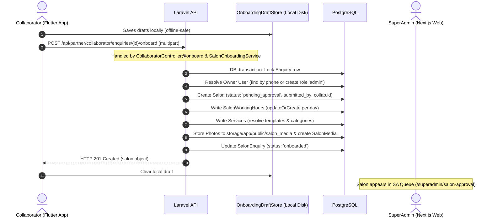
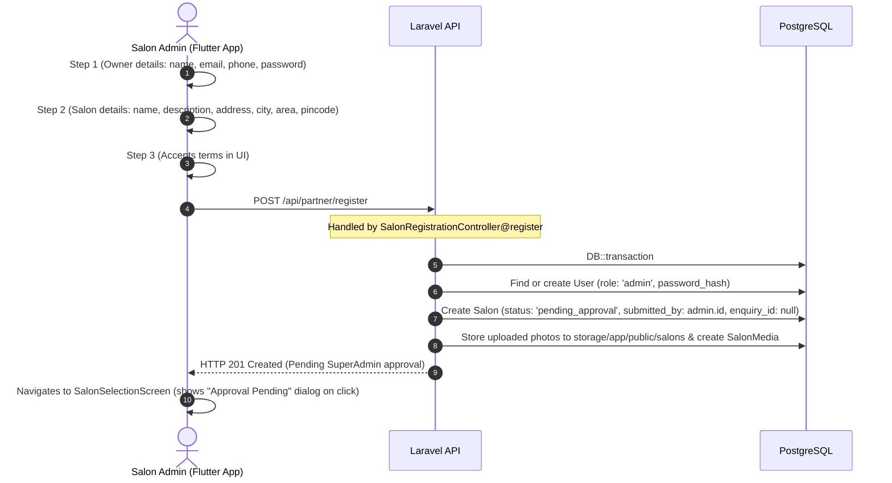
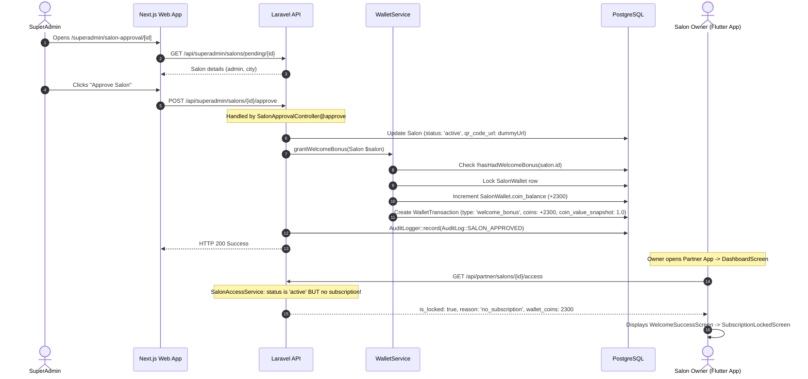
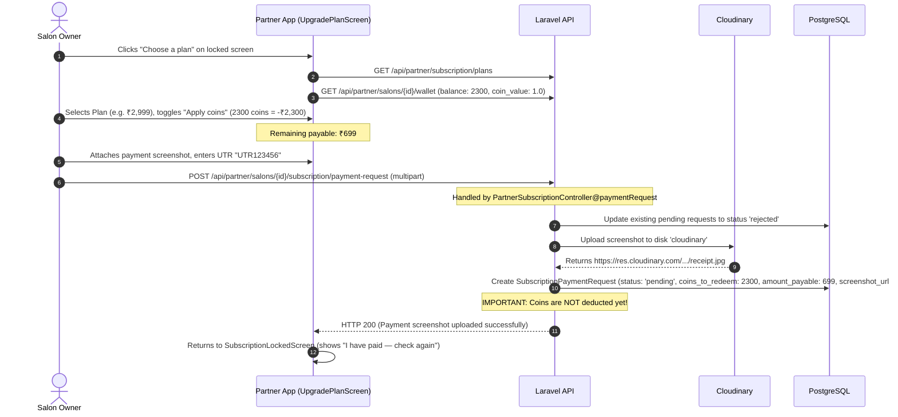
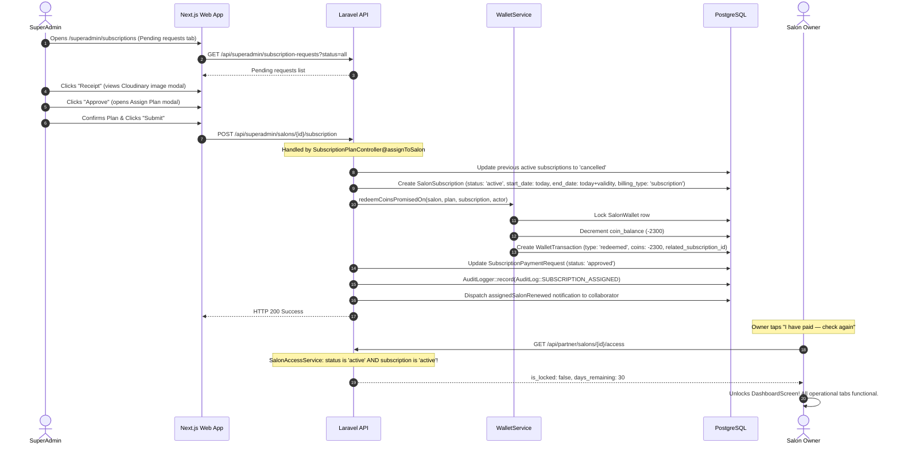
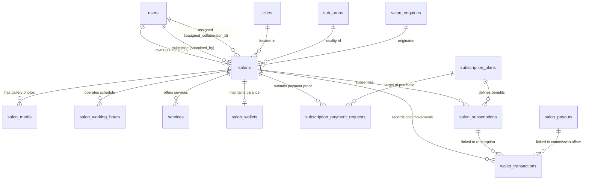

# Complete Technical Audit Report: Salon Registration, Onboarding, Wallet/Coin Credit, Plan Purchase, Payment, and SuperAdmin Approval Workflow

**Repository:** `BookALook`  
**Date:** October 18, 2026  
**Audit Purpose:** Comprehensive technical audit of the salon lifecycle from initial registration through subscription activation to prepare for consolidating the two-stage SuperAdmin approval workflow into a unified single review stage.  
**Constraint Enforced:** Read-only inspection. No source code, database schemas, configurations, or behavior have been modified.

---

## 1. Executive Summary

### 1.1 Actual Implementation Overview
The BookALook codebase comprises three primary tiers:
1. **API & Backend:** Laravel 11 (PHP 8.2+) REST API using PostgreSQL as the relational datastore with Eloquent ORM, Laravel Sanctum token-based authentication, and Cloudinary storage for screenshots and salon media.
2. **SuperAdmin Management Portal:** Next.js 14+ (React/TypeScript, App Router) hosted in `website/src/app/superadmin/`.
3. **Partner Mobile Application:** Flutter (Dart) mobile application in `Partner App/` serving three distinct roles: Salon Owner (`admin`), Field Agent (`collaborator`), and Staff Provider (`service_provider`).

### 1.2 Comparison: User-Supplied Model vs. Actual Code Implementation

| Step in User Narrative | Actual Codebase Implementation | Discrepancies & Crucial Discoveries |
| :--- | :--- | :--- |
| **1. Salon is registered or onboarded** | Two separate entry points exist:  a) **Collaborator Onboarding** via `POST /api/partner/collaborator/enquiries/{id}/onboard` (assigned enquiry required, 4-step wizard with working hours, catalog/custom services, geolocation, up to 10 photos). b) **Direct Salon Admin Registration** via `POST /api/partner/register` (3-step wizard with owner account credentials, basic salon location, terms agreement). | • Direct registration **does not collect working hours or services**. • Collaborator onboarding creates an admin user, salon, working hours, and priced services in one transactional submission. • Collaborators cannot onboard unassigned salons; they must pick an enquiry assigned by SuperAdmin. |
| **2. Salon reviewed by SuperAdmin** | Stage A review occurs at `website/src/app/superadmin/salon-approval/[id]/page.tsx` backed by `GET /api/superadmin/salons/pending/{id}`. | • **Major Blind Spot:** The review screen **only displays** salon name, slug, city, address, pincode, gender focus, description, and owner name/phone/email. It **does not display** photos, working hours, services, or collaborator attribution even though the collaborator submitted them. |
| **3. Initial approval credits wallet with coins** | `POST /api/superadmin/salons/{id}/approve` executed by `SalonApprovalController::approve`. Sets `$salon->status = 'active'`, generates QR code URL, and invokes `WalletService::grantWelcomeBonus($salon)`. | • Welcome bonus is read from `platform_policy_settings` (`welcome_bonus_coins`, default: 2,300 coins, worth ₹2,300 at `coin_value_inr` = 1.0). • The operation is strictly idempotent (checks if a `welcome_bonus` transaction already exists). • **Crucial Discovery:** Although `$salon->status` becomes `'active'`, the salon **has no active subscription**. Thus, `SalonAccessService` flags the salon as `is_active = false` with reason `no_subscription`. The partner app gates the entire dashboard behind `subscription_locked_screen.dart`. |
| **4. Salon uses coins to purchase subscription** | In `Partner App`, owner sees `subscription_locked_screen.dart` with a welcome banner celebrating their approval and free coins. Clicking "Choose a plan" opens `UpgradePlanScreen`. Owner selects a plan and toggles "Apply coins". | • Whole coins are quoted using `floor(price / coinValue)`. • If coins cover 100% of the plan (`amount_payable <= 0`), the plan is **instantly activated** without payment proof or SuperAdmin review via `PartnerSubscriptionController::activatePaidInCoins`. • If `amount_payable > 0`, owner must upload payment proof. |
| **5. Salon uploads payment screenshot** | Owner uploads bank transfer/UPI screenshot, optional transaction UTR, and optional note via `POST /api/partner/salons/{salon_id}/subscription/payment-request`. | • Creates a `SubscriptionPaymentRequest` with status `'pending'`. • Coins to redeem (`coins_to_redeem`) are stored as **intent only** on the request row; **coins are NOT deducted from the wallet at this stage**. • Any previous pending request for that salon is automatically set to `'rejected'`. |
| **6. SuperAdmin reviews and approves plan/payment** | Stage B review occurs in `website/src/app/superadmin/subscriptions/page.tsx` under the "Pending Requests" table (`GET /api/superadmin/subscription-requests?status=all`). | • SuperAdmin views salon name, plan, transaction reference, date, and clicks "Receipt" modal. • Clicking "Approve" triggers `POST /api/superadmin/salons/{id}/subscription` (`SubscriptionPlanController::assignToSalon`). • **Defect Identified:** There is **NO REJECT BUTTON** and **NO REJECT API ENDPOINT** for subscription payment requests. Pending requests can only be marked rejected if the salon submits a new payment or commission request. |
| **7. Subscription/account becomes active** | `SubscriptionPlanController::assignToSalon` creates `SalonSubscription` with status `'active'`, deduces promised coins from `SalonWallet`, sets `SubscriptionPaymentRequest` status to `'approved'`, and fires renewal notifications. | • Salon is now fully operational (`SalonAccessService::status` returns `is_active = true`). • The Partner App unlocks and operational API endpoints (`salon.active` middleware) permit access. |

---

## 2. Architecture and Source Map

### 2.1 Technology Stack & Architectural Patterns
- **Backend:** Laravel 11.x framework using Controller-Service-Model architecture with PostgreSQL database.
- **ORM:** Eloquent with UUID primary keys on primary business entities (`users`, `salons`, `salon_subscriptions`, `wallet_transactions`, `subscription_plans`).
- **Authentication:** Laravel Sanctum personal access tokens (`auth:sanctum`).
- **File Storage:** Cloudinary (`Storage::disk('cloudinary')`) for payment screenshots and template banners; public disk (`storage/app/public/salon_media`) for salon photos.
- **Frontend SuperAdmin:** Next.js 14+ (App Router, React 18, TypeScript, CSS Modules).
- **Frontend Partner App:** Flutter 3.x (Dart 3.x) with multi-role state routing and SQLite/SharedPreferences offline caching.

### 2.2 Key Files and Source Paths

#### Backend (Laravel)
- **Routes:**
  - [`backend/routes/api.php`](file:///d:/BookALook/backend/routes/api.php): Defines all API routes (`customer`, `superadmin`, `partner`).
- **Controllers:**
  - [`SalonApprovalController.php`](file:///d:/BookALook/backend/app/Http/Controllers/Admin/SalonApprovalController.php): Stage A pending salon queue, detail, approve, reject.
  - [`SalonRegistrationController.php`](file:///d:/BookALook/backend/app/Http/Controllers/Api/Partner/SalonRegistrationController.php): Direct Salon Admin registration endpoint (`/api/partner/register`).
  - [`CollaboratorController.php`](file:///d:/BookALook/backend/app/Http/Controllers/Api/Partner/CollaboratorController.php): Collaborator onboarding endpoints, enquiry assignment list, salon re-editing (`/api/partner/collaborator/...`).
  - [`PartnerSubscriptionController.php`](file:///d:/BookALook/backend/app/Http/Controllers/Api/Partner/PartnerSubscriptionController.php): Partner plan fetching, upgrade, renew, payment-request upload, commission-request.
  - [`PartnerWalletController.php`](file:///d:/BookALook/backend/app/Http/Controllers/Api/Partner/PartnerWalletController.php): Wallet balance, coin value, coin quotation, transaction history.
  - [`SubscriptionPlanController.php`](file:///d:/BookALook/backend/app/Http/Controllers/Api/SuperAdmin/SubscriptionPlanController.php): Stage B subscription requests listing, plan CRUD, plan assignment (`assignToSalon`).
  - [`WalletSchemeController.php`](file:///d:/BookALook/backend/app/Http/Controllers/Api/SuperAdmin/WalletSchemeController.php): SuperAdmin reward ladder CRUD.
  - [`SettingsController.php`](file:///d:/BookALook/backend/app/Http/Controllers/Api/SuperAdmin/SettingsController.php): SuperAdmin platform policies (coin value, welcome bonus, grace periods).
  - [`SalonAccessController.php`](file:///d:/BookALook/backend/app/Http/Controllers/Api/Partner/SalonAccessController.php): Partner endpoint returning salon operational lockdown state.
- **Services:**
  - [`SalonOnboardingService.php`](file:///d:/BookALook/backend/app/Services/SalonOnboardingService.php): Handles atomic creation/revision of salons, working hours, services, and photos for collaborator onboardings.
  - [`SalonAccessService.php`](file:///d:/BookALook/backend/app/Services/SalonAccessService.php): Single source of truth determining if a salon is tradeable, reason for lockdown, and lock payload.
  - [`WalletService.php`](file:///d:/BookALook/backend/app/Services/WalletService.php): Wallet lifecycle, welcome bonus grant, coin quote calculation, coin redemption against subscriptions and payouts.
  - [`CommissionService.php`](file:///d:/BookALook/backend/app/Services/CommissionService.php): Manages Commission Model activations, rates, and settlements.
  - [`AuditLogger.php`](file:///d:/BookALook/backend/app/Services/AuditLogger.php): Records immutable audit log entries.
- **Middleware:**
  - [`EnsureSalonSubscriptionActive.php`](file:///d:/BookALook/backend/app/Http/Middleware/EnsureSalonSubscriptionActive.php): Route middleware `salon.active` that enforces active subscription check, responding with HTTP 402 if locked.
- **Models:**
  - [`Salon.php`](file:///d:/BookALook/backend/app/Models/Salon.php)
  - [`User.php`](file:///d:/BookALook/backend/app/Models/User.php)
  - [`SalonEnquiry.php`](file:///d:/BookALook/backend/app/Models/SalonEnquiry.php)
  - [`SalonWorkingHour.php`](file:///d:/BookALook/backend/app/Models/SalonWorkingHour.php)
  - [`SalonMedia.php`](file:///d:/BookALook/backend/app/Models/SalonMedia.php)
  - [`Service.php`](file:///d:/BookALook/backend/app/Models/Service.php)
  - [`ServiceTemplate.php`](file:///d:/BookALook/backend/app/Models/ServiceTemplate.php)
  - [`ServiceCategory.php`](file:///d:/BookALook/backend/app/Models/ServiceCategory.php)
  - [`SalonWallet.php`](file:///d:/BookALook/backend/app/Models/SalonWallet.php)
  - [`WalletTransaction.php`](file:///d:/BookALook/backend/app/Models/WalletTransaction.php)
  - [`SubscriptionPlan.php`](file:///d:/BookALook/backend/app/Models/SubscriptionPlan.php)
  - [`SalonSubscription.php`](file:///d:/BookALook/backend/app/Models/SalonSubscription.php)
  - [`SubscriptionPaymentRequest.php`](file:///d:/BookALook/backend/app/Models/SubscriptionPaymentRequest.php)
  - [`PlatformPolicySetting.php`](file:///d:/BookALook/backend/app/Models/PlatformPolicySetting.php)
  - [`AuditLog.php`](file:///d:/BookALook/backend/app/Models/AuditLog.php)

#### Frontend SuperAdmin (Next.js)
- [`website/src/app/superadmin/salon-approval/page.tsx`](file:///d:/BookALook/website/src/app/superadmin/salon-approval/page.tsx): Stage A pending salon queue & public enquiry manager.
- [`website/src/app/superadmin/salon-approval/[id]/page.tsx`](file:///d:/BookALook/website/src/app/superadmin/salon-approval/%5Bid%5D/page.tsx): Stage A salon review, approve, reject page.
- [`website/src/app/superadmin/subscriptions/page.tsx`](file:///d:/BookALook/website/src/app/superadmin/subscriptions/page.tsx): Stage B subscription requests table, receipt modal, approve assignation, plan CRUD.
- [`website/src/app/superadmin/salons/[id]/page.tsx`](file:///d:/BookALook/website/src/app/superadmin/salons/%5Bid%5D/page.tsx): Comprehensive salon directory profile view.
- [`website/src/app/superadmin/wallet-schemes/page.tsx`](file:///d:/BookALook/website/src/app/superadmin/wallet-schemes/page.tsx): Reward scheme editor.
- [`website/src/app/superadmin/settings/policy/page.tsx`](file:///d:/BookALook/website/src/app/superadmin/settings/policy/page.tsx): Welcome coins and coin value configuration.

#### Frontend Partner App (Flutter)
- [`Partner App/lib/screens/phone_screen.dart`](file:///d:/BookALook/Partner%20App/lib/screens/phone_screen.dart): Phone OTP login and registration entry.
- [`Partner App/lib/screens/otp_screen.dart`](file:///d:/BookALook/Partner%20App/lib/screens/otp_screen.dart): OTP verification and routing.
- [`Partner App/lib/screens/registration/admin_registration_screen.dart`](file:///d:/BookALook/Partner%20App/lib/screens/registration/admin_registration_screen.dart): Direct Salon Admin registration wizard.
- [`Partner App/lib/screens/registration/steps/step1_owner_details.dart`](file:///d:/BookALook/Partner%20App/lib/screens/registration/steps/step1_owner_details.dart): Step 1 owner credentials.
- [`Partner App/lib/screens/registration/steps/step2_salon_details.dart`](file:///d:/BookALook/Partner%20App/lib/screens/registration/steps/step2_salon_details.dart): Step 2 salon profile, locality, and photos.
- [`Partner App/lib/screens/registration/steps/step3_terms.dart`](file:///d:/BookALook/Partner%20App/lib/screens/registration/steps/step3_terms.dart): Step 3 legal terms acceptance.
- [`Partner App/lib/screens/collaborator/onboard_salon_screen.dart`](file:///d:/BookALook/Partner%20App/lib/screens/collaborator/onboard_salon_screen.dart): Collaborator 4-step onboarding wizard.
- [`Partner App/lib/services/onboarding_draft_store.dart`](file:///d:/BookALook/Partner%20App/lib/services/onboarding_draft_store.dart): Offline draft persistence and background synchronization.
- [`Partner App/lib/screens/subscription_locked_screen.dart`](file:///d:/BookALook/Partner%20App/lib/screens/subscription_locked_screen.dart): Gateway lock screen displayed post-Stage A approval.
- [`Partner App/lib/screens/onboarding/welcome_success_screen.dart`](file:///d:/BookALook/Partner%20App/lib/screens/onboarding/welcome_success_screen.dart): Welcome screen celebrating Stage A approval and coin balance.
- [`Partner App/lib/screens/dashboard/more/upgrade_plan_screen.dart`](file:///d:/BookALook/Partner%20App/lib/screens/dashboard/more/upgrade_plan_screen.dart): Plan picker, coin quotation, screenshot upload.
- [`Partner App/lib/screens/dashboard/more/subscription_billing_screen.dart`](file:///d:/BookALook/Partner%20App/lib/screens/dashboard/more/subscription_billing_screen.dart): Active plan details, pending request status, payment history.
- [`Partner App/lib/screens/dashboard/more/wallet_screen.dart`](file:///d:/BookALook/Partner%20App/lib/screens/dashboard/more/wallet_screen.dart): Coin balance, rupee valuation, earning and redemption ledger.

---

## 3. Stage A Complete Field Inventory: Salon Onboarding & Initial Approval

The following inventory details every attribute collected, persisted, or reviewed during initial registration/onboarding and Stage A SuperAdmin approval.

| Attribute / Property | UI Form Field & Component | API Payload Key | Backend Validation Rule | DB Model & Column | Data Type & Nullability | Default Value | Editable Post-Submit | Visible to SuperAdmin | Editable by SuperAdmin | Affects Approval? |
| :--- | :--- | :--- | :--- | :--- | :--- | :--- | :--- | :--- | :--- | :--- |
| **Owner Full Name** | "Full Name *" (`step1_owner_details.dart`, `onboard_salon_screen.dart`) | `full_name` (admin) / `owner_name` (collab) | `required\|string\|max:150` | `User::$name` (`users.name`) | `VARCHAR(150)`, NOT NULL | None | No (locked after registration) | Yes (`salon-approval/[id]`) | No | Yes |
| **Owner Email** | "Email Address *" (`step1_owner_details.dart`) / Optional in Collab | `email` (admin) / `owner_email` (collab) | Admin: `required\|email\|max:150` Collab: `nullable\|email\|max:150` | `User::$email` (`users.email`) | `VARCHAR(150)`, NULLABLE, UNIQUE | `NULL` | No | Yes (`salon-approval/[id]`) | No | No |
| **Owner Phone** | "Phone Number *" (`step1_owner_details.dart`, `onboard_salon_screen.dart`) | `phone_number` (admin) / `owner_phone` (collab) | `required\|string\|min:10\|max:15` | `User::$phone` (`users.phone`) | `VARCHAR(15)`, NOT NULL, UNIQUE | None | No (primary auth identity) | Yes (`salon-approval/[id]`) | No | Yes |
| **Owner Password** | "Password *" (`step1_owner_details.dart`) | `password` | Admin: `required\|string\|min:6` Collab: Autogenerated random 32-char | `User::$password_hash` (`users.password_hash`) | `VARCHAR(255)`, NOT NULL | None | Via reset only | No | No | No |
| **Salon Name** | "Salon Name *" (`step2_salon_details.dart`, `onboard_salon_screen.dart`) | `salon_name` | `required\|string\|max:150` | `Salon::$name` (`salons.name`) | `VARCHAR(150)`, NOT NULL | None | Collab can re-edit if rejected | Yes (`salon-approval/[id]`) | Yes (in Directory) | Yes |
| **Salon Slug** | Auto-derived from Salon Name | Derived on server (`Str::slug`) | Unique slug generation with random suffix if collision | `Salon::$slug` (`salons.slug`) | `VARCHAR(180)`, NOT NULL, UNIQUE | None | No | Yes (`salon-approval/[id]`) | No | No |
| **Salon Description** | "Description *" (`step2_salon_details.dart`, `onboard_salon_screen.dart`) | `description` | Admin: `nullable\|string` Collab: `required\|string` | `Salon::$description` (`salons.description`) | `TEXT`, NULLABLE | `NULL` | Collab can re-edit if rejected | Yes (`salon-approval/[id]`) | Yes (in Directory) | No |
| **Salon Landline/Phone** | "Salon Contact Phone *" (`onboard_salon_screen.dart` only) | `salon_phone` | Collab: `required\|string\|max:20` Admin: Not collected | `Salon::$phone_num` (`salons.phone_num`) | `VARCHAR(20)`, NULLABLE | `NULL` | Collab can re-edit if rejected | **No** (omitted on review view) | Yes (in Directory) | No |
| **Street Address** | "Street Address *" (`step2_salon_details.dart`, `onboard_salon_screen.dart`) | `street_address` (admin) / `address` (collab) | `required\|string` | `Salon::$address` (`salons.address`) | `TEXT`, NOT NULL | None | Collab can re-edit if rejected | Yes (`salon-approval/[id]`) | Yes (in Directory) | Yes |
| **City ID** | "City Dropdown *" (`step2_salon_details.dart`, `onboard_salon_screen.dart`) | `city_id` | `required\|exists:cities,id` | `Salon::$city_id` (`salons.city_id`) | `BIGINT`, NOT NULL, FK | None | Collab can re-edit if rejected | Yes (displays City Name) | Yes (in Directory) | Yes |
| **Sub-Area / Locality** | "Sub-Area Dropdown *" (`step2_salon_details.dart`, `onboard_salon_screen.dart`) | `sub_area_id` | `required\|uuid\|exists:sub_areas,id (scoped to city)` | `Salon::$sub_area_id` (`salons.sub_area_id`) | `UUID`, NOT NULL, FK | None | Collab can re-edit if rejected | **No** (omitted on review view) | Yes (in Directory) | Yes |
| **Pincode** | "Pincode *" (`step2_salon_details.dart`, `onboard_salon_screen.dart`) | `pincode` | `required\|string\|max:10` | `Salon::$pincode` (`salons.pincode`) | `VARCHAR(10)`, NULLABLE | `NULL` | Collab can re-edit if rejected | Yes (`salon-approval/[id]`) | Yes (in Directory) | No |
| **Latitude & Longitude** | "Use Current Location" GPS button | `latitude`, `longitude` | `nullable\|numeric\|between:-90,90 / -180,180` | `Salon::$latitude`, `longitude` | `DECIMAL(10,7)`, NULLABLE | `NULL` | Updatable via More > Location | **No** (omitted on review view) | No | No |
| **Location Source** | Computed server-side | None | Set to `'owner'` if coords provided | `Salon::$location_source` | `VARCHAR(20)`, NULLABLE | `NULL` | Yes | No | No | No |
| **Gender Focus** | Radio/Pill: Unisex / Men Only / Women Only | `gender_focus` | Admin: `nullable\|string` Collab: `required\|in:Unisex,Men Only,Women Only` | `Salon::$gender_focus` (`salons.gender_focus`) | `VARCHAR(20)`, NOT NULL | `'Unisex'` | Collab can re-edit if rejected | Yes (`salon-approval/[id]`) | Yes (in Directory) | No |
| **Photos (Gallery)** | Image Picker (up to 10 photos) | `photos` / `photos.*` (multipart) | `nullable\|array\|max:10` `photos.* => image\|mimes:jpeg,png,jpg,webp\|max:5120` | `SalonMedia` rows (`salon_media`) | Model rows, FK to `salons.id` | None | Re-uploadable in Collab re-edit | **No** (omitted on review view) | Yes (in Directory) | No |
| **Cover Photo Index** | "Set as Cover" selector on photo | `cover_index` | `nullable\|integer\|min:0` | `SalonMedia::$is_cover`, `Salon::$cover_photo_url` | `VARCHAR(500)`, NULLABLE | `NULL` | Re-selectable | **No** (omitted on review view) | Yes | No |
| **Working Hours** | 7-day schedule matrix (`onboard_salon_screen.dart` step 3) | `working_hours` (JSON string in multipart) | Collab: `required\|array\|min:1`, at least 1 open day, close > open. Admin: **Not collected** | `SalonWorkingHour` rows (`salon_working_hours`) | Model rows: `day_of_week` (0-6), `is_closed`, `open_time`, `close_time` | None | Re-editable by collab if rejected; owner edits in app | **No** (omitted on review view) | No | No |
| **Services & Pricing** | Service Picker Sheet (`onboard_salon_screen.dart` step 4) | `services` (JSON string in multipart) | Collab: `array`, price >= 0, template or custom. Admin: **Not collected** | `Service` rows (`services`), `ServiceTemplate`, `ServiceCategory` | Model rows: `template_id`, `price`, `description`, `advance_percentage` | None | Re-editable by collab if rejected; owner edits in app | **No** (omitted on review view) | Yes (in Directory) | No |
| **Terms Acceptance** | Checkbox (`step3_terms.dart`) | None (purely client-side gate) | Not sent or validated on backend | Not persisted in DB | None | `false` | N/A | No | No | No |
| **Enquiry ID** | Assigned Enquiry Scope (`onboard_salon_screen.dart`) | URL route param `enquiryId` | `required\|exists:salon_enquiries,id` assigned to authenticated collaborator | `Salon::$enquiry_id` (`salons.enquiry_id`) | `UUID`, NULLABLE, FK | `NULL` (Admin reg) | No | No | No | Yes |
| **Submitted By** | Derived from auth token | Implicit auth user ID | Enforced by auth middleware | `Salon::$submitted_by` (`salons.submitted_by`) | `UUID`, NOT NULL, FK | None | No | No | No | No |
| **Assigned Collaborator ID** | Assigned from enquiry or manual SuperAdmin directory | Collab: derived from auth Admin: `NULL` initially | Collab: auth ID SuperAdmin: `exists:users,id` | `Salon::$assigned_collaborator_id` | `UUID`, NULLABLE, FK | `NULL` (Admin reg) | Yes (SuperAdmin can reassign) | Yes (in Directory) | Yes | No |
| **Salon Status (Stage A)** | System-controlled status | None | Enum: `pending_approval`, `active`, `rejected`, `suspended`, `deactivated` | `Salon::$status` (`salons.status`) | `VARCHAR(30)`, NOT NULL | `'pending_approval'` | Yes (via approve/reject) | Yes | Yes (approve/reject) | Core |
| **Rejection Reason** | Textarea in Reject Modal (`salon-approval/[id]/page.tsx`) | `rejection_reason` | `required\|string\|max:500` | `Salon::$rejection_reason` (`salons.rejection_reason`) | `TEXT`, NULLABLE | `NULL` | Overwritten on resubmission | Yes (when rejected) | Yes | Core |
| **Approved At / By** | System audit metadata | Set upon approval | Backend timestamp and user | `Salon::$approved_at`, `approved_by` | `TIMESTAMP`, `UUID` NULLABLE | `NULL` | Set once on approval | Yes (AuditLog) | No | No |

---

## 4. Stage B Complete Field Inventory: Plan, Wallet, Coin, Payment & Final Approval

The following inventory details every attribute involved in Stage B: plan selection, wallet/coin credit, payment proof submission, and final SuperAdmin review.

| Attribute / Property | UI Form Field & Component | API Payload Key | Backend Validation Rule | DB Model & Column | Data Type & Nullability | Default Value | Editable Post-Submit | Visible to SuperAdmin | Editable by SuperAdmin | Affects Activation? |
| :--- | :--- | :--- | :--- | :--- | :--- | :--- | :--- | :--- | :--- | :--- |
| **Welcome Bonus Coins** | Displayed in `subscription_locked_screen.dart` & `welcome_success_screen.dart` | Set via `grantWelcomeBonus` on Stage A approval | Policy setting: `welcome_bonus_coins` (default: 2300) | `SalonWallet::$coin_balance`, `WalletTransaction::$coins` | `INTEGER`, NOT NULL | `0` | No | Yes (`settings/policy`) | Yes (`settings/policy`) | Yes (covers plan price) |
| **Coin Value (INR)** | "Worth ₹X at ₹Y per coin" in `wallet_screen.dart` & `upgrade_plan_screen.dart` | Read via `GET /partner/salons/{id}/wallet` | Policy setting: `coin_value_inr` (default: 1.00) | `PlatformPolicySetting::$setting_value`, `WalletTransaction::$coin_value_snapshot` | `DECIMAL(12,2)` | `1.00` | SuperAdmin updates policy | Yes (`settings/policy`, `wallet-schemes`) | Yes | Yes (converts coins to INR) |
| **Selected Plan ID** | Plan Selection Card in `upgrade_plan_screen.dart` | `plan_id` | `required\|exists:subscription_plans,id` | `SubscriptionPaymentRequest::$subscription_plan_id`, `SalonSubscription::$plan_id` | `UUID`, NOT NULL, FK | None | Locked on request row | Yes (`subscriptions/page.tsx`) | Yes (SuperAdmin can change assigned plan) | Core |
| **Plan Name & Price** | Displayed on plan card | Read from plan record | `price` is decimal >= 0 | `SubscriptionPlan::$name`, `price` | `VARCHAR(50)`, `DECIMAL(12,2)` | `0.00` | Only by SuperAdmin in Plan settings | Yes | Yes | Core |
| **Apply Coins Toggle** | Switch/Checkbox "Apply X coins (−₹Y)" in `upgrade_plan_screen.dart` | `coins_to_redeem` | `nullable\|integer\|min:0`, clamped to `quote()` | `SubscriptionPaymentRequest::$coins_to_redeem` | `INTEGER`, NOT NULL | `0` | Intent frozen until approval | Yes (`subscriptions/page.tsx`) | No | Core |
| **Coin Discount Amount (INR)** | Calculated line item on checkout | Computed server-side: `coins * coinValue` | Server computation | `SubscriptionPaymentRequest::$coin_discount_inr` | `DECIMAL(12,2)`, NOT NULL | `0.00` | Frozen on request | Yes (`subscriptions/page.tsx`) | No | Core |
| **Amount Payable (INR)** | "Paying now: ₹Z" | Computed: `max(price - discount, 0)` | Server computation | `SubscriptionPaymentRequest::$amount_payable_inr` | `DECIMAL(12,2)`, NULLABLE | `NULL` | Frozen on request | Yes (`subscriptions/page.tsx`) | No | Core |
| **Payment Proof Screenshot** | Image picker in `upgrade_plan_screen.dart` | `screenshot` (multipart) | `required_if:payable>0\|image\|mimes:jpeg,png,jpg\|max:5120` | `SubscriptionPaymentRequest::$screenshot_url` | `VARCHAR(255)`, NOT NULL | None | Replaced if new request raised | Yes (Receipt modal in SuperAdmin) | No | Core |
| **Transaction Reference / UTR** | Textfield "Transaction ID / UTR" (`upgrade_plan_screen.dart`) | `transaction_id` | `nullable\|string\|max:150` | `SubscriptionPaymentRequest::$transaction_id` | `VARCHAR(150)`, NULLABLE | `NULL` | Replaced if new request raised | Yes (`subscriptions/page.tsx`) | No | Reference only |
| **Payment Note** | Textfield "Add a note" (`upgrade_plan_screen.dart`) | `note` | `nullable\|string\|max:1000` | `SubscriptionPaymentRequest::$note` | `TEXT`, NULLABLE | `NULL` | Replaced if new request raised | Yes (`subscriptions/page.tsx`) | No | Reference only |
| **Payment Request Status** | Status chip in billing history | Managed by system | Enum: `pending`, `approved`, `rejected` | `SubscriptionPaymentRequest::$status` | `VARCHAR(20)`, NOT NULL | `'pending'` | System transitions | Yes (`subscriptions/page.tsx`) | Indirectly (Approve sets `'approved'`) | Core |
| **Billing Type** | Dropdown / badge: Subscription vs Commission | `billing_type` | `in:subscription,commission` | `SubscriptionPaymentRequest::$billing_type`, `SalonSubscription::$billing_type` | `VARCHAR(20)`, NOT NULL | `'subscription'` | Yes | Yes | Yes | Core |
| **Agreed Commission %** | Input in Assign Modal (`subscriptions/page.tsx`) | `commission_percentage` | `required_if:billing_type,commission\|numeric\|min:0\|max:100` | `Salon::$commission_percentage`, `SalonSubscription::$commission_percentage` | `DECIMAL(5,2)`, NULLABLE | `NULL` | Changed via `setCommissionRate` | Yes | Yes | Core (Commission only) |
| **Subscription Start & End Dates** | Displayed in Billing & Access checks | System computed (`today`, `today + validity_days`) | `validity_days` from `subscription_plans` | `SalonSubscription::$start_date`, `end_date` | `DATE`, NOT NULL | None | Automatic extension on renewal | Yes (`subscriptions/page.tsx`) | No | Core |
| **Subscription Status** | Status badge in `subscriptions/page.tsx` | Managed by system | Enum: `active`, `expired`, `cancelled` | `SalonSubscription::$status` | `VARCHAR(20)`, NOT NULL | `'active'` | Controlled by lifecycle / expiry job | Yes | No | Core |
| **Wallet Transaction Row (Deduction)** | Listed in `wallet_screen.dart` redeemed tab | Created on approval / coin payment | System internal | `WalletTransaction` row (`type = 'redeemed'`, `coins = -X`) | `UUID`, FKs to `salon_id`, `related_subscription_id` | None | Immutable ledger row | Yes (in DB / Audit) | No | Core |

---

## 5. Combined Field Mapping & Discrepancy Analysis

### 5.1 Category Breakdown
- **Fields Unique to Stage A (Salon Onboarding & Verification):**
  - Owner Account Details (`full_name`, `email`, `phone_number`, `password_hash`).
  - Salon Identity (`salon_name`, `slug`, `description`, `phone_num`, `gender_focus`).
  - Location Attributes (`street_address`, `city_id`, `sub_area_id`, `pincode`, `latitude`, `longitude`, `location_source`).
  - Salon Operations (`working_hours` schedule array: `day_of_week`, `is_closed`, `open_time`, `close_time`).
  - Service Menu (`services` array: `template_id`, `price`, `description`, `advance_percentage`, custom categories/templates).
  - Media (`photos` array, `cover_index`, `cover_photo_url`).
  - Association (`enquiry_id`, `submitted_by`, `assigned_collaborator_id`).
  - Initial Decision Metadata (`approved_at`, `approved_by`, `rejection_reason`).

- **Fields Unique to Stage B (Plan, Payment & Subscription Activation):**
  - Reward & Coin Allocation (`welcome_bonus_coins`, `coin_value_inr`, `SalonWallet::coin_balance`, `WalletTransaction` records).
  - Plan Selection (`subscription_plan_id`, `plan_name`, `plan_price_snapshot`, `validity_days`, `whatsapp_campaign_limit`).
  - Payment Calculations (`coins_to_redeem`, `coin_discount_inr`, `amount_payable_inr`).
  - Payment Verification Evidence (`screenshot_url`, `transaction_id`, `note`, `SubscriptionPaymentRequest::status`).
  - Subscription Lifecycle (`SalonSubscription` record: `start_date`, `end_date`, `status`, `billing_type`, `cancelled_at`).

- **Fields Shared Across Both Stages:**
  - `salon_id`: Foreign key anchor tying salon profile, wallet, subscriptions, and payment requests.
  - `admin_id`: User anchor identifying the owner.
  - `city_id` & `sub_area_id`: Geographic anchors utilized in search, onboarding matching, and directory filtering.

- **Fields Collected in UI but NOT Persisted in Database:**
  - Terms and Conditions Acceptance: Checked in Flutter UI (`step3_terms.dart`), but no timestamp, version number, or boolean flag is transmitted to or stored in Laravel backend.
  - State Name (`_selectedState`): Used to filter city dropdowns in Flutter, but only `city_id` is stored in the database.

- **Fields Persisted in Database but NOT Displayed in SuperAdmin Review Screens:**
  - **Stage A Review Screen:**
    - Gallery Photos (`SalonMedia`): Stored in database, but `SalonApprovalController::show` does not eager load `media`, and `salon-approval/[id]/page.tsx` has no gallery component.
    - Working Hours (`SalonWorkingHour`): Stored in database, but omitted on review screen.
    - Services & Pricing (`Service`): Stored in database, but omitted on review screen.
    - Assigned Collaborator: Omitted on review screen.
    - Geolocation Coordinates (`latitude`, `longitude`): Omitted on review screen.
  - **Stage B Review Screen:**
    - Rejection Reason for Payment Requests: Completely missing from both database schema and UI.

- **Fields Calculated or Populated Automatically:**
  - `slug`: Auto-generated via `Str::slug` with collision deduplication.
  - `qr_code_url`: Generated on Stage A approval (`https://api.qrserver.com/v1/create-qr-code/?size=150x150&data=salon_{id}`).
  - `coin_discount_inr`: Calculated on server as `coins_to_redeem * coin_value_inr`.
  - `amount_payable_inr`: Calculated on server as `max(plan_price - coin_discount_inr, 0)`.
  - `end_date`: Calculated as `today + validity_days`.
  - `welcome_bonus`: Read from `platform_policy_settings.welcome_bonus_coins`.

- **Fields Missing from One Registration Path:**
  - Direct Salon Admin Registration **completely lacks** working hours and services.
  - Collaborator Onboarding requires working hours (at least 1 open day) and offers optional service pricing.

---

## 6. End-to-End Workflow Traces

### Scenario 1: Collaborator Onboards a Salon

### Scenario 2: Salon Admin Registers Directly

### Scenario 3 & 4: Initial SuperAdmin Approval & Wallet Coin Credit (Stage A)

### Scenario 5 & 6: Plan Purchase & Payment Proof Submission

### Scenario 7: Stage B SuperAdmin Review & Subscription Activation

### Scenario 8: Rejection and Retry Mechanics
- **Stage A Rejection:**
  - Triggered by: `POST /api/superadmin/salons/{id}/reject` with `{ rejection_reason: "..." }`.
  - Backend updates `salons.status = 'rejected'` and `salons.rejection_reason = "..."`.
  - If `salon.enquiry_id` exists: resets `salon_enquiries.status = 'assigned'`.
  - The enquiry reappears in the Collaborator's `getAssignedEnquiries` list with `needs_correction: true` and the rejection reason.
  - Collaborator taps the enquiry, which calls `GET /api/partner/collaborator/salons/{salonId}/submission`, pre-populates `onboard_salon_screen.dart`, allows editing, and resubmits to `POST /api/partner/collaborator/enquiries/{id}/onboard`.
  - Backend `SalonOnboardingService` detects existing salon in `pending_approval` or `rejected` status, calls `reviseSalon()`, overwriting attributes and resetting status to `'pending_approval'`.
  - Direct Registration Rejection: If a self-registered salon is rejected, it has no `enquiry_id`. The salon owner's app shows `'rejected'`, and there is **no UI or API flow for self-registered owners to correct and resubmit**!
- **Stage B Rejection:**
  - **Critical Architectural Flaw:** There is **NO reject endpoint** or UI button for SuperAdmin to reject a payment request.
  - A payment request is only rejected when the salon submits a *new* payment request from the app, which runs `SubscriptionPaymentRequest::where('salon_id', $salonId)->where('status', 'pending')->update(['status' => 'rejected'])`.
  - If the owner uploads a replacement screenshot, coins are recalculated. Since coins were never deducted during request submission, no refund or balance restoration is needed.

### Scenario 9: Concurrency, Failure & Race Conditions
- **Double-Crediting Welcome Bonus:** Fully protected. `grantWelcomeBonus()` checks `hasHadWelcomeBonus()` inside a `DB::transaction` with `lockForUpdate()`. Second attempt returns `already_granted = true`.
- **Double-Debit of Coins on Plan Activation:** Fully protected. `redeem()` locks `SalonWallet` with `lockForUpdate()`. In addition, `redeemCoinsPromisedOn()` re-evaluates `min(promised, current_balance)` so a salon that spent coins elsewhere in the interim cannot overdraw.
- **Concurrent Submissions by Collaborator (Draft Retry):** Fully protected. `SalonOnboardingService::onboard()` acquires an exclusive row lock on `SalonEnquiry` (`lockForUpdate()`), preventing duplicate salon records or `(salon_id, day_of_week)` collisions on `salon_working_hours`.
- **Concurrent Plan Approvals:** Handled cleanly in transaction; cancels prior active subscriptions before inserting the new active subscription.

---

## 7. Status and Transition Matrix

| Entity | Status Value | Meaning | Initial State? | Trigger Event | Trigger Source API / Function | Resulting State | Side Effects | User-Facing UI Label | Reversible? |
| :--- | :--- | :--- | :--- | :--- | :--- | :--- | :--- | :--- | :--- |
| **Salon** | `pending_approval` | Newly registered or onboarded salon awaiting SuperAdmin verification. | Yes (on creation) | Form submission | `SalonRegistrationController@register` or `SalonOnboardingService@createSalon` | `pending_approval` | Enquiry set to `onboarded`; audit log initiated. | "Pending Approval" | No |
| **Salon** | `active` | Salon verified by SuperAdmin. | No | SuperAdmin clicks "Approve Salon" | `SalonApprovalController@approve` | `active` | QR code generated; `grantWelcomeBonus` called (credits 2300 coins); audit log recorded. | "Active" | No (can only be suspended/deactivated) |
| **Salon** | `rejected` | Salon failed Stage A verification. | No | SuperAdmin clicks "Reject Salon" with reason | `SalonApprovalController@reject` | `rejected` | Enquiry status reset to `assigned`; rejection reason saved; audit log recorded. | "Rejected" | Yes (Collaborator can revise and resubmit) |
| **Salon** | `suspended` | Platform disciplinary action against salon. | No | SuperAdmin complaint action | `ComplaintController@suspend` | `suspended` | `SalonAccessService` blocks trading; customers cannot book. | "Suspended" | Yes (`ComplaintController@reinstate`) |
| **SalonEnquiry** | `pending` | Customer/partner submitted public enquiry on website. | Yes | Web form POST | `PublicEnquiryController@store` | `pending` | None. | "New" | No |
| **SalonEnquiry** | `assigned` | SuperAdmin matched enquiry to a field Collaborator. | No | SuperAdmin assigns collaborator | `SuperAdminEnquiryController@assignCollaborator` | `assigned` | Appears in Collaborator's assigned enquiry queue. | "Assigned" | Yes (can be reassigned) |
| **SalonEnquiry** | `onboarded` | Collaborator submitted completed onboarding wizard. | No | Collaborator submits onboard | `SalonOnboardingService@onboard` | `onboarded` | Enquiry completed; linked to new Salon. | "Onboarded" | Yes (reverts to `assigned` on rejection) |
| **SubscriptionPaymentRequest** | `pending` | Owner submitted plan purchase with payment screenshot. | Yes | Owner submits payment proof | `PartnerSubscriptionController@paymentRequest` | `pending` | Previous pending requests set to `rejected`; screenshot uploaded to Cloudinary. | "Payment Under Verification" | No |
| **SubscriptionPaymentRequest** | `approved` | SuperAdmin verified transfer and assigned plan. | No | SuperAdmin approves request in subscriptions dashboard | `SubscriptionPlanController@assignToSalon` (`closePendingRequests`) | `approved` | Coins deducted from wallet; `SalonSubscription` created as `active`. | "Approved" | No |
| **SubscriptionPaymentRequest** | `rejected` | Owner submitted a superseding payment/commission request. | No | Owner resubmits payment or commission request | `PartnerSubscriptionController@paymentRequest` / `commissionRequest` | `rejected` | Overridden by newer request. | "Rejected" | No |
| **SalonSubscription** | `active` | Plan currently live and protecting salon access. | Yes (upon creation) | SuperAdmin approval OR 100% coin coverage | `SubscriptionPlanController@assignToSalon` OR `activatePaidInCoins` | `active` | Unlocks Partner App; allows customer bookings; enables staff payroll/walk-ins. | "Active" | No (can expire or cancel) |
| **SalonSubscription** | `expired` | Plan end date has passed. | No | Daily command or on-demand check | `CheckSubscriptions` command OR `SalonAccessService@expireStale` | `expired` | `SalonAccessService` blocks trading (reason: `subscription_expired`); lock screen shown. | "Expired" | No (requires renewal) |
| **SalonSubscription** | `cancelled` | Plan replaced by upgrade or newer assignment. | No | Plan upgrade or assignment | `PartnerSubscriptionController@upgradeSubscription` / `assignToSalon` | `cancelled` | Timestamped with `cancelled_at` and `cancelled_by`. | "Cancelled" | No |
| **WalletTransaction** | `welcome_bonus` | One-time bonus credited upon Stage A approval. | Yes | `SalonApprovalController@approve` | `WalletService@grantWelcomeBonus` | N/A (immutable) | Increments `SalonWallet.coin_balance`; sets balance snapshot. | "Welcome bonus on approval" | No |
| **WalletTransaction** | `redeemed` | Coins spent towards plan purchase or commission. | Yes | Plan activation OR Commission payout deduction | `WalletService@redeemForSubscription` OR `redeemAgainstCommission` | N/A (immutable) | Decrements `SalonWallet.coin_balance` with negative coin integer. | "Applied to [Plan Name]" | No |
| **WalletTransaction** | `earned` | Coins earned for completed online appointments. | Yes | Appointment completed | `WalletService@awardForCompletedAppointment` | N/A (immutable) | Increments `SalonWallet.coin_balance` according to active reward ladder. | "Tier X Reward" | No |

---

## 8. Database Entity and Relationship Map

### 8.1 Key Schema Definitions

#### `salons` Table
- `id`: UUID (Primary Key)
- `admin_id`: UUID (Foreign Key -> `users.id`, CASCADE)
- `name`: VARCHAR(150), NOT NULL
- `slug`: VARCHAR(180), UNIQUE, NOT NULL
- `description`: TEXT, NULLABLE
- `cover_photo_url`: VARCHAR(500), NULLABLE
- `city_id`: BIGINT (Foreign Key -> `cities.id`), NOT NULL
- `sub_area_id`: UUID (Foreign Key -> `sub_areas.id`), NULLABLE (validated strictly in code)
- `address`: TEXT, NOT NULL
- `pincode`: VARCHAR(10), NULLABLE
- `phone_num`: VARCHAR(20), NULLABLE
- `latitude`: DECIMAL(10, 7), NULLABLE
- `longitude`: DECIMAL(10, 7), NULLABLE
- `location_source`: VARCHAR(20), NULLABLE ('owner', etc.)
- `status`: VARCHAR(30), DEFAULT `'pending_approval'`, INDEXED
- `submitted_by`: UUID (Foreign Key -> `users.id`), NOT NULL
- `approved_by`: UUID (Foreign Key -> `users.id`), NULLABLE
- `approved_at`: TIMESTAMP, NULLABLE
- `rejection_reason`: TEXT, NULLABLE
- `qr_code_url`: VARCHAR(500), NULLABLE
- `assigned_collaborator_id`: UUID (Foreign Key -> `users.id`), NULLABLE, INDEXED
- `enquiry_id`: UUID (Foreign Key -> `salon_enquiries.id`), NULLABLE
- `commission_opt_in`: BOOLEAN, DEFAULT `false`
- `commission_percentage`: DECIMAL(5, 2), NULLABLE
- `commission_rate_effective_from`: DATE, NULLABLE
- `gender_focus`: ENUM('Unisex', 'Men Only', 'Women Only'), DEFAULT `'Unisex'`
- `created_at`, `updated_at`: TIMESTAMPS
- `deleted_at`: SOFT DELETES

#### `subscription_payment_requests` Table
- `id`: BIGSERIAL (Primary Key)
- `salon_id`: UUID (Foreign Key -> `salons.id`, CASCADE), NOT NULL
- `subscription_plan_id`: UUID (Foreign Key -> `subscription_plans.id`, CASCADE), NULLABLE
- `billing_type`: VARCHAR(20), DEFAULT `'subscription'`
- `coins_to_redeem`: UNSIGNED INT, DEFAULT `0`
- `coin_discount_inr`: DECIMAL(12, 2), DEFAULT `0.00`
- `amount_payable_inr`: DECIMAL(12, 2), NULLABLE
- `screenshot_url`: VARCHAR(255), NULLABLE (mandatory if amount_payable > 0)
- `transaction_id`: VARCHAR(150), NULLABLE (owner UTR / reference)
- `note`: TEXT, NULLABLE
- `status`: VARCHAR(20), DEFAULT `'pending'` ('pending', 'approved', 'rejected')
- `created_at`, `updated_at`: TIMESTAMPS

#### `salon_subscriptions` Table
- `id`: UUID (Primary Key)
- `salon_id`: UUID (Foreign Key -> `salons.id`, CASCADE), NOT NULL
- `plan_id`: UUID (Foreign Key -> `subscription_plans.id`), NOT NULL
- `billing_type`: VARCHAR(20), DEFAULT `'subscription'`
- `commission_percentage`: DECIMAL(5, 2), NULLABLE
- `plan_price_snapshot`: DECIMAL(12, 2), DEFAULT `0.00`
- `start_date`: DATE, NOT NULL
- `end_date`: DATE, NOT NULL
- `status`: VARCHAR(20), DEFAULT `'active'` ('active', 'expired', 'cancelled')
- `auto_renew`: BOOLEAN, DEFAULT `false`
- `renewed_from_id`: UUID (Foreign Key -> `salon_subscriptions.id`), NULLABLE
- `cancelled_at`: TIMESTAMP, NULLABLE
- `cancelled_by`: UUID (Foreign Key -> `users.id`), NULLABLE
- `created_at`, `updated_at`: TIMESTAMPS

#### `salon_wallets` Table
- `salon_id`: UUID (Primary Key, Foreign Key -> `salons.id`, CASCADE)
- `coin_balance`: INTEGER, DEFAULT `0`, NOT NULL
- `completed_online_appointments_count`: INTEGER, DEFAULT `0`, NOT NULL

#### `wallet_transactions` Table
- `id`: UUID (Primary Key)
- `salon_id`: UUID (Foreign Key -> `salons.id`, CASCADE), NOT NULL
- `type`: VARCHAR(20), NOT NULL ('welcome_bonus', 'earned', 'redeemed', 'adjustment', 'expired')
- `coins`: INTEGER, NOT NULL (Positive for credit, Negative for debit)
- `balance_after`: INTEGER, NOT NULL
- `coin_value_snapshot`: DECIMAL(12, 2), NULLABLE
- `related_scheme_tier_id`: UUID (Foreign Key -> `wallet_scheme_tiers.id`), NULLABLE
- `related_appointment_id`: UUID (Foreign Key -> `appointments.id`), NULLABLE
- `related_payout_id`: UUID (Foreign Key -> `salon_payouts.id`), NULLABLE
- `related_subscription_id`: UUID (Foreign Key -> `salon_subscriptions.id`), NULLABLE
- `created_by`: UUID (Foreign Key -> `users.id`), NULLABLE
- `note`: VARCHAR(255), NULLABLE
- `created_at`, `updated_at`: TIMESTAMPS

---

## 9. Wallet and Coin Accounting Analysis

### 9.1 Coin Generation & Valuation Mechanics
- **Configuration Source:** `platform_policy_settings` table.
  - `welcome_bonus_coins`: Integer setting defining welcome coins (default: 2300).
  - `coin_value_inr`: Float setting defining the rupee equivalent of 1 coin (default: ₹1.00).
- **Welcome Bonus Trigger:** `WalletService::grantWelcomeBonus(Salon $salon)`.
  - Condition: `$salon->status === 'active'`.
  - Check: `hasHadWelcomeBonus($salon->id)` queries if a `wallet_transactions` row with `type = 'welcome_bonus'` already exists.
  - Concurrency Lock: `SalonWallet::where('salon_id', $salon->id)->lockForUpdate()`.
  - Ledger Record: Inserts `WalletTransaction` with `type = 'welcome_bonus'`, `coins = 2300`, `balance_after = 2300`, `coin_value_snapshot = 1.00`.
- **Coin Quotation Formula:** `WalletService::quote(salonId, price)`:
  $$\text{usable\_coins} = \min\left(\text{wallet\_balance}, \left\lfloor\frac{\text{price}}{\text{coin\_value}}\right\rfloor\right)$$
  $$\text{discount\_value} = \text{usable\_coins} \times \text{coin\_value}$$
  $$\text{amount\_payable} = \max(\text{price} - \text{discount\_value}, 0)$$
  Coins are strictly integer-based. Fractional coin burns are prohibited.

### 9.2 Coin Consumption & Timing
- **Pre-Approval Intent vs. Post-Approval Deduction:**
  - When an owner submits a payment request in `PartnerSubscriptionController::paymentRequest`, `coins_to_redeem` is saved on `subscription_payment_requests`. **Coins remain in the wallet.**
  - Coins are only deducted when SuperAdmin approves via `SubscriptionPlanController::assignToSalon()`, which calls `redeemCoinsPromisedOn()`.
  - Inside `WalletService::redeem()`, `SalonWallet` is row-locked (`lockForUpdate()`), `coin_balance` is decremented, and a `WalletTransaction` row with negative coins (`coins = -$coins`) and `related_subscription_id = $subscription->id` is created.
  - **Exception (100% Coin Coverage):** If `amount_payable <= 0`, coins are deducted immediately by `activatePaidInCoins()` within `DB::transaction`, and the subscription activates instantly.

### 9.3 Reversal and Rollback Behavior
- If SuperAdmin rejects a salon at Stage A: No coins were ever credited, so no rollback is required.
- If a Stage B payment request is superseded or rejected: Coins were never deducted, so no refund is necessary.
- If an active subscription is cancelled or upgraded early: **No coin refund logic exists.** Coins spent are considered consumed.

---

## 10. Payment and Subscription Analysis

### 10.1 Payment Gateways vs. Screenshot Proof
- **Appointment Bookings:** Razorpay gateway integration is implemented (`RazorpayGateway.php`, `BookingPaymentService.php`) for customer appointment advances.
- **Salon Subscriptions:** Razorpay is **NOT used for salon subscriptions**. Subscriptions are strictly bank transfer/UPI-based, requiring an uploaded screenshot of the transaction receipt.
- **Proof Storage:** Stored in Cloudinary via `Storage::disk('cloudinary')->put('screenshots', ...)`.

### 10.2 Entitlement & Gate Enforcement
- **Gatekeeper Middleware:** `App\Http\Middleware\EnsureSalonSubscriptionActive` (`'salon.active'`).
  - Applied to all operational salon partner routes: Service management, staff, working hours, closures, payroll, appointments, walk-ins, check-ins, and offers.
  - Excluded from: Authentication, `access` check, wallet endpoints, renewal/upgrade/payment-request endpoints, ratings review, and WhatsApp campaign overview.
- **Evaluation Service:** `SalonAccessService::status()`.
  1. Checks if `status === 'suspended'` -> blocks with `reason = 'suspended'`.
  2. Checks if `status !== 'active'` -> blocks with `reason = 'not_approved'`.
  3. Queries active `SalonSubscription` (`status = 'active'`, `latest('start_date')`).
  4. If no active subscription exists:
     - If previous lapsed subscription exists -> blocks with `reason = 'subscription_expired'`.
     - If never had a subscription -> blocks with `reason = 'no_subscription'`.
  5. If active subscription found: passes with `is_active = true`, returning remaining days.

---

## 11. Existing Defects and Technical Risks

### 11.1 Confirmed Defects in Codebase
1. **Missing Stage B Rejection Mechanism:**
   - There is no API route, controller method, or SuperAdmin UI action to reject an invalid `SubscriptionPaymentRequest`.
   - A fraudulent or unreadable screenshot sits in the queue indefinitely unless the owner independently resubmits another request.
2. **Review Screen Blind Spot in Stage A:**
   - Collaborators upload gallery photos, working hours, and priced services.
   - `SalonApprovalController::show` only executes `Salon::with(['admin', 'city'])->findOrFail($id)`.
   - `website/src/app/superadmin/salon-approval/[id]/page.tsx` does not render photos, schedule, or services, meaning SuperAdmin approves salons blindly without reviewing the submitted catalog or media.
3. **Registration Path Asymmetry:**
   - Direct Salon Admin registration does not capture working hours or services.
   - Collaborator onboarding captures working hours and services.
   - A self-registered salon approved at Stage A has no opening hours and an empty service catalog, rendering it unbookable by customers even after subscribing.
4. **No Resubmission Flow for Self-Registered Salons:**
   - If SuperAdmin rejects a self-registered salon, it has `enquiry_id = null`.
   - The owner is permanently locked on the "Approval Pending" / "Rejected" dialog with no form to edit or resubmit their application.
5. **Missing Terms & Consent Persistence:**
   - Terms and Privacy policy acceptance in `step3_terms.dart` is purely a local UI check and is not recorded in the database.

### 11.2 High-Risk Areas for Consolidation
1. **Coin Sequencing Dependency:**
   - Currently, a salon cannot select a plan using welcome bonus coins until Stage A approval grants them.
   - If plan selection occurs *during* registration, the salon does not yet possess welcome bonus coins in the database.
2. **Double-Crediting Risk:**
   - If approval triggers both salon activation and coin crediting, approving a combined submission must ensure welcome bonus coins are credited and immediately debited towards the plan in one atomic transaction.
3. **Premature Public Exposure:**
   - `salons.status = 'active'` currently represents both "business profile approved" and triggers public visibility in the customer directory.
   - If a combined review approves the salon and plan simultaneously, status must remain pending until payment verification succeeds.

---

## 12. Proposed Combined Workflow Analysis

### 12.1 Target Unified Lifecycle
1. **Unified Registration Intake:**
   - Standardize registration fields across Collaborators and direct Salon Admins (Owner Details, Salon Details, Locality, GPS, Photos, Working Hours, Service Catalog).
2. **Upfront Plan Selection & Payment Proof:**
   - Within the same onboarding session, the registrant selects a subscription plan.
   - The UI simulates the welcome bonus discount (e.g. ₹2,300 deduction) and displays the net payable amount.
   - Registrant uploads payment transfer screenshot and enters transaction UTR.
3. **Consolidated SuperAdmin Review:**
   - SuperAdmin receives one single review entry containing:
     - Business identity, owner contact, and collaborator attribution.
     - Working hours schedule and service catalog.
     - Uploaded salon photos.
     - Selected subscription plan, coin discount applied, net payable amount, transaction UTR, and payment receipt image.
4. **Atomic Single Approval Execution:**
   - SuperAdmin clicks "Approve Registration & Payment".
   - In a single database transaction:
     - `salons.status` updates from `'pending_approval'` to `'active'`.
     - `SalonWallet` is initialized; welcome bonus (2,300 coins) is credited.
     - Welcome bonus coins are immediately debited against the subscription plan.
     - `SalonSubscription` is created with status `'active'`.
     - `SubscriptionPaymentRequest` is marked `'approved'`.
     - Audit log and notification dispatch are executed.
5. **Rejection Handling:**
   - SuperAdmin enters rejection reason.
   - `salons.status` updates to `'rejected'`.
   - `SubscriptionPaymentRequest` updates to `'rejected'`.
   - No coins were debited, no subscription was activated.
   - Both Collaborators and direct Salon Admins receive an edit-and-resubmit workflow.

---

## 13. Required Business Decisions

The following architectural and business questions cannot be determined from code inspection alone and require executive product decisions:

1. **Welcome Bonus Coins Policy in Upfront Purchase:**
   - *Option A:* Welcome coins (2,300) are automatically applied as an upfront discount during registration checkout, reducing the initial transfer amount.
   - *Option B:* The first subscription must be paid in full (100% in rupees), and welcome coins are awarded to the wallet for subsequent renewals and commission offsets.
2. **Commission Model on Registration:**
   - Can a new salon register directly under the Commission Model (paying ₹0 upfront)?
   - If yes, SuperAdmin must agree the commission percentage during the single review approval.
3. **Handling Missing Working Hours / Services for Direct Registrations:**
   - Should direct Salon Admin registration mandate adding working hours and at least one service before submission, or can salons submit profile-only drafts and remain hidden from customer search until configured?
4. **Handling Partial Rejections:**
   - What happens if the salon details are acceptable but the payment screenshot is fraudulent or invalid?
   - Should SuperAdmin be able to request "Payment Resubmission" while keeping the salon profile validated?

---

## 14. Implementation Impact Map

### 14.1 Backend (Laravel)
- **Controllers & Services:**
  - Create `UnifiedOnboardingService` merging `SalonOnboardingService` and `PartnerSubscriptionController::paymentRequest`.
  - Update `SalonApprovalController`: add consolidated approval endpoint `approveConsolidated($id)` that executes profile activation, wallet creation, coin credit, coin redemption, subscription activation, and request approval atomically.
  - Add `rejectConsolidated($id, Request $request)` that properly rejects both salon and payment request with reasons.
- **Database Schema:**
  - Add `terms_accepted_at`, `terms_version` to `salons` or `users`.
  - Add `rejection_reason` to `subscription_payment_requests`.

### 14.2 Frontend SuperAdmin (Next.js)
- **Consolidated Review UI:**
  - Unify `website/src/app/superadmin/salon-approval/[id]/page.tsx` and the approval modal from `website/src/app/superadmin/subscriptions/page.tsx`.
  - Add comprehensive inspection tabs: Profile, Schedule, Services, Photos, and Payment Proof.
  - Implement explicit Rejection Modal with reason input.

### 14.3 Frontend Partner App (Flutter)
- **Registration Wizard:**
  - Update `admin_registration_screen.dart` to include Step 4 (Working Hours), Step 5 (Services/Catalog), and Step 6 (Plan Selection & Payment Proof Upload).
  - Update `onboard_salon_screen.dart` to append Plan Selection & Payment Proof as Step 5.
  - Update `SubscriptionLockedScreen` and `SalonSelectionScreen` to handle unified rejection and resubmission.

---

## 15. Regression Test Checklist

To ensure existing salons, ledgers, and subscriptions remain undamaged during future consolidation:

- [ ] **Historical Subscriptions Integrity:** Verify existing rows in `salon_subscriptions` and `subscription_payment_requests` maintain their foreign keys and statuses.
- [ ] **Wallet Coin Balance Audit:** Ensure existing `SalonWallet.coin_balance` values match the sum of their historical `wallet_transactions` (`type = welcome_bonus`, `earned`, `redeemed`).
- [ ] **Welcome Bonus Idempotency:** Verify that calling approval on an existing or migrated salon does not grant a second welcome bonus.
- [ ] **Commission Model Independence:** Verify that Commission Model salons with open payouts cannot be erroneously switched to flat subscriptions without settling.
- [ ] **Lockdown Middleware Stability:** Verify that `EnsureSalonSubscriptionActive` continues returning HTTP 402 for expired subscriptions.
- [ ] **Offline Draft Replay:** Verify that collaborator offline drafts created under previous app versions can still be submitted and replayed cleanly.
- [ ] **Cloudinary Media Retention:** Confirm that screenshot and media upload pipelines retain existing URLs without broken links.
